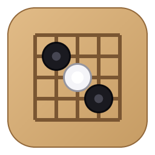
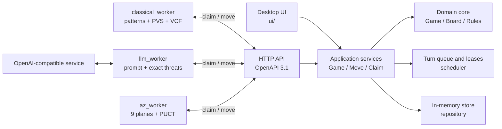

<div align="center">



# MyGo · Gomoku AI Desktop Platform

**A Go authoritative game core + native desktop UI + three pluggable Python AI engines**

[简体中文](README.md) · [**English**](README.en.md)

[](https://go.dev/)
[](https://www.python.org/)
[](api/openapi.yaml)
[](#engines)
[](https://github.com/qzh200/Gomoku)
[](#contributing)
[](LICENSE)

Gomoku · AlphaZero · MCTS · PVS · VCF · LLM · Go · Python · Desktop

</div>

---

## Overview

MyGo is a **local-first** Gomoku (Five-in-a-Row) desktop application. Go owns the single authoritative game state, the HTTP API, turn leases and the native UI. Python workers long-poll for turns, compute a move and submit it back. All three engines speak the same protocol, so any two of them can play each other in one game.

- **One rules implementation**: the UI and every worker go through the same Go `Game` / `Board` / `Rules`.
- **Replaceable engines**: classical search, an LLM and AlphaZero are all just workers implementing `choose_move`.
- **Playable offline**: the classical engine and AlphaZero inference need no external service; only the LLM calls a model API.
- **Verifiable contract**: `api/openapi.yaml` is the frozen API contract, and Go contract tests spawn the real Python workers.

> See [`doc/`](doc/README.md) for the in-depth design: domain model, lease protocol, engine algorithms, UI rendering and operations. The deep-dive docs are currently maintained in Chinese.

## Table of Contents

- [Features](#features)
- [Engines](#engines)
- [Architecture](#architecture)
- [Quick Start](#quick-start)
- [Usage](#usage)
- [Configuration](#configuration)
- [HTTP API](#http-api)
- [Testing](#testing)
- [Project Layout](#project-layout)
- [Documentation](#documentation)
- [Known Limitations](#known-limitations)
- [Contributing](#contributing)
- [License](#license)

## Features

- **Native desktop experience**: board, move history, last-move marker, winning line, hover preview, dark/light themes.
- **Three game modes**: human vs AI, AI vs AI, human vs human.
- **Complete game controls**: undo (in human-vs-AI it also reverts the AI reply), pause/resume for AI-vs-AI, and replay of recent games.
- **Authoritative state and concurrency control**: game versions, idempotent move submission, turn leases with renewal; stale results never corrupt a game.
- **Exact threat descriptions**: five points, open-four points, four-maker points and double threes are computed deterministically, not guessed from strings.
- **Pluggable engines**: a new engine only needs a `choose_move` implementation and the worker protocol.
- **Offline-first**: the classical engine has zero dependencies; AlphaZero only needs local PyTorch; the LLM is the only external call.
- **Documented**: Chinese deep-dive docs cover architecture, algorithms, parameters, evaluation and troubleshooting.

## Engines

| `engine_id` | Engine | Decision method | Runtime dependency | Best for |
| --- | --- | --- | --- | --- |
| `classical` | Classical search | 6-cell window patterns + PVS + transposition table + VCF | CPU only, no external service | Stable, reproducible tactical play |
| `llm` | Large language model | Exact threat text + 0-based coordinate prompt, JSON move parsing | OpenAI-compatible API | Explainable natural-language reasoning, prompt research |
| `az` | AlphaZero | 9-plane residual network + PUCT MCTS, pure self-play training (official-method baseline) | Local PyTorch + weights | Learned positional intuition, long-term strategy |

There is also `mock_worker/`, used only for contract tests and link diagnostics; it is not meant for real games.

## Architecture



**Startup order**: start MyGo first. It writes `configs/engines.runtime.json`; workers read their tokens from that file. MyGo regenerates missing tokens on every start, so do not start workers first.

## Quick Start

### Requirements

| Component | Requirement |
| --- | --- |
| Go | `1.27.3` (declared in `go.mod`) |
| Python | `3.12` (development environment; classical/LLM workers use the standard library, AlphaZero also needs PyTorch) |
| AlphaZero (optional) | PyTorch `cu128` + NVIDIA GPU, or CPU |
| LLM (optional) | API key for any OpenAI-compatible service |

### 1. Build and start MyGo

```sh
git clone https://github.com/qzh200/Gomoku.git
cd Gomoku
GOPROXY=off go build ./...
go run ./cmd/app
```

Windows PowerShell:

```powershell
$env:GOPROXY = "off"
go build ./...
go run ./cmd/app
```

MyGo prints the local client token and engine tokens, writes `configs/engines.runtime.json`, and opens the desktop window.

### 2. Prepare the workers

```sh
cp classical_worker/.env.example classical_worker/.env
cp llm_worker/.env.example llm_worker/.env
cp az_worker/.env.example az_worker/.env
```

For the LLM engine, edit `llm_worker/.env`:

```dotenv
OPENAI_API_KEY=sk-...
OPENAI_MODEL=gpt-4o-mini
```

For AlphaZero, install dependencies once:

```sh
python -m venv .venv
.venv/Scripts/python -m pip install torch --index-url https://download.pytorch.org/whl/cu128
.venv/Scripts/python -m pip install numpy tensorboard tqdm
```

> On Linux/macOS, replace `.venv/Scripts/python` with `.venv/bin/python`.

### 3. Start the engines you need

Run each command in its own terminal, **from the repository root**:

```sh
python -m classical_worker
python -m llm_worker
.venv/Scripts/python.exe -m az_worker
```

Logs such as `领取 ...` / `落子 ...` (claim / move) mean the worker is connected.

## Usage

1. Choose a mode on the left: **Human vs AI**, **AI vs AI**, or **Human vs Human**.
2. For Human vs AI, pick the AI engine and side. For AI vs AI, pick the black and white engines.
3. Click **Start new game**.
4. In human modes, click an intersection to move. AI turns are played automatically by workers.
5. AI-vs-AI games can be **paused** and **resumed**.
6. In Human vs AI, **Undo** also reverts the AI reply, returning the turn to the human.
7. The right panel lists moves by number, player and coordinate; the left panel replays recent games.

Coordinate conventions:

- The API, workers and engines all use **0-based** `(row, col)` in `0..14`.
- The UI displays columns `A`–`O` and rows `1`–`15`.
- Cell encoding: `0` empty, `1` black, `2` white. Black moves first. Five in a row wins.

## Configuration

All workers share the connection variables. The full matrix is in [`doc/07-comparison-and-operations.md`](doc/07-comparison-and-operations.md).

| Variable | Default | Description |
| --- | --- | --- |
| `MYGO_ADDR` | `127.0.0.1:8080` | MyGo HTTP listen address |
| `MYGO_CONFIG` | `configs/engines.json` | Static engine configuration |
| `MYGO_RUNTIME_CONFIG` | `configs/engines.runtime.json` | Runtime token file |
| `MYGO_URL` | `http://127.0.0.1:8080/api/v1` | API base URL used by workers |
| `MYGO_ENGINE_ID` | per-engine default | Must match the `engine_id` in the registry |
| `MYGO_ENGINE_TOKEN` | empty | Read from the runtime config when empty |
| `OPENAI_API_KEY` | required for LLM | Model service key |
| `OPENAI_MODEL` | `gpt-4o-mini` | Model name |
| `AZ_MODEL_PATH` | `models/az/current.pt` | AlphaZero weights |
| `AZ_DEVICE` | `auto` | `auto` / `cpu` / `cuda` |
| `AZ_CANDIDATE_RADIUS` | `0` | Candidate radius opened by the search; `0` = all 225 cells |
| `CLASSICAL_DEPTH` | `8` | Classical search depth limit |
| `CLASSICAL_TIME_BUDGET` | `2.0` | Seconds per classical move |

Per-game overrides are passed through `players.<side>.config` when creating a game:

```json
{
  "black": {"type": "ai", "engine_id": "classical", "config": {"depth": 3}},
  "white": {"type": "ai", "engine_id": "az", "config": {"simulations": 4000}}
}
```

## HTTP API

The server listens on loopback by default. The full contract is [`api/openapi.yaml`](api/openapi.yaml).

| Method | Path | Auth | Purpose |
| --- | --- | --- | --- |
| `POST` | `/api/v1/games` | Local client token | Create a game |
| `GET` | `/api/v1/games` | None | List games |
| `GET` | `/api/v1/games/{id}` | None | Read a game |
| `PATCH` | `/api/v1/games/{id}` | Owner token | Pause/resume AI-vs-AI |
| `DELETE` | `/api/v1/games/{id}` | Owner token | Delete a game |
| `GET` | `/api/v1/games/{id}/moves` | None | Move history |
| `POST` | `/api/v1/games/{id}/moves` | Owner or engine token | Submit a move |
| `GET` | `/api/v1/engines` | None | Engine registry |
| `POST` | `/api/v1/ai/turn-claims` | Engine token | Long-poll for a turn |
| `PATCH` | `/api/v1/ai/turn-claims/{id}` | Engine token | Renew a lease |
| `DELETE` | `/api/v1/ai/turn-claims/{id}` | Engine token | Release a lease |

The three credentials are not interchangeable:

- `X-Local-Client-Token`: local UI / cross-game operations;
- `X-Game-Owner-Token`: the game creator;
- `Authorization: Bearer <engine_token>`: AI workers.

Engine identity always comes from the token. The server never trusts an engine name in a request body.

## Testing

```sh
# Go: domain, application services, scheduler, HTTP contract
GOPROXY=off go test ./... -count=1

# Python: the three engines
python -m unittest discover -s classical_worker/tests -t .
python -m unittest discover -s llm_worker/tests -t .
.venv/Scripts/python.exe -m unittest discover -s az_worker/tests -t .
```

`tests/contracts/` starts the real Python workers. An AI-vs-AI contract test needs both workers to start; otherwise the game waits forever on the side without a worker.

## Project Layout

```text
.
├─ cmd/app/                 # Process entry: config, HTTP, desktop window
├─ internal/
│  ├─ domain/gomoku/        # Board, game, rules
│  ├─ application/          # Use cases, concurrency, idempotency
│  ├─ scheduler/            # Turn queue and leases
│  ├─ transport/http/       # REST API
│  ├─ repository/           # In-memory storage
│  ├─ auth/                 # Engine registry and tokens
│  └─ config/               # Static/runtime configuration
├─ ui/                      # Native desktop UI (MyGo + Lobe MyGo)
├─ aiworker/                # Worker protocol and config resolution
├─ classical_worker/        # Classical search engine
├─ llm_worker/              # LLM engine
├─ az_worker/               # AlphaZero engine
├─ mock_worker/             # Minimal worker for tests
├─ tests/contracts/         # Go contract tests
├─ api/openapi.yaml         # Frozen API contract
├─ configs/                 # Engine config examples/runtime file
├─ doc/                     # Technical documentation (Chinese)
└─ assets/                  # Icons and embedded assets
```

## Documentation

| Document | Contents |
| --- | --- |
| [`doc/README.md`](doc/README.md) | System overview, engine table, global conventions |
| [`doc/01-mygo-architecture.md`](doc/01-mygo-architecture.md) | Domain model, application services, concurrency, auth, startup |
| [`doc/02-worker-protocol.md`](doc/02-worker-protocol.md) | Worker contract, long polling, leases, idempotency, failures |
| [`doc/03-classical-engine.md`](doc/03-classical-engine.md) | Window patterns, incremental evaluation, threats, PVS, VCF |
| [`doc/04-llm-engine.md`](doc/04-llm-engine.md) | Threat primitives, prompt, parsing, retries, reasoning models |
| [`doc/05-az-engine.md`](doc/05-az-engine.md) | 9 planes, bitboard threats, network, PUCT, pure self-play training, VCF/VCT, arena |
| [`doc/06-desktop-ui.md`](doc/06-desktop-ui.md) | UI layers, rendering, interaction, replay, themes |
| [`doc/07-comparison-and-operations.md`](doc/07-comparison-and-operations.md) | Engine comparison, evaluation, env vars, runbook, troubleshooting |

> The deep-dive documentation is currently written in Chinese.

## Known Limitations

- Games, leases and idempotency records live in memory; restarting MyGo loses active games.
- Only standard Gomoku "five in a row wins" is implemented. There are no forbidden moves, swap or three-move variants.
- LLM strength, latency and cost depend on the external model service.
- AlphaZero weights live under `models/` and are excluded by `.gitignore`; train them or provide your own.
- The classical engine prunes candidates by width, so a rare position can miss the only defensive point.
- The server listens on `127.0.0.1` by default and should not be exposed to the public internet.

## Contributing

Issues and pull requests are welcome.

1. Search existing issues first to avoid duplicates.
2. When changing an engine or the protocol, update `doc/` and `api/openapi.yaml` together.
3. Run the relevant tests before submitting; new workers should include unit and contract tests.
4. Keep the existing style: `gofmt` for Go, standard library first for Python.

## License

This project is licensed under the [MIT License](LICENSE). Copyright © 2026 qzh200.

---

<div align="center">
  <sub>Built with Go, Python, MyGo and Lobe MyGo.</sub>
</div>
