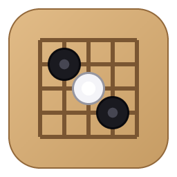
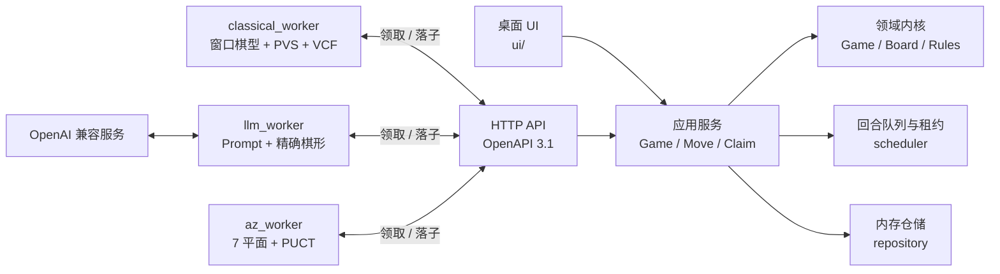

<div align="center">



# MyGo · 五子棋 AI 桌面平台

**Go 权威棋局内核 + 原生桌面 UI + 三个可插拔 Python AI 引擎**

[**简体中文**](README.md) · [English](README.en.md)

[](https://go.dev/)
[](https://www.python.org/)
[](api/openapi.yaml)
[](#三个引擎)
[](https://github.com/qzh200/Gomoku)
[](#贡献)
[](https://github.com/qzh200/Gomoku/stargazers)
[](https://github.com/qzh200/Gomoku/network/members)
[](https://github.com/qzh200/Gomoku/commits/master)

五子棋 · Gomoku · AlphaZero · MCTS · PVS · VCF · LLM · Go · Python · Desktop

</div>

---

## 项目简介

MyGo 是一个**本地优先**的五子棋桌面应用。Go 负责唯一权威的棋局状态、HTTP API、回合租约和原生界面；Python Worker 通过长轮询领取回合、计算落子并提交。三个引擎共享同一套协议，因此可以在同一局中自由对战。

- **规则只有一份**：UI 与 Worker 都调用 Go 领域的 `Game` / `Board` / `Rules`。
- **引擎可以替换**：传统搜索、LLM、AlphaZero 都只是实现 `choose_move` 的 Worker。
- **本地即可开玩**：传统引擎与 AlphaZero 推理不依赖外部服务；只有 LLM 需要模型 API。
- **协议可验证**：`api/openapi.yaml` 是冻结契约，Go 契约测试会启动真实 Python Worker。

> 深入实现细节见 [`doc/`](doc/README.md)：领域模型、租约协议、三个引擎的算法、UI 绘制和运维手册。

## 目录

- [特性](#特性)
- [三个引擎](#三个引擎)
- [架构](#架构)
- [快速开始](#快速开始)
- [使用](#使用)
- [配置](#配置)
- [HTTP API](#http-api)
- [测试](#测试)
- [项目结构](#项目结构)
- [技术文档](#技术文档)
- [已知限制](#已知限制)
- [贡献](#贡献)
- [许可证](#许可证)

## 特性

- **原生桌面体验**：棋盘、落子记录、最后一手标记、胜利连线、悬停预览、暗色/亮色主题。
- **三种对战模式**：人机对战、AI 对战、玩家对战。
- **完整棋局操作**：悔棋（人机模式自动回退 AI 一手）、AI 对战暂停/恢复、历史棋局复盘。
- **权威状态与并发控制**：棋局版本号、落子幂等键、回合租约与自动续期，过期结果不会污染棋局。
- **精确威胁描述**：成五点、活四点、冲四点、双三由确定性代码计算，不依赖启发式字符串匹配。
- **可插拔引擎**：新增引擎只需要实现一个 `choose_move` 并接入 Worker 协议。
- **离线优先**：传统引擎零依赖；AlphaZero 只需本地 PyTorch；LLM 是唯一的外部调用。
- **文档完整**：中文技术文档覆盖架构、算法、参数、评测和故障排查。

## 三个引擎

| `engine_id` | 引擎 | 决策方式 | 运行依赖 | 适合 |
| --- | --- | --- | --- | --- |
| `classical` | 传统搜索 | 6 格窗口棋型评估 + PVS + 置换表 + VCF/VCT | 纯 CPU，无外部服务 | 稳定、可复现的战术对局 |
| `llm` | 大语言模型 | 精确棋形文字 + 0 基坐标 Prompt，解析 JSON 落子 | OpenAI 兼容 API | 可解释的自然语言推理、Prompt 研究 |
| `az` | AlphaZero | 7 平面残差网络 + PUCT MCTS，自对弈训练 | 本地 PyTorch + 权重 | 学习型局面直觉、长期策略 |

另外提供 `mock_worker/`，只用于契约测试和链路排查，不参与正式对局。

## 架构



**运行顺序**：`MyGo` 先启动并写入 `configs/engines.runtime.json`，Worker 再从该文件读取令牌。MyGo 每次启动都会重新生成缺失的令牌，因此不要反过来先启动 Worker。

## 快速开始

### 环境要求

| 组件 | 要求 |
| --- | --- |
| Go | `1.27.3`（见 `go.mod`） |
| Python | `3.12`（开发环境；传统/LLM Worker 仅用标准库，AlphaZero 另需 PyTorch） |
| AlphaZero（可选） | PyTorch `cu128` + NVIDIA GPU，或 CPU |
| LLM（可选） | 任意 OpenAI 兼容服务的 API Key |

### 1. 编译并启动 MyGo

```sh
git clone https://github.com/qzh200/Gomoku.git
cd Gomoku
GOPROXY=off go build ./...
go run ./cmd/app
```

Windows PowerShell：

```powershell
$env:GOPROXY = "off"
go build ./...
go run ./cmd/app
```

启动后控制台会打印本地客户端令牌、引擎令牌，并生成 `configs/engines.runtime.json`。桌面窗口会自动打开。

### 2. 准备 Worker

```sh
cp classical_worker/.env.example classical_worker/.env
cp llm_worker/.env.example llm_worker/.env
cp az_worker/.env.example az_worker/.env
```

LLM 引擎需要在 `llm_worker/.env` 中填写：

```dotenv
OPENAI_API_KEY=sk-...
OPENAI_MODEL=gpt-4o-mini
```

AlphaZero 需要安装依赖（仅首次）：

```sh
python -m venv .venv
.venv/Scripts/python -m pip install torch --index-url https://download.pytorch.org/whl/cu128
.venv/Scripts/python -m pip install numpy
```

> Linux/macOS 将 `.venv/Scripts/python` 换成 `.venv/bin/python`。

### 3. 启动需要的引擎

在三个终端中分别运行，**都在仓库根目录**：

```sh
python -m classical_worker
python -m llm_worker
.venv/Scripts/python.exe -m az_worker
```

看到 `领取 ...` / `落子 ...` 日志即表示 Worker 已接入 MyGo。

## 使用

1. 在左侧选择模式：**人机对战**、**AI 对战**、**玩家对战**。
2. 人机模式选择 AI 引擎与执子方；AI 对战分别选择黑方、白方引擎。
3. 点击 **开始新棋局**。
4. 人机/玩家模式点击棋盘落子；AI 回合由 Worker 自动完成。
5. AI 对战可以 **暂停对战** / **恢复对战**。
6. 人机模式 **悔棋** 会自动回退到人类落子前，避免只撤掉 AI 的一手。
7. 右侧落子记录可查看手数、棋手和坐标；左侧“棋局记录”可进入历史复盘。

坐标约定：

- API、Worker、引擎内部全部使用 **0 基** `(row, col)`，取值 `0..14`。
- 界面显示使用 `A`–`O` 列、`1`–`15` 行。
- 棋子编码：`0` 空、`1` 黑、`2` 白；黑先，五连即胜。

## 配置

所有 Worker 共用一组连接变量，完整矩阵见 [`doc/07-comparison-and-operations.md`](doc/07-comparison-and-operations.md)。

| 变量 | 默认值 | 说明 |
| --- | --- | --- |
| `MYGO_ADDR` | `127.0.0.1:8080` | MyGo HTTP 监听地址 |
| `MYGO_CONFIG` | `configs/engines.json` | 静态引擎配置 |
| `MYGO_RUNTIME_CONFIG` | `configs/engines.runtime.json` | 运行时令牌文件 |
| `MYGO_URL` | `http://127.0.0.1:8080/api/v1` | Worker 访问的 API 根地址 |
| `MYGO_ENGINE_ID` | 各引擎默认 | 必须与注册表中的 `engine_id` 一致 |
| `MYGO_ENGINE_TOKEN` | 空 | 为空时从运行时配置读取 |
| `OPENAI_API_KEY` | 必填（LLM） | 模型服务密钥 |
| `OPENAI_MODEL` | `gpt-4o-mini` | 模型名称 |
| `AZ_MODEL_PATH` | `models/az/current.pt` | AlphaZero 权重 |
| `AZ_DEVICE` | `auto` | `auto` / `cpu` / `cuda` |
| `CLASSICAL_DEPTH` | `8` | 传统引擎最大深度 |
| `CLASSICAL_TIME_BUDGET` | `2.0` | 传统引擎每手秒数 |

每局还可以在创建棋局时通过 `players.<side>.config` 覆盖部分参数，例如：

```json
{
  "black": {"type": "ai", "engine_id": "classical", "config": {"depth": 3}},
  "white": {"type": "ai", "engine_id": "az", "config": {"simulations": 4000}}
}
```

## HTTP API

默认只监听回环地址，完整契约见 [`api/openapi.yaml`](api/openapi.yaml)。

| 方法 | 路径 | 鉴权 | 作用 |
| --- | --- | --- | --- |
| `POST` | `/api/v1/games` | 本地客户端令牌 | 创建棋局 |
| `GET` | `/api/v1/games` | 无 | 列出棋局 |
| `GET` | `/api/v1/games/{id}` | 无 | 读取棋局 |
| `PATCH` | `/api/v1/games/{id}` | Owner 令牌 | 暂停/恢复 AI 对战 |
| `DELETE` | `/api/v1/games/{id}` | Owner 令牌 | 删除棋局 |
| `GET` | `/api/v1/games/{id}/moves` | 无 | 着法历史 |
| `POST` | `/api/v1/games/{id}/moves` | Owner 或引擎令牌 | 落子 |
| `GET` | `/api/v1/engines` | 无 | 引擎注册表 |
| `POST` | `/api/v1/ai/turn-claims` | 引擎令牌 | 长轮询领取回合 |
| `PATCH` | `/api/v1/ai/turn-claims/{id}` | 引擎令牌 | 续期租约 |
| `DELETE` | `/api/v1/ai/turn-claims/{id}` | 引擎令牌 | 释放租约 |

三种凭据互不通用：

- `X-Local-Client-Token`：本地界面/跨棋局操作；
- `X-Game-Owner-Token`：棋局创建者；
- `Authorization: Bearer <engine_token>`：AI Worker。

引擎身份永远由令牌解析，服务端不信任请求体里的引擎名。

## 测试

```sh
# Go：领域、应用服务、调度、HTTP 契约
GOPROXY=off go test ./... -count=1

# Python：三个引擎
python -m unittest discover -s classical_worker/tests -t .
python -m unittest discover -s llm_worker/tests -t .
.venv/Scripts/python.exe -m unittest discover -s az_worker/tests -t .
```

`tests/contracts/` 会真实启动 Python Worker。AI 对 AI 契约测试需要双方 Worker 都能启动，否则对局会停在另一方回合。

## 项目结构

```text
.
├─ cmd/app/                 # 进程入口：配置、HTTP、桌面窗口
├─ internal/
│  ├─ domain/gomoku/        # 棋盘、棋局、规则
│  ├─ application/          # 用例、并发、幂等
│  ├─ scheduler/            # 回合队列与租约
│  ├─ transport/http/       # REST API
│  ├─ repository/           # 内存存储
│  ├─ auth/                 # 引擎注册表与令牌
│  └─ config/               # 静态/运行时配置
├─ ui/                      # 原生桌面界面（MyGo + Lobe MyGo）
├─ aiworker/                # Worker 协议与配置解析
├─ classical_worker/        # 传统搜索引擎
├─ llm_worker/              # LLM 引擎
├─ az_worker/               # AlphaZero 引擎
├─ mock_worker/             # 测试用最小 Worker
├─ tests/contracts/         # Go 契约测试
├─ api/openapi.yaml         # 冻结 API 契约
├─ configs/                 # 引擎配置示例/运行时文件
├─ doc/                     # 中文技术文档
└─ assets/                  # 图标等嵌入资源
```

## 技术文档

| 文档 | 内容 |
| --- | --- |
| [`doc/README.md`](doc/README.md) | 系统全貌、引擎总表、全局约定 |
| [`doc/01-mygo-architecture.md`](doc/01-mygo-architecture.md) | 领域模型、应用服务、并发、鉴权、启动流程 |
| [`doc/02-worker-protocol.md`](doc/02-worker-protocol.md) | Worker 契约、长轮询、租约、幂等、失败处理 |
| [`doc/03-classical-engine.md`](doc/03-classical-engine.md) | 窗口棋型、增量评估、威胁表、PVS、VCF/VCT |
| [`doc/04-llm-engine.md`](doc/04-llm-engine.md) | 棋形原语、Prompt、解析、重试、推理模型适配 |
| [`doc/05-az-engine.md`](doc/05-az-engine.md) | 7 平面特征、bitboard 威胁、网络、MCTS、训练 |
| [`doc/06-desktop-ui.md`](doc/06-desktop-ui.md) | UI 分层、绘制、交互、复盘、主题 |
| [`doc/07-comparison-and-operations.md`](doc/07-comparison-and-operations.md) | 引擎对比、评测、环境变量、运行手册、排障 |

> 英文 README 见 [`README.en.md`](README.en.md)。深入技术文档目前以中文维护。

## 已知限制

- 棋局、租约、幂等记录都在内存中；MyGo 重启会丢失当前对局。
- 只实现标准五子棋“五连即胜”，没有禁手、交换、三手等规则变体。
- LLM 引擎的棋力、延迟和费用取决于外部模型服务。
- AlphaZero 权重位于 `models/`，默认被 `.gitignore` 排除；需要自行训练或放入权重。
- 传统引擎使用宽度裁剪，极端局面可能漏掉唯一防守点。
- 服务默认只监听 `127.0.0.1`，不应直接暴露到公网。

## 贡献

欢迎提交 Issue 和 Pull Request。建议流程：

1. 先搜索已有 Issue，避免重复。
2. 修改引擎或协议时，同步更新 `doc/` 与 `api/openapi.yaml`。
3. 提交前运行相关测试；新增 Worker 请附带单元测试和契约测试。
4. 保持现有代码风格：Go 用 `gofmt`，Python 保持标准库优先。

## 许可证

本仓库目前尚未添加 `LICENSE` 文件。在明确许可证之前，代码默认保留所有权利；如果你希望以 MIT / Apache-2.0 等方式开源，请先补充许可证文件。

---

<div align="center">
  <sub>Built with Go, Python, MyGo and Lobe MyGo.</sub>
</div>
