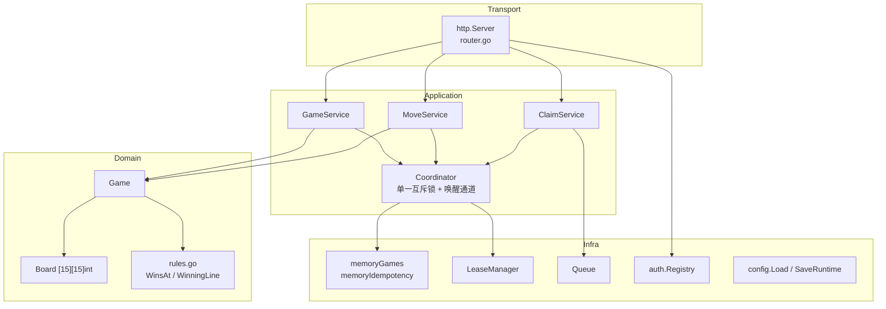
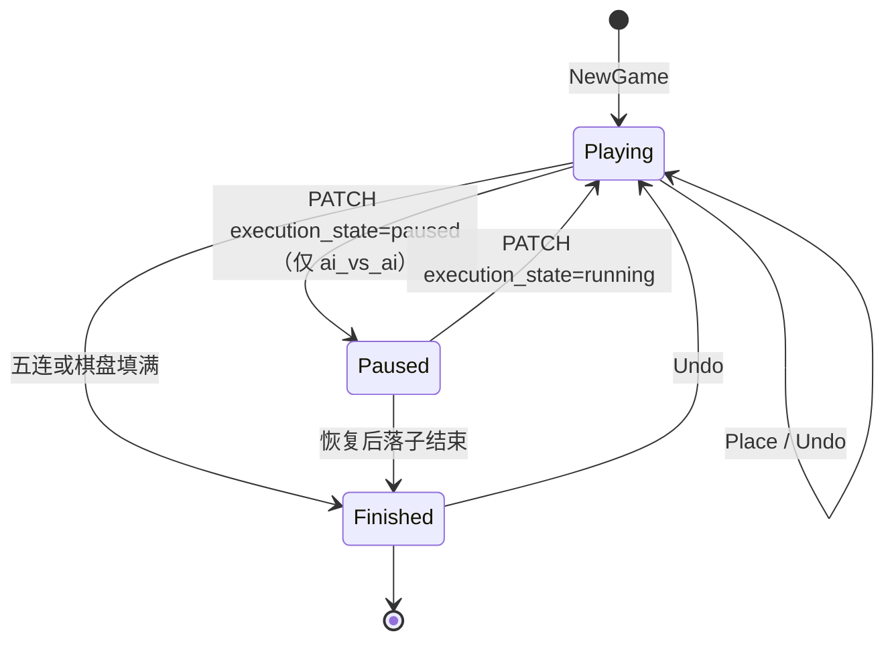
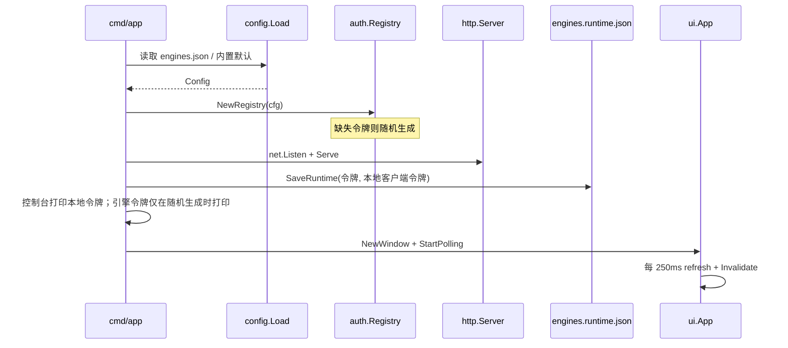

# MyGo 平台架构

MyGo 是权威棋局状态管理者。桌面 UI 和所有 AI Worker 都通过同一组应用服务访问棋局；Python 引擎不持有权威状态，只在一个回合内计算并提交落子。

## 1. 进程与目录

`cmd/app/main.go` 启动一个 Go 进程，进程内同时包含：

- `internal/domain/gomoku/`：棋盘、棋局、规则、着法。
- `internal/application/`：用例服务与 `Coordinator`。
- `internal/repository/`：内存棋局仓储与幂等记录。
- `internal/scheduler/`：回合队列与租约。
- `internal/transport/http/`：REST API。
- `internal/auth/`：引擎注册表、令牌哈希、本地客户端令牌。
- `internal/config/`：静态配置与运行时配置。
- `ui/`：Lobe MyGo + MyGo 原生界面。
- `assets/`：窗口图标等嵌入资源。



UI 不经过 HTTP，直接调用 `application.GameService` / `MoveService`；Worker 经过 HTTP 调用同样的服务。这是“同一套规则”的保证方式。

## 2. 领域模型

### 2.1 Board

`internal/domain/gomoku/board.go`

```go
type Board [BoardSize][BoardSize]int // BoardSize = 15
```

- `At(row, col)` 越界返回 `Empty`，调用方不需要重复判界。
- `Place` 只在界内且为空时写入，返回是否成功。
- `IsFull` 全盘扫描；15×15 规模下成本可忽略。
- `Cells()` 返回深拷贝的 `[][]int`，用于 API/Worker 传输，避免外部修改权威棋盘。

### 2.2 Game

`internal/domain/gomoku/game.go` 的字段就是 API 返回的 `Game`：

| 字段 | 含义 |
| --- | --- |
| `id` | `game_001` 递增编号 |
| `mode` | `ai_vs_ai` / `human_vs_ai` / `human_vs_human` |
| `players` | `black` / `white` 两个 `PlayerConfig` |
| `board` | 当前棋盘 |
| `current_player` | 下一步轮到谁 |
| `status` | `playing` / `finished` |
| `result` | `ongoing` / `black_win` / `white_win` / `draw` |
| `winner` | 胜方，未结束为 `null` |
| `last_move` | 最后一手，含 `row/col/player/number` |
| `move_count` | 已落子数 |
| `version` | 每次 `Place` / `Undo` 递增 |
| `execution_state` | `running` / `paused` |
| `ai_thinking` | 由租约状态派生，不落库 |

`Place` 的顺序很重要：

1. 写棋盘；
2. 追加 `moves`；
3. `MoveCount++`、`Version++`；
4. 更新 `LastMove`、切换 `Current`；
5. `WinsAt` 判胜；
6. 未胜则尝试判和。

失败（占用/越界）在写棋盘之前返回，因此不会产生半更新。

`Undo` 不反向计算，而是重建一个 `NewGame` 后重放剩余着法，再把 `version` 设为原值 +1、恢复 `execution`。这样 `moves`、`LastMove`、`Winner`、`Result` 不可能与棋盘不一致，版本号也始终保持单调递增。

### 2.3 玩家配置

```go
type PlayerConfig struct {
    Type     PlayerType     `json:"type"`      // human | ai
    EngineID *string        `json:"engine_id"` // human 时为 null
    Config   map[string]any `json:"config"`    // 原样交给 Worker
}
```

`config` 是唯一的“每局引擎参数”通道。例如传统引擎可以收到 `{"depth": 3}`，AlphaZero 可以收到 `{"simulations": 4000}`；服务端不解释这些键。

### 2.4 模式约束

| 模式 | 约束 |
| --- | --- |
| `ai_vs_ai` | 双方都必须是已注册且 `available` 的 AI 引擎 |
| `human_vs_ai` | 恰好一方人类、一方 AI |
| `human_vs_human` | 双方都是人类 |

人类方指定 `engine_id` 会返回 `INVALID_GAME_CONFIG`；AI 方缺少 `engine_id` 或引擎不可用同样拒绝。

### 2.5 状态机



- `paused` 只允许 `ai_vs_ai`。服务端拒绝其他模式的暂停/恢复。
- 暂停会立即 `InvalidateGame`，让所有 Worker 手中的租约失效。
- 结束状态不会自动清理；删除棋局要显式 `DELETE`。
- 悔棋可以作用于已结束的棋局，重建后回到 `playing`（`Undo` 用 `NewGame` 重置状态）。UI 只在复盘中、AI 对战模式下、或没有着法时隐藏悔棋按钮；服务端对已结束的棋局同样不禁止。
- 暂停/恢复只校验模式（`ai_vs_ai`）与可选的 `expected_version`，不校验棋局是否已结束；已结束的棋局接受 PATCH 后 `execution_state` 会改变，但不会产生可领取的回合。

## 3. 应用服务

### 3.1 Coordinator

`Coordinator` 是并发边界：

```go
func (c *Coordinator) Lock()
func (c *Coordinator) Unlock()
func (c *Coordinator) Signal()
func (c *Coordinator) WaitChannel() <-chan struct{}
```

- 所有用例先拿 `Coordinator` 的互斥锁，再读/写仓储和租约。仓储自身也有一把 `RWMutex`，但业务层不依赖它做跨对象一致性。
- `Signal` 关闭当前 `notify` 通道并换一个新的；长轮询的 `ClaimService.wait` 监听旧通道，因此落子、悔棋、暂停/恢复、删除、释放租约都会唤醒等待者。创建棋局不触发 signal，已经在等待的 Worker 要等本轮 `wait` 到期后才会看到新棋局。
- `pendingTurns(engineID)` 遍历所有棋局，过滤 `playing`、`running`、当前方是 AI 且 `engine_id` 匹配，产出待领取回合。

### 3.2 GameService

职责：创建、列出、读取、删除棋局，暂停/恢复。

`Create` 的行为：

1. 计算幂等作用域（调用者 + `POST /games` + key）和请求哈希；
2. 命中幂等记录且请求哈希一致时直接返回首次结果；哈希不同返回 `IDEMPOTENCY_KEY_REUSED`；
3. 校验模式、双方配置、注册表可用性；
4. `game_%03d` 生成 ID，`auth.RandomToken()` 生成 owner token；
5. 仓储只保存 owner token 的 SHA-256；首次创建返回明文。同一调用者用相同幂等键重放创建请求时，返回首次保存的结果，其中再次包含同一个 `owner_token`。

`List` / `Get` 会用 `Leases().ActiveFor(game.ID, game.Version)` 填充 `ai_thinking`。它是派生字段：有有效租约即 true，不持久化。

`Delete` 删除棋局并 `InvalidateGame`，避免 Worker 继续提交。

`SetExecutionState` 在 `Update` 回调里校验模式和 `expected_version`，避免检查与写入之间被其他请求插入。

### 3.3 MoveService

`Submit` 的校验顺序（顺序本身是契约）：

1. 幂等记录命中 → 直接返回；
2. 棋局存在；
3. 调用者是否属于该棋局（owner token 哈希，或引擎 ID 是某方 AI）；
4. 是否轮到该调用者；
5. 坐标在界内；
6. 目标格为空；
7. `expected_version == game.version`；
8. 棋局未结束、未暂停；
9. 引擎调用者必须携带有效 `claim_id`（归属引擎、归属棋局、`lease.version == game.version`、未过期）。

随后在仓储 `Update` 回调中再检查一次 `stored.Version == game.Version`，然后 `Place`。第二次检查用于防止在“读快照”和“写”之间被其他请求改动；虽然 `Coordinator` 锁已经串行化，保留它让仓储层独立安全。

成功落子后：

- `InvalidateTurn(gameID:version)` 清掉刚用完的租约；
- `Signal()` 唤醒其他长轮询；
- 保存幂等结果。

`Undo` 的规则：

- 引擎禁止悔棋；
- 没有着法返回 `INVALID_REQUEST`；
- `expected_version == 0` 表示不校验版本；
- 暂停中的棋局返回 `GAME_PAUSED`；
- `human_vs_ai` 下如果最后一手是 AI 的，回退 2 手（回到人类落子前）；否则回退 1 手；
- 其他模式固定回退 1 手；
- 成功后 `InvalidateGame`，所有该局租约失效。

### 3.4 ClaimService

`Claim(ctx, engineID, workerID, wait)` 是长轮询入口：

```text
deadline = now + wait
loop:
  tryClaim() -> 有则返回 201
  remaining <= 0 -> 204
  wait(ctx, remaining)  // 监听 coordinator notify / ctx / timer
```

`tryClaim` 在 `Coordinator` 锁内调用 `queue.Next(engineID, workerID)`。`Queue.Next` 遍历该引擎的待领取回合：

1. 回合已有有效租约 → 跳过；
2. `TryAcquire` 创建租约；
3. 返回租约与原回合。

`TryAcquire` 还维护 `retryAt`：Worker 主动释放后，同一回合在 `RetryBackoff = 2s` 内不允许再次领取，防止失败循环把 CPU/LLM 费用打满。

`Claim` 返回的 payload 包含 Worker 决策所需的全部信息：`board`、`history`、`last_move`、`player`、`config`、`version`、`claim_id`。

## 4. 存储

`internal/repository/memory.go` 提供两个内存实现：

- `memoryGames`：`map[id]*Game` + 插入顺序 `order` + `map[id]ownerHash`。
- `memoryIdempotency`：`map[scope]IdempotencyRecord`，记录请求哈希与首次响应对象。

`GameRepository.Update(id, fn)` 在仓储锁内把**存储中的指针**交给回调，因此回调必须做完整校验和修改，不能把指针泄漏出去。`Get` / `List` 返回 `Clone()`，调用方拿到的是快照。

进程退出即丢失全部棋局、租约与幂等记录；这是当前设计取舍，不涉及数据库。

## 5. 鉴权

`internal/auth/token.go` 的 `Registry` 维护三类凭据：

| 凭据 | 请求头 | 用途 |
| --- | --- | --- |
| 引擎令牌 | `Authorization: Bearer <token>` | Worker 领取回合、续期、释放、提交落子 |
| 棋局 Owner 令牌 | `X-Game-Owner-Token` | 创建者操作自己的棋局：落子、暂停/恢复、删除 |
| 本地客户端令牌 | `X-Local-Client-Token` | 只用于 `POST /games`；UI 创建棋局 |

- 引擎注册表保留令牌明文（运行时文件与启动日志需要），反查表以 SHA-256 为键；棋局 owner token 在仓储里只存哈希。
- 引擎名永远来自令牌解析结果，不信任请求体。
- 静态配置 `configs/engines.json`（默认）可给出固定令牌；缺失令牌时启动时随机生成。
- 启动后把实际生效配置写到 `configs/engines.runtime.json`（权限 `0600`，目录 `0700`），Worker 从这里读取自己的令牌。
- `Touch(engineID)` 在领取/提交时更新 `last_active_at`，`GET /engines` 可以观察。

## 6. 配置

`internal/config/config.go`：

- `MYGO_CONFIG` 覆盖静态配置路径，默认 `configs/engines.json`。
- 文件不存在时使用内置三引擎：`az`、`classical`、`llm`，并生成随机令牌。
- `MYGO_RUNTIME_CONFIG` 覆盖运行时配置路径，默认 `configs/engines.runtime.json`。
- `MYGO_ADDR` 覆盖监听地址，默认 `127.0.0.1:8080`。

静态配置格式见 `configs/engines.example.json`：

```json
{
  "local_client_token": "replace-with-a-random-local-token",
  "engines": [
    {"engine_id": "classical", "display_name": "Classical AI", "token": "...", "available": true}
  ]
}
```

`available` 为 `null` 时默认 true。`engines.runtime.json` 是生成文件，`.gitignore` 已排除。

## 7. HTTP API

路由在 `internal/transport/http/router.go`，完整契约在 `api/openapi.yaml`。

| 方法 | 路径 | 鉴权 | 作用 |
| --- | --- | --- | --- |
| POST | `/api/v1/games` | 本地客户端 | 创建棋局，返回 `owner_token` |
| GET | `/api/v1/games` | 无 | 列出棋局 |
| GET | `/api/v1/games/{id}` | 无 | 读取棋局 |
| PATCH | `/api/v1/games/{id}` | Owner | 暂停/恢复（仅 AI 对 AI） |
| DELETE | `/api/v1/games/{id}` | Owner | 删除棋局 |
| GET | `/api/v1/games/{id}/moves` | 无 | 着法历史 |
| POST | `/api/v1/games/{id}/moves` | Owner 或引擎 | 落子；引擎必须带 `claim_id`，必须带 `Idempotency-Key` |
| GET | `/api/v1/engines` | 无 | 引擎列表、可用性、最后活跃时间 |
| POST | `/api/v1/ai/turn-claims` | 引擎 | 长轮询领取回合；`201` 有任务，`204` 超时 |
| PATCH | `/api/v1/ai/turn-claims/{id}` | 引擎 | 续期租约 |
| DELETE | `/api/v1/ai/turn-claims/{id}` | 引擎 | 释放租约，`2s` 内同一回合不再分配 |

错误统一返回：

```json
{"error": {"code": "VERSION_CONFLICT", "message": "棋局版本已经变化"}}
```

`Code -> HTTP 状态` 的映射在 `internal/transport/http/errors.go`。例如版本冲突、占用、已结束、暂停、租约为 `409`；配置错误和越界为 `422`；未认证 `401`；越权/不是你的回合 `403`；不存在 `404`。

## 8. 启动流程



顺序要点：**先绑定监听并开始服务，再写运行时配置**，这样 Worker 看到文件时服务一定已经可用。写文件失败只记录日志，程序继续运行；此时 Worker 需要手动设置 `MYGO_ENGINE_TOKEN`。

## 9. 已知边界

- 单机内存实现，不支持多实例；`Coordinator` 锁只在单进程内有效。
- 没有观战/回放持久化；UI 的复盘依赖当前进程内的棋局列表。
- 没有禁手、交换、三手等规则变体。
- 没有速率限制；租约的 `retryAt` 只约束同一回合，不约束引擎整体调用频率。
- HTTP 服务默认只监听回环地址，不应直接暴露到公网。
