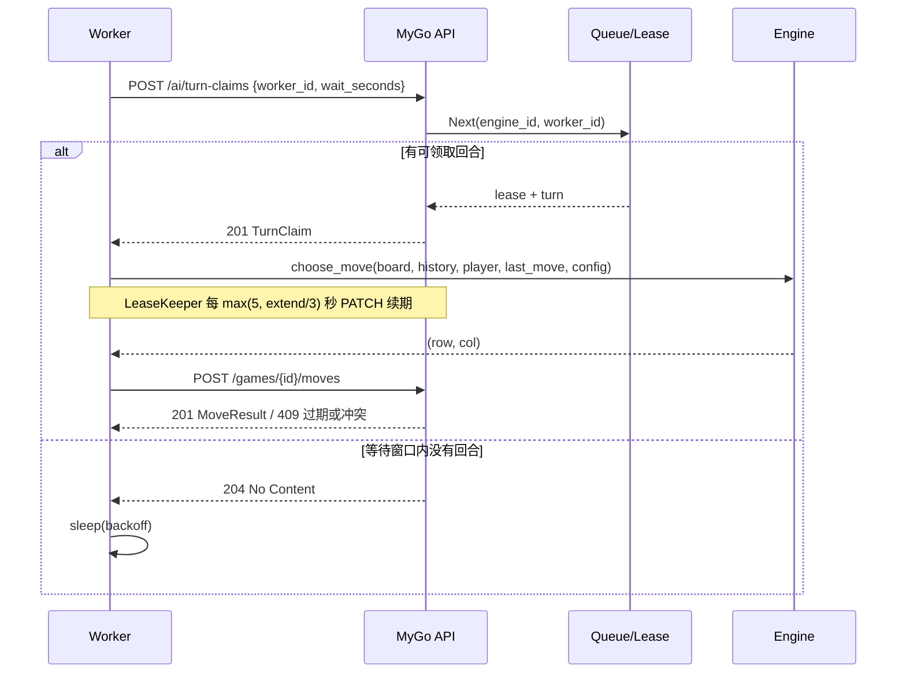

# Worker 协议与租约调度

所有 Python 引擎共用 `aiworker/`。这里没有游戏规则、没有搜索逻辑，只有“领取回合 → 计算 → 提交”的协议，以及配置/令牌解析。

## 1. 模块边界

| 文件 | 职责 |
| --- | --- |
| `aiworker/protocol.py` | `Engine` 协议、`Claim`、`MyGoClient`、`LeaseKeeper`、`Worker` |
| `aiworker/settings.py` | `.env` 解析、环境变量优先级、运行时配置里的令牌查找、`Connection` |
| `*/config.py` | 每个引擎自己的参数解析，组合 `Connection` |
| `*/__main__.py` | 加载 `.env`、构造引擎、启动 `Worker` |

引擎只需要实现：

```python
class Engine(Protocol):
    def choose_move(
        self,
        board: list[list[int]],
        history: list[dict],
        player: int,
        last_move: dict | None = None,
        config: dict | None = None,
    ) -> tuple[int, int]:
        ...
```

`board` 是 15×15，`0/1/2`；`player` 是 `1/2`；`last_move` 是 `{"row", "col", "player", "number"}` 或 `None`；`config` 是该棋局该玩家配置的原始字典。返回 0 基 `(row, col)`。

协议层不翻译坐标，也不校验落点是否为空——服务端会校验。引擎应当自己返回空点；返回占用点会被 `409 POSITION_OCCUPIED` 拒绝。

## 2. 配置与令牌解析

### 2.1 `.env` 查找顺序

`worker_dotenv_candidates(package, explicit)`：

1. `--env-file` 显式路径（只查这一个）；
2. 仓库根/<package>/.env，例如 `classical_worker/.env`；
3. 仓库根/.env；
4. 当前工作目录/.env。

找到第一个存在的文件后停止。`load_dotenv` 用 `os.environ.setdefault`，因此**真实环境变量优先于文件**。

`.env` 支持 `KEY=VALUE`、`export KEY=VALUE`、单双引号包裹；空行和 `#` 注释会被跳过；格式错误直接报 `ConfigError`，不会静默忽略。

### 2.2 连接参数

`Connection.read(source, default_engine_id)` 解析：

| 环境变量 | 默认 | 含义 |
| --- | --- | --- |
| `MYGO_URL` | `http://127.0.0.1:8080/api/v1` | API 根地址 |
| `MYGO_ENGINE_TOKEN` | 空 | 引擎 Bearer Token；为空时去运行时配置找 |
| `MYGO_ENGINE_ID` | 每个引擎不同 | 引擎标识 |
| `MYGO_WORKER_ID` | `<engine_id>-worker-01` | Worker 实例名 |
| `MYGO_WAIT_SECONDS` | `20` | 长轮询等待秒数 |
| `MYGO_LEASE_EXTEND_SECONDS` | `120` | 续期时申请的租约长度 |
| `MYGO_RUNTIME_CONFIG` | `configs/engines.runtime.json` | 令牌文件路径；显式设置后只读这一个文件 |

令牌默认顺序：

1. `MYGO_ENGINE_TOKEN`；
2. `MYGO_RUNTIME_CONFIG`；未设置时才依次尝试仓库根与当前目录的 `configs/engines.runtime.json`。

运行时文件结构：

```json
{
  "local_client_token": "...",
  "engines": [
    {"engine_id": "classical", "display_name": "Classical AI", "token": "...", "available": true}
  ]
}
```

`read_runtime_token` 按 `engine_id` 精确匹配，取非空 `token`。找不到时抛出带操作提示的 `ConfigError`：先启动 MyGo，或直接设置 `MYGO_ENGINE_TOKEN`。

**MyGo 每次启动都会重新生成缺失的令牌**，所以固定流程是“先 MyGo，后 Worker”。只有静态配置里显式写了令牌，才可能跨重启保持不变。

## 3. 领取与提交

### 3.1 时序



`wait_seconds` 由服务端限制在 0–120，越界返回 `400 INVALID_REQUEST`；Worker 侧不做额外钳制。首次领取的租约固定为 60 秒，请求里没有 TTL 字段。

### 3.2 TurnClaim 字段

```json
{
  "claim_id": "claim_...",
  "turn_id": "game_001:12",
  "expires_at": "2026-11-17T10:00:00Z",
  "game_id": "game_001",
  "version": 12,
  "player": 1,
  "board": [[0, 0, "..."]],
  "history": [{"row": 7, "col": 7, "player": 1, "number": 1}],
  "last_move": {"row": 7, "col": 7, "player": 1, "number": 1},
  "config": {"depth": 3}
}
```

- `turn_id` 是 `game_id:version`，一个版本对应一个回合。
- `version` 必须原样作为 `expected_version` 提交。
- `player` 是本次行动方（`1` 黑、`2` 白）。
- `config` 来自创建棋局时该方的 `players.*.config`。

### 3.3 租约

`internal/scheduler/lease.go`：

| 参数 | 值 | 说明 |
| --- | --- | --- |
| `DefaultLeaseSeconds` | 60 | 首次领取的租约长度（调用方不能指定 TTL） |
| `MaxExtendSeconds` | 300 | 单次续期上限 |
| `MaxLeaseTotalSeconds` | 900 | 从 `StartsAt` 起的累计上限 |
| `RetryBackoff` | 2s | 主动释放后同一回合的冷却 |

- 同一 `turn_id` 同时最多一个有效租约；`TryAcquire` 在 `LeaseManager` 锁内保证原子性。
- 过期租约会被下一次 `TryAcquire` / `ActiveFor` 惰性清理，不存在后台扫描线程。
- 续期长度必须在 1–300s 之间；从 `StartsAt` 起的累计时长超过 900s 返回 `CLAIM_INVALID`。默认每次续期 120s，约 7 次后触及累计上限。
- `Release` 删除租约并写入 `retryAt = now + 2s`；已过期但尚未被清理的租约同样可以直接释放并返回 `204`。
- 落子、悔棋、暂停、删除棋局都会让相关租约失效。

### 3.4 Worker 主循环

`Worker.run` 的实际行为：

```text
failures = 0
while True:
    try:
        played = play_turn()
    except Exception as error:
        failures += 1
        delay = min(60, 2.0 * failures)
        sleep(delay)
        continue
    if played: failures = 0
    else:      sleep(2.0)
```

`play_turn`：

1. `claim()`；`204` 返回 `False`。
2. 进入 `LeaseKeeper` 上下文，后台线程定期 `renew`。
3. 调用 `engine.choose_move`。引擎抛异常时先 `release(claim_id)`，再把异常抛给主循环。
4. 打印落子并 `submit_move`，带新的 UUID `Idempotency-Key`。
5. `201` 成功；任何 `409` 都视为本回合作废，丢弃结果并返回 `False`；其他状态抛 `WorkerError`。`409` 分支不释放租约，因此同一回合要等租约过期（默认 60s）后才能重新领取。

注意 `LeaseKeeper` 的续期失败会直接退出后台线程，不打断正在计算的引擎；如果计算时间超过租约，提交时会被服务端以 `CLAIM_EXPIRED` 拒绝。续期长度还会受服务端 1–300s 与累计 900s 的限制，超出同样按续期失败处理。

## 4. 失败语义

| 现象 | 服务端响应 | Worker 行为 |
| --- | --- | --- |
| 没有可领取回合 | `204` | `sleep(2.0)` 后继续轮询 |
| 落子时版本已变 | `409 VERSION_CONFLICT` | 丢弃该手，不释放租约；租约到期后重领 |
| 租约过期/失效 | `409 CLAIM_EXPIRED` / `CLAIM_INVALID` | 丢弃该手，重新领取 |
| 落点被占 | `409 POSITION_OCCUPIED` | 视为引擎缺陷；丢弃该手；租约到期前重领会得到 `204` |
| 引擎内部异常 | 无（本地） | 主动释放租约；退避后重领 |
| 服务不可达 | 连接错误 | 失败计数递增，退避上限 60s |
| 服务端 5xx | `500` | 抛 `WorkerError`，按失败处理 |

连续失败会线性退避（2s、4s、6s…封顶 60s）。成功一手后计数清零。

**不要用异常表达“这一手想不出来”**。对 LLM 引擎来说，解析失败应当由引擎内部兜底到一个合法空点；对传统/AZ 引擎来说，`EngineError` 只应表示“没有空点”。否则同一个回合会被反复领取，形成日志里每 2 秒一次的热循环。

## 5. 幂等

`POST /games/{id}/moves` 必须带 `Idempotency-Key`，否则 `400`。服务端按 `(调用者, 端点, key)` 去重：

- 相同键 + 相同请求体 → 返回首次保存的 `MoveResult`；
- 相同键 + 不同请求体 → `409 IDEMPOTENCY_KEY_REUSED`。

Worker 每手生成新的 UUID。网络超时重试时**复用同一个 key** 才不会重复落子；当前 `protocol.py` 在 `submit_move` 调用点生成 key，因此同一手重新领取后会产生新 key。幂等记录的请求哈希包含 `claim_id`，同一回合重新领取后再用旧 key 会得到 `409 IDEMPOTENCY_KEY_REUSED`。

`POST /games` 的幂等键可选，作用域按 owner token 哈希区分。

## 6. 坐标与数据格式

- `board` 行优先，`board[row][col]`。
- `row` / `col` 都是 0 基；`(0,0)` 是左上角。
- `history` 按落子顺序排列，`number` 从 1 开始。
- 颜色：`1` 黑先手，`2` 白。
- 服务端没有任何 A1/H8 形式的坐标输入；标签只在 UI 显示。

## 7. 新增一个 Worker 的检查清单

1. 实现 `choose_move`，不捕获协议异常、不自行提交 HTTP。
2. 在 `config.py` 里复用 `Connection.read(os.environ, "<engine_id>")`。
3. 在 `__main__.py` 里按 `worker_dotenv_candidates` 加载 `.env`，构造引擎和 `Worker`。
4. 把参数写入 `.env.example`，不要提交 `.env`。
5. 确保返回值是空点，并在盘面满时抛 `EngineError`。
6. 为 `choose_move` 写单元测试，覆盖：空盘、己方成五、必须堵对方成五、非法/满盘。
7. 若要接入 Go 契约测试，新增 `tests/contracts/<engine>_test.go`，用 `MYGO_ENGINE_TOKEN` / `MYGO_URL` 指向 `httptest` 服务。
