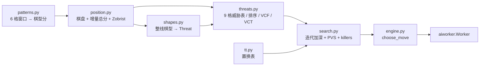

# 传统引擎（classical_worker）

传统引擎是纯 CPU 的确定性搜索：6 格窗口棋型评分、精确 9 格威胁分类、PVS + 置换表、VCF/VCT 强制手搜索。默认参数下每手约 2 秒，深度 8、宽度 12。

## 1. 模块



| 文件 | 是否有棋盘 | 职责 |
| --- | --- | --- |
| `patterns.py` | 否 | 6 格窗口的 base-3 编码与评分表 |
| `position.py` | 是 | 落子/撤销、增量评分、Zobrist、邻居集合 |
| `shapes.py` | 传入 | 整条线枚举活四/冲四/活三，供 VCT 防守使用 |
| `threats.py` | 传入 | 9 格威胁表、候选排序、强制手、VCF、VCT |
| `tt.py` | 否 | 有界置换表与 mate 分数归一化 |
| `search.py` | 是 | 根搜索、PVS、时间预算 |
| `engine.py` | 适配层 | 把 `board` 转成 `Position`，读取每局 config |
| `benchmark.py` | 是 | v2 对冻结 v1 的自对弈基准 |

## 2. 6 格窗口棋型

### 2.1 编码

每条长度 ≥6 的线被切成连续 6 格窗口。窗口用三进制编码：

```text
code = sum(cell[i] * 3^i), i = 0..5, cell ∈ {0,1,2}
```

共 `3^6 = 729` 种。`WINDOW_SCORES[code]` 预先算好 `(黑方得分, 白方得分)`：对窗口分类后，把 `1/2` 互换再分类一次，因此一张表同时服务双方。

### 2.2 棋型与权重

`patterns.SHAPES`（按优先级从高到低匹配）：

| 棋型 | 模式 | 分数 |
| --- | --- | --- |
| five | `11111` | 10,000,000 |
| open_four | `011110` | 120,000 |
| four | `011112` `211110` `11011` `10111` `11101` | 15,000 |
| open_three | `011100` `001110` `010110` `011010` | 6,000 |
| closed_three | `001112` `211100` | 600 |
| open_two | `001100` `010100` | 300 |
| closed_two | `001120` `021100` | 50 |
| one | `001000` | 2 |

`211110` / `011112` 里的 `2` 表示对方棋子或边界，即被堵住的一端。破三（`010110`、`011010`）与跳四（`11011` 等）显式列出，避免只认连续子。

窗口互相重叠：一个活四会同时出现在多个 6 格窗口里，因此总分不是严格的“棋型计数”，而是位置强弱的连续代理。搜索只用它做叶节点评估和排序，不做精确胜负判断。

### 2.3 位置评估

`Position.evaluate(player) = totals[player] - totals[other]`。

`totals` 在 `__init__` 时枚举所有合法窗口（4 个方向 × 起点）累加一次。之后每次 `play`：

1. 找出所有经过该点的窗口；
2. 记录落子前 `before` 的 code 列表；
3. 落子；
4. 重新取 `after`；
5. 对每对 `(old, new)` 用 `WINDOW_SCORES` 做差，更新双方 `totals`。

`Undo` 保存 `(old, new)` 的 delta，反向应用，**不重扫棋盘**。这是搜索能跑到百万级节点的关键。

Zobrist：`ZOBRIST[player][row*15+col]`，落子/撤销 XOR 同一个键。置换表键再 XOR `SIDE_KEY[player]` 区分轮到谁。

`neighbours(radius=1)` 缓存所有“距离已有棋子 1 格以内”的空点。落子/撤销使缓存失效。半径 1 是实测选择：半径 2 会把候选集扩大约 3 倍，在 0.2s/手预算下胜率从 80% 掉到 20%。

## 3. 威胁分类

`threats.py` 不枚举整条线，而是对每个候选点问“如果在这里落子，四个方向各形成什么”。

### 3.1 9 格窗口表

以候选点为中心，沿一个方向取左右各 4 格，共 8 个可变格（中心固定为自己）。编码为 base-3 的 8 位数，共 `3^8 = 6561` 种。`THREAT_TABLE[code]` 返回：

```text
(five, five_points, open_fours, open_threes)
```

- `five`：窗口里已有五连；
- `five_points`：落这一子后，本线上能立刻成五的空点数；
- `open_fours`：本线上出现 `011110` 的次数；
- `open_threes`：本线上出现活三模式且中心是其中一子的情况。

越界一律当 `2`（对方/墙）。四个方向的结果相加/取或，得到 `Threat`。

### 3.2 威胁等级

`Threat.rank` 是排序键：

| 条件 | rank |
| --- | --- |
| 已经成五 | 1,000,000,000 |
| 有两个及以上成五点（活四/双四） | 100,000,000 |
| 一个成五点 + 一个活三 | 90,000,000 |
| 两个活三 | 80,000,000 |
| 一个成五点（冲四） | 70,000,000 |
| 一个活三 | 60,000,000 |
| 其他 | 0 |

### 3.3 排序与强制手

`_scored` 对每个候选点**只计算一次** `attack = classify(..., player)` 和 `defence = classify(..., opponent)`，同时产出：

- `wins`：攻击方成五的点；
- `blocks`：防守方成五的点（即必须堵的点）；
- 排序键：

```text
(
  tt_move ? 1 : 0,
  max(attack_rank, defence_rank),
  attack_rank + defence_rank,
  killer ? 1 : 0,
  history_score,
  -row,
  -col,
)
```

`forced_moves` 的优先级：

1. 自己有 `wins` → 只返回成五点；
2. 对方有 `blocks` → 只返回堵点；
3. 否则按排序键取前 `limit` 个。

`ordered_moves` 只排序、不裁剪成强制手，供 VCF/教师策略使用。

排序键**故意不含窗口总分**：为每个候选构造 24 个窗口 code 的成本会主导节点开销，把深度压到 2 左右。威胁等级、killer、history 和行列序已经足够。

## 4. 根节点特殊处理

`Searcher.best_move` 在进入 PVS 前：

1. 空盘 → 天元 `(7,7)`。
2. 自己有立即成五点 → 直接下。
3. 对方恰有一个成五点 → 直接堵。
4. 对方有两个及以上成五点 → 跑 VCF（限 `budget * vcf_budget`），找不到就堵第一个。
5. `vcf_budget > 0` → 跑 VCF，找到直接返回。
6. `vct_budget > 0` → 跑 VCT，找到直接返回。
7. 否则迭代加深 `2..max_depth` 的 PVS。

这些短路让“必须赢/必须堵”的局面不消耗搜索预算，也避免 PVS 在明显战术点上选错。

## 5. VCF（连续冲四胜）

VCF = Victory by Continuous Fours：只下能制造冲四/活四/成五的着法，对方被迫堵，直到成五。

`_ForcedSearch` 公共设施：

- `max_depth`、`max_nodes`、`deadline`；
- 每 8 个节点检查一次硬截止；
- 局部 `tt`：`(position.hash ^ SIDE_KEY[player], depth) -> bool`。

`VCF.best_move` 从深度 2 开始，每次 +2，直到找到或超限。

`_root` 遍历 `_attack_moves`（能成五、或落子后 `five_points > 0` 的点），落子后：

- 若直接成五 → 成功；
- 否则 `_wins_after`。

`_wins_after` 的判定顺序是正确性的核心：

1. 对方有立即成五点 → 这条线失败（对方先赢）；
2. 自己有 ≥2 个成五点 → 成功；
3. 自己不是恰好 1 个成五点 → 失败；
4. 对方堵住唯一的成五点；
5. 对方堵子若直接成五 → 失败；
6. 进入 `_search`，深度减 1。

`_search` 继续只走攻击着法，命中局部 TT 直接返回。

注意：VCF 是**攻击方**搜索。根节点调用时传入当前行动方；如果当前方没有连续冲四，结果为空。

## 6. VCT（连续活三胜）

VCT 允许活三、冲四混合，搜索树更宽，也更容易产生误判。默认 `vct_budget = 0`，代码保留在 `CLASSICAL_VCT_BUDGET` 后面。

`VCT` 与 VCF 的差异：

- 深度从 1 开始递增；
- `_defends` 需要枚举对方所有防守（活三的堵点、以及对方能造冲四的点），要求**每个**防守都失败才算成功；
- `_attacks` 先处理自己/对方的成五点，再递归；
- `_defences` 用 `shapes.threat_profile` 找活三，返回其 `blocks`，加上对方能形成 `five_points` 的点。

根节点的防守不生成反冲四，因此单独启用 VCT 在实测中会降低胜率。除非重新设计防守生成，不要默认打开。

## 7. PVS 搜索

### 7.1 迭代加深

```text
for depth in 2..max_depth:
    value, move = _root(position, player, depth)
    记录 best_move / depth_reached
    若 value >= MATE_THRESHOLD 或超过 soft_deadline: break
```

`soft_deadline = now + budget * 0.85`；硬截止 `deadline = now + budget * 0.95`。

### 7.2 根搜索

根节点用 `forced_moves(..., limit*2)`，比内部宽一倍，保证战术点不会被宽度裁掉。第一个子节点全窗口，后续子节点先零窗口探测；若 `value > alpha` 再全窗口重搜。根节点结果以 `EXACT` 写入 TT。

### 7.3 内部 PVS

```text
_pvs(depth, alpha, beta, player, ply):
  tick()
  if depth == 0: return evaluate(player)
  probe TT
  moves = forced_moves(limit, tt_move, killers[ply], history, ply)
  for i, move in moves:
    if 立即成五: value = MATE_SCORE - (ply+1)
    elif i == 0: value = -pvs(... -beta, -alpha ...)
    else:
      value = -pvs(... -alpha-1, -alpha ...)
      if alpha < value < beta:
        value = -pvs(... -beta, -alpha ...)
    if value > best: best = value
    if best > alpha: alpha = best
    if alpha >= beta: 记录 killer/history; break
  根据 best 与原始 alpha/beta 写 EXACT/LOWER/UPPER
```

- 宽度 `self.width`；根节点 `2*width`。
- 置换表命中且深度足够时直接返回；`LOWER` / `UPPER` 用于收窄窗口。
- 杀手着法按 ply 保存前 2 个；history 按 `(player,row,col)` 累加 `depth^2`。
- 没有 LMR：安静格往往就是唯一防守点，宽度和强制手已经把树压窄。

### 7.4 置换表

`tt.py` 的 `TranspositionTable` 是 `dict[int, Entry]`：

- `Entry(depth, value, flag, move, age)`；
- 超出 `max_entries` 时**整体清空**（简单、可预测，避免逐出策略的复杂度）；
- 同一代内新条目深度更浅时不覆盖；
- `new_generation()` 每手递增 age，超限清空。

mate 分数在写入/读出时按 ply 归一化：

```text
to_table:   value > MATE_THRESHOLD  -> value + ply
            value < -MATE_THRESHOLD -> value - ply
from_table: 反向
```

这样同一个“几步内必胜”在不同搜索深度下不会因为 ply 偏移而互相污染。

### 7.5 时间与节点

- `tick()` 每 16 个节点检查一次硬截止；VCF/VCT 每 8 个。
- 硬截止抛 `SearchTimeout`，根循环捕获后返回已完成深度的最佳着法。
- `max_nodes` 可选，测试用。
- 超时不会修改棋盘：所有 `play` 都有对应 `finally: undo`。

## 8. 参数

环境变量（`classical_worker/config.py`）：

| 变量 | 默认 | 含义 |
| --- | --- | --- |
| `CLASSICAL_DEPTH` | 8 | 最大迭代深度 |
| `CLASSICAL_WIDTH` | 12 | 内部节点宽度 |
| `CLASSICAL_TIME_BUDGET` | 2.0 | 每手秒数 |
| `CLASSICAL_VCF_BUDGET` | 0.10 | VCF 占总预算比例 |
| `CLASSICAL_VCT_BUDGET` | 0.0 | VCT 比例，默认关闭 |
| `CLASSICAL_TT_ENTRIES` | 200000 | 置换表条目上限 |

每局 `config` 覆盖 `depth` / `width` / `time_budget`（`engine.choose_move` 读取）。`vcf_budget` / `vct_budget` / `tt_entries` 只来自进程环境。

`Searcher` 复用同一个实例，因此 TT、history、killers 在整局内保留；每手 `new_generation()` 和清空 killers/history。TT 跨手保留是刻意的。

## 9. 基准

`python -m classical_worker.benchmark --games 20 --budget 0.2`

`benchmark.py` 让 v2 与 `tests/fixtures/` 里冻结的 v1 对弈，交替先后手，8 种开局偏移，统计胜负、平均/p95/最大用时、平均完成深度。

实测记录（默认配置、0.2s/手）：

| 指标 | 值 |
| --- | --- |
| 对 v1 | 14 胜 / 6 负 |
| 平均每手 | 0.126 s |
| p95 | 0.204 s |
| 平均完成深度 | 2.2 |

深度只有 2.2 是宽度 12 + 每候选两次威胁分类的代价；战术正确性主要来自根节点短路、VCF 和威胁排序，而不是完整深搜。

## 10. 已知边界

- 评估是窗口加权和，不是精确的“活四/双三”组合判定；叶节点可能高估或低估复合威胁。
- VCF 只检查对方立即成五，不检查对方反冲四（VCT 才处理，且默认关闭）。
- 宽度裁剪可能漏掉唯一防守；`forced_moves` 只保证成五/堵成五不被裁。
- 置换表用整体清空，长局中会出现周期性重建。
- 没有开局库；第一手固定天元。
- 单线程；没有并行搜索。
