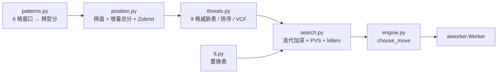

# 传统引擎（classical_worker）

传统引擎是纯 CPU 的搜索：6 格窗口棋型评分、精确的威胁分类、PVS + 置换表、
VCF 强制手搜索。默认参数下每手约 2 秒，迭代加深上限 8 层、宽度 12。搜索按时间预算
截断，因此同一盘面、同一组参数只有在同一层深度跑完时才会给出相同走法；机器负载变化会
改变完成深度，也可能改变落点。

它的能力集中在战术上：一眼成五、必堵点、连续冲四必杀。局面价值靠窗口加权和近似，
不做长程判断，所以它靠搜索树和强制手规则补足，而不是靠网络直觉。

## 1. 模块



| 文件 | 是否有棋盘 | 职责 |
| --- | --- | --- |
| `patterns.py` | 否 | 6 格窗口的 base-3 编码与评分表 |
| `position.py` | 是 | 落子/撤销、增量评分、Zobrist、邻居集合 |
| `threats.py` | 传入 | 9 格威胁表、候选排序、强制手、VCF |
| `tt.py` | 否 | 有界置换表与 mate 分数归一化 |
| `search.py` | 传入 | 根搜索、PVS、时间预算 |
| `engine.py` | 适配层 | 把 `board` 转成 `Position`，读取每局 config |
| `benchmark.py` | 是 | v2 对冻结 v1 的自对弈基准 |

## 2. 6 格窗口棋型

### 2.1 编码

每条长度 ≥6 的线被切成连续的 6 格窗口。窗口用三进制编码：

```text
code = sum(cell[i] * 3^i), i = 0..5, cell ∈ {0,1,2}
```

一共 `3^6 = 729` 种。`WINDOW_SCORES[code]` 预先算好 `(黑方得分, 白方得分)`：先按
窗口内容分类一次，再把 `1/2` 互换后分类一次，因此一张表同时服务双方。

### 2.2 棋型与权重

`patterns.SHAPES`（按优先级从高到低匹配）：

| 棋型 | 模式 | 分数 |
| --- | --- | --- |
| five | `11111` | 10,000,000 |
| open_four | `011110` | 120,000 |
| four | `011112` `211110` `11011` `10111` `11101` | 15,000 |
| open_three | `011100` `001110` `010110` `011010` | 6,000 |
| closed_three | `001112` `211100` | 600 |
| open_two | `001100` `010100` | 300 |
| closed_two | `001120` `021100` | 50 |
| one | `001000` | 2 |

`211110` / `011112` 里的 `2` 表示对方棋子，即被堵住的一端（6 格窗口总是完整落在盘内，
所以这里的 `2` 不会是墙）。破三（`010110`、`011010`）与跳四（`11011` 等）显式列出，
避免只认连续子。

窗口是滑动的：每条线上所有合法的 6 格起点都会被枚举，因此一个活四会同时出现在多个
窗口里，总分不是严格的“棋型计数”，而是位置强弱的连续代理。搜索只用它做叶节点评估，
不拿它判断胜负，也不用它排序。

### 2.3 位置评估

`Position.evaluate(player) = totals[player] - totals[other]`。

`totals` 在 `__init__` 时枚举所有合法窗口（4 个方向 × 起点）累加一次。之后每次 `play`：

1. 找出所有经过该点的窗口；
2. 记录落子前 `before` 的 code 列表；
3. 落子；
4. 重新取 `after`；
5. 对每对 `(old, new)` 用 `WINDOW_SCORES` 做差，更新双方 `totals`。

`Undo` 保存 `(old, new)` 的 delta，反向应用，**不重扫棋盘**。这是搜索能跑到百万级
节点的关键。

Zobrist：`ZOBRIST[player][row*15+col]`，落子/撤销 XOR 同一个键。置换表键再 XOR
`SIDE_KEY[player]`，区分轮到谁走。

`neighbours()` 缓存所有“距离已有棋子 1 格以内”的空点，落子/撤销使缓存失效。半径固定为 1：
半径 2 会把候选集扩大约 3 倍，在 0.2s/手预算下胜率从 80% 掉到 20%，所以这个口径
不再做成可调参数。

## 3. 威胁分类

`threats.py` 不枚举整条线，而是对每个候选点问“如果落在这里，四个方向各形成什么”。

### 3.1 9 格窗口表

以候选点为中心，沿一个方向取左右各 4 格，共 8 个可变格（中心固定为自己）。编码为
base-3 的 8 位数，共 `3^8 = 6561` 种。`THREAT_TABLE[code]` 返回：

```text
(five, five_points, open_threes)
```

- `five`：这一子落下就能成五（窗口的中心格已按己方棋子编码）；
- `five_points`：这一子落下后，本线上能立刻成五的空点个数；
- `open_threes`：本线上出现活三模式、且中心属于该模式的情况。

越界一律当 `2`（对方/墙）。四个方向的结果相加/取或，得到 `Threat`。其中
`five_points` 与 `open_threes` 是**按方向累加**的，所以“两个活三”指两个方向各有一条
活三，而不是同一条线上有两个活三。

### 3.2 威胁等级

`Threat.rank` 是排序键里的一项：

| 条件 | rank |
| --- | --- |
| 落子即成五 | 1,000,000,000 |
| 有两个及以上成五点（活四/双四） | 100,000,000 |
| 一个成五点 + 一个活三 | 90,000,000 |
| 两个活三 | 80,000,000 |
| 一个成五点（冲四） | 70,000,000 |
| 一个活三 | 60,000,000 |
| 其他 | 0 |

### 3.3 排序与强制手

`_scored` 对每个候选点**只计算一次** `attack = classify(..., player)` 和
`defence = classify(..., opponent)`，同时产出：

- `wins`：攻击方成五的点；
- `blocks`：防守方成五的点（即必须堵的点）；
- 排序键：

```text
(
  tt_move ? 1 : 0,
  max(attack_rank, defence_rank),
  attack_rank + defence_rank,
  killer ? 1 : 0,
  history_score,
  -row,
  -col,
)
```

`forced_moves` 的优先级：

1. 自己有 `wins` → 只返回成五点；
2. 对方有 `blocks` → 只返回堵点；
3. 否则按排序键取前 `limit` 个。

排序键**故意不含窗口总分**：为每个候选构造 24 个窗口 code 的成本会主导节点开销，
把深度压到 2 左右。威胁等级、killer、history 和行列序已经足够。

## 4. 根节点特殊处理

`Searcher.best_move` 在进入 PVS 前：

1. 棋盘已满 → 无着法；
2. 空盘 → 天元 `(7,7)`；
3. 自己有立即成五点 → 直接下；
4. 对方恰有一个成五点 → 直接堵；
5. 对方有两个及以上成五点 → 跑 VCF（限 `budget * vcf_budget`），找不到就堵第一个；
6. `vcf_budget > 0` → 跑 VCF，找到直接返回；
7. 否则迭代加深 `2..max_depth` 的 PVS。

前几种短路不计入搜索深度，所以基准里的“平均完成深度”会把它们算成 0。

这些短路让“必须赢/必须堵”的局面不消耗搜索预算，也避免 PVS 在明显战术点上选错。

## 5. VCF（连续冲四胜）

VCF = Victory by Continuous Fours：只下能制造冲四/活四/成五的着法，对方被迫堵，
直到成五。

`_ForcedSearch` 公共设施：

- `max_depth`、`max_nodes`、`deadline`；
- 每 8 个节点检查一次硬截止；节点数超过 `max_nodes`（VCF 默认 50000）同样中止；
- 局部 `tt`：`(position.hash ^ SIDE_KEY[player], depth) -> bool`，每次调用重置。

`VCF.best_move` 从深度 2 开始，每次 +2，直到找到或超限。

`_root` 遍历 `_attack_moves`（能成五、或落子后 `five_points > 0` 的点），落子后：

- 若直接成五 → 成功；
- 否则 `_wins_after`。

`_wins_after` 的判定顺序是正确性的核心：

1. 对方有立即成五点 → 这条线失败（对方先赢）；
2. 自己有 ≥2 个成五点 → 成功；
3. 自己不是恰好 1 个成五点 → 失败；
4. 对方堵住唯一的成五点；
5. 对方堵子若直接成五 → 失败；
6. 进入 `_search`；深度已在调用方减 1，`_search` 每走一个攻击着法再减 1。

`_search` 继续只走攻击着法，命中局部 TT 直接返回。

注意：VCF 是**攻击方**搜索。根节点调用时传入当前行动方；如果当前方没有连续冲四，
结果为空。根节点把 VCF 的深度上限设为 `max(4, 搜索深度)`，并以此覆盖 VCF 自身的默认值 10：
配置深度不超过 8 时 VCF 比默认更浅，大于 8 时 VCF 会跟着变深。

## 6. PVS 搜索

### 6.1 迭代加深

搜索从深度 2 起逐层加深，每层都完整走一遍根搜索。某层算出必胜（价值超过
`MATE_THRESHOLD`）就停，超过软截止也停；否则继续加深到 `max_depth`。

`soft_deadline = now + budget * 0.85`；硬截止 `deadline = now + budget * 0.95`。硬截止
在进入 `best_move` 时就起算，所以 VCF 花掉的时间算在里面，而软截止在 VCF 之后才起算。

### 6.2 根搜索

根节点用 `forced_moves(..., limit*2)`，比内部宽一倍，保证战术点不会被宽度裁掉。
第一个子节点全窗口搜索，后续子节点先用零窗口试探，只在返回值落在窗口内时才重搜
全窗口。根节点的结果以 `EXACT` 写入置换表。

`best_move` 先排一次根走法，再把它交给第一层 `_root` 复用；只有 killer/history 变化后
的后续层才重新排序。根节点自己不查置换表，也不单独计节点数；超时判定发生在 `_pvs`
内部。

### 6.3 内部 PVS

每个节点先查置换表：命中且深度足够就直接返回，`LOWER` / `UPPER` 则用来收窄窗口。
候选走法按上一节的排序键取出，宽度是 `self.width`（根节点是它的两倍）。

子节点价值的算法是标准的主变例搜索：第一个子节点用全窗口，其余先用零窗口探测，
返回值落在窗口内时再重搜一次全窗口。某个走法直接成五就按 `MATE_SCORE - (ply+1)`
记账，不再展开。窗口被逼死时记录杀手着法与 history 并剪枝。

- 杀手着法按 ply 保存前 2 个；history 按 `(player,row,col)` 累加 `depth^2`。
- 没有 LMR：安静格往往就是唯一防守点，宽度和强制手已经把树压窄。

### 6.4 置换表

`tt.py` 的 `TranspositionTable` 是 `dict[int, Entry]`：

- `Entry(depth, value, flag, move, age)`；
- `max_entries` 下限 1024，超出时**整体清空**（简单、可预测，避免逐出策略的复杂度）；
- 只有同一代里更深的条目才挡住覆盖，旧一代的条目无论深度都会被替换；
- `new_generation()` 每手递增 age，超限清空。

mate 分数在写入/读出时按 ply 归一化：

```text
to_table:   value > MATE_THRESHOLD  -> value + ply
            value < -MATE_THRESHOLD -> value - ply
from_table: 反向
```

这样同一个“几步内必胜”在不同搜索深度下不会因为 ply 偏移而互相污染。

### 6.5 时间与节点

- `tick()` 每 16 个节点检查一次硬截止；VCF 每 8 个。
- 硬截止抛 `SearchTimeout`，根循环捕获后返回已完成深度的最佳着法。
- 超时不会修改棋盘：所有 `play` 都有对应 `finally: undo`。

## 7. 参数

环境变量（`classical_worker/config.py`）：

| 变量 | 默认 | 含义 |
| --- | --- | --- |
| `CLASSICAL_DEPTH` | 8 | 最大迭代深度 |
| `CLASSICAL_WIDTH` | 12 | 内部节点宽度 |
| `CLASSICAL_TIME_BUDGET` | 2.0 | 每手秒数 |
| `CLASSICAL_VCF_BUDGET` | 0.10 | VCF 占总预算比例 |
| `CLASSICAL_TT_ENTRIES` | 200000 | 置换表条目上限 |

每局 `config` 覆盖 `depth` / `width` / `time_budget`（`engine.choose_move` 读取）。
`vcf_budget` / `tt_entries` 只来自进程环境。

默认值集中在 `config.py`；`tt.TranspositionTable` 的构造签名另有 200000 的兜底值。
`Searcher` 会静默修正越界参数：深度不低于 2、宽度不低于 4、时间预算不低于 0.05s、
VCF 比例不低于 0。每局 `config` 传入的值也经过同样的下限钳制。

`Searcher` 复用同一个实例，因此置换表跨手保留；每手 `new_generation()` 递增代号，
history 与 killers 则是每手清空。置换表跨手保留是刻意的。

## 8. 基准

```sh
python -m classical_worker.benchmark --games 20 [--budget 0.2] [--vcf 0.10]
```

`benchmark.py` 让 v2 与 `tests/fixtures/` 里冻结的 v1 对弈，交替先后手，8 种开局偏移，
统计胜负、平均/p95/最大用时、平均完成深度。基准默认档位是 0.2s/手、VCF 比例取生产
默认 0.10（`BENCHMARK_*` 常量集中在 `benchmark.py` 顶部）。v1 冻结在深度 6、宽度 10，
用的是另一套评估模型，所以这个基准比的是两个引擎，不是同一个引擎的两代。

读这个数字要注意三件事：开局偏移按奇偶分配，与先后手绑定，并没有与两种颜色交叉；
v1 拿到的是完整的时间预算，而 v2 还要分出 VCF 的那一份；p95 是排序后按位置取的，
不是插值分位数。

默认档位（0.2s/手、`--vcf 0.10`）的测量记录：

| 指标 | 第 1 次 | 第 2 次 |
| --- | --- | --- |
| 对 v1 | 7 胜 / 13 负 | 7 胜 / 13 负 |
| 平均每手 | 0.140 s | 0.140 s |
| p95 | 0.204 s | 0.204 s |
| 最大每手 | 0.219 s | 0.219 s |
| 平均完成深度 | 2.1 | 2.1 |

搜索按**时间预算**截断，同一份代码在机器负载不同的时候走法就会变，胜负也会跟着波动。
上面两次是同一台机器上的连续测量。空闲机器上同一份代码的胜场更高（约 14–19），
所以这组数字不能跨机器比较。20 局不足以断言强弱；要判断一次改动有没有变强，
应把预算固定成节点数再对比，并在结果里记录机器与负载。

深度只有 2.1 是宽度 12 加上每候选两次威胁分类的代价。战术正确性主要来自根节点短路、
VCF 和威胁排序，而不是完整深搜。

## 9. 已知边界

- 评估是窗口加权和，不是精确的“活四/双三”组合判定；叶节点可能高估或低估复合威胁。
- VCF 只检查对方立即成五，不检查对方反冲四。
- 宽度裁剪可能漏掉唯一防守；`forced_moves` 返回的成五点与堵点列表同样受 `limit` 截断，
  只是实际很少触发。
- 置换表用整体清空，长局中会出现周期性重建。
- 没有开局库；第一手固定天元。
- 单线程；没有并行搜索。
