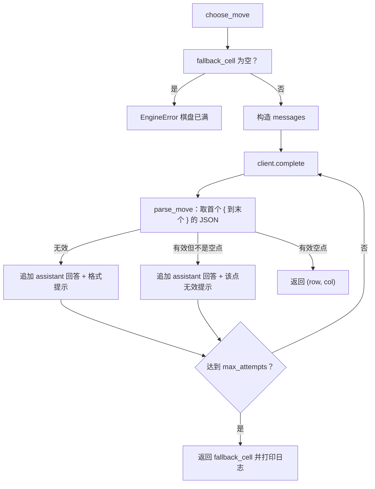

# LLM 引擎（llm_worker）

LLM 引擎不做搜索。它把棋盘翻译成模型能可靠读取的坐标和棋形描述，让模型在“这一手”的明确约束下输出一个 0 基坐标，再由 Worker 解析、校验、必要时重试。

核心结论来自实测：**只给坐标列表，模型会下合法的瞎棋；把双方成五点、活四点、冲四点写成文字，模型才会堵正确的格子。**

## 1. 模块

| 文件 | 职责 |
| --- | --- |
| `board.py` | 棋盘原语：成五、成五点、活四/冲四制造点、双三、文本化、落点解析、兜底格 |
| `engine.py` | 构造 Prompt、调用模型、校验落点、重试、兜底 |
| `openai_client.py` | OpenAI 兼容 Chat Completions 调用、thinking 开关、空响应处理 |
| `config.py` | 连接参数 + 模型参数 |
| `__main__.py` | 组装 `LLMEngine` 与 `Worker` |

## 2. 棋盘原语

全部基于“落一子后是否成五”的精确判定，没有棋型表，也没有连续子扫描器。

### 2.1 `wins_with(board, player, row, col)`

在 `(row,col)` 临时放 `player`，沿四个方向向两侧延伸计数，任一方向 `>=5` 即胜。

### 2.2 `five_points(board, player)`

遍历所有空格，返回“落下即胜”的点。含义：

- 1 个 → 冲四；
- ≥2 个 → 活四 / 双四，无法同时堵。

### 2.3 `four_makers(board, player)`

对每个候选空格（距已有棋子 ≤2 格）：

1. 临时落子；
2. `_new_five_points` 检查该子沿四个方向、每侧 1..4 格内空点，落子后是否成五；
3. 新增 ≥2 个成五点 → `open_fours`（活四制造点）；
4. 新增恰好 1 个 → `fours`（冲四制造点）。

“先落子，再看新增成五点”的定义天然覆盖跳三/跳四，不需要单独识别 `1011` 之类的形状。

### 2.4 `threats(board, player)` 的提前退出

```text
fives = five_points(player)
if fives: return (fives, [], [], [])          # 已有成五点，制造点无意义
open_fours, fours = four_makers(player)
if open_fours: return ([], open_fours, fours, [])
return ([], [], fours, double_threes(player))
```

这避免了“已经有成五点却还列出 24 个制造点”的噪声。

### 2.5 双三

`double_threes` 对候选点落子后，检查该点周围 4 个方向、每侧 1..4 格内的空点，统计能形成活四（新增 ≥2 成五点）的位置。若 ≥2 个，说明这一手同时做出两个活三，对手只能挡一边。

### 2.6 候选半径

`_candidates` 只取距已有棋子 ≤2 的空格。五连窗口必然包含距离落点 ≤2 的棋子，因此这个半径足够覆盖所有相关棋形。空盘时 `fallback_cell` 返回中心附近。

### 2.7 文本化

`describe(threats, player)` 生成中文句子，例如：

- `黑棋有 2 个成五点 (7, 7)、(7, 11)，落一子就成五，堵一个也挡不住。`
- `白棋下在 (7, 10) 就成活四：之后有两个成五点，挡不住。`
- `黑棋下在 (8, 8) 会同时做出两个活三：对手只能挡一边，另一边下一手就成活四。`
- `白棋下在 (6, 9) 就成冲四：只有一个成五点，对手必须去堵。`

`spots` 对过长的列表做截断（`limit=4`），避免单行过长。

## 3. Prompt 结构

### 3.1 System Prompt

`engine.SYSTEM_PROMPT` 以**棋手口吻**写，不称模型为“引擎”。它做四件事：

1. 说明规则和 0 基坐标；
2. 要求主动进攻：造四、造活三、逼对手来堵；
3. 定义三种点：成五点（立刻赢）、活四点（下一手赢，慢一手）、冲四点（对手必须堵）；
4. 给出固定决策顺序。

决策顺序（与棋形描述一一对应）：

```text
1. 我方有成五点 → 立刻下，赢。
2. 对方有成五点 → 只能堵，别下别的；自己的活四慢一手。
3. 我方有成活四点 → 下，对方挡不住。
4. 我方有冲四点且对方没有成五 → 抢攻。
5. 对方有成活四点 → 现在挡。
6. 都没有 → 靠近对方、把自己的两子接成三子、三子接成四子，别下边角。
```

最后要求只输出：

```json
{"move": {"row": 7, "col": 7}}
```

### 3.2 User Prompt

`_messages` 按固定顺序拼接：

```text
棋盘是 15 行 × 15 列，行号和列号都从 0 数到 14。
这一手：<由威胁数据计算的一句话>
我方（白棋）的棋子坐标：(7, 8) (7, 9)
对方（黑棋）的棋子坐标：(5, 9) (6, 8) (7, 7)
对方的棋形：
- <describe(theirs)>
我方的棋形：
- <describe(mine)>
最后一手是黑棋，下在 (5, 9)。
请给一个空点落子，只输出 {"move": {"row": 行号, "col": 列号}}。
```

`这一手` 的优先级（`_this_move`）：

1. 我方成五 → “下在 X 就成五，立刻获胜”；
2. 对方恰好 1 个成五 → “必须堵这里，下别处下一手就输”；
3. 对方 ≥2 个成五 → “堵一个也挡不住，只能自己立刻成五”；
4. 我方活四 → “下在 X 就成活四”；
5. 对方活四 → “必须现在处理”；
6. 否则不输出这一行。

这一行是**修复“模型选错防守点”的关键**。编号规则列表单独存在时，模型会在“成活四”和“堵成五”之间选错；把当前最紧急的一手写在最前面后，同一局面可以稳定给出正确堵点。

### 3.3 为什么不给 ASCII 棋盘

15×15 的字符网格对斜线不友好。实测中模型能看见网格上的子，却读不出对角线上的活三。用 `(row, col)` 坐标列表 + 棋形文字，模型反而能正确推理。

## 4. 输出解析与重试



- `parse_move` 只接受 JSON 对象里的整数 `row`/`col`，或在 `move` 子对象里的同名键；越界返回 `None`。
- 不接受 `H8` 之类标签，也不做 1 基到 0 基的自动纠正。标签/1 基会被当作格式错误重试。
- 每次重试都把模型的原文作为 `assistant` 消息、把错误原因作为新的 `user` 消息追加，保证模型看到“为什么被拒绝”。
- `max_attempts` 默认 2。用尽后**必须落一个合法空点**，不能抛异常：抛异常会让 Worker 释放租约、服务端重新发放同一回合，形成热循环。
- 兜底格 `fallback_cell`：优先选与已有棋子相邻（含斜向）的空格，其次选离中心最近的空格。

唯一的 `EngineError` 是“棋盘已满，没有可落子的位置”。

## 5. OpenAI 客户端

`OpenAIClient.complete` 发送：

```json
{
  "model": "...",
  "messages": [...],
  "temperature": 0.2,
  "max_tokens": 2000
}
```

可选：

```json
"thinking": {"type": "disabled"}
```

适配逻辑：

- `OPENAI_DISABLE_THINKING=1` 时附带 `thinking` 字段；
- 若服务端返回 `400` 且请求里确实有 `thinking`，去掉该字段重试一次，并记住“不支持”，后续不再发送；
- `content` 为空时读取 `reasoning_content`（推理模型会把正文放在这里）；
- `finish_reason == "length"` 且内容为空时，报“token 预算在思考阶段用完”，提示增大 `OPENAI_MAX_TOKENS` 或关闭思考。

`reasoning_content` 只作为最后兜底，因为推理文本可能顺带提到别的坐标；正常路径应让模型把 JSON 放在 `content`。

## 6. 参数

| 环境变量 | 默认 | 含义 |
| --- | --- | --- |
| `MYGO_URL` | `http://127.0.0.1:8080/api/v1` | MyGo API |
| `MYGO_ENGINE_ID` | `llm` | 引擎 ID |
| `MYGO_ENGINE_TOKEN` | 空 | 为空时读运行时配置 |
| `OPENAI_BASE_URL` | `https://api.openai.com/v1` | 兼容接口根地址 |
| `OPENAI_API_KEY` | 必填 | API Key |
| `OPENAI_MODEL` | `gpt-4o-mini` | 模型名 |
| `OPENAI_TEMPERATURE` | `0.2` | 采样温度 |
| `OPENAI_MAX_TOKENS` | `2000` | 输出预算，推理模型需要更大 |
| `OPENAI_TIMEOUT` | `60` | 单次请求秒数 |
| `OPENAI_MAX_ATTEMPTS` | `2` | 解析/校验失败后的总尝试次数 |
| `OPENAI_DISABLE_THINKING` | `0` | 关闭思考字段 |

`OPENAI_API_KEY` 是唯一真正必需的模型参数；其余都有默认值。

## 7. 实测记录

以下为仓库开发期记录，位置来自 `deepseek-flash`、3 次采样：

| Prompt 内容 | 局面：黑 `(7,7)(6,8)(5,9)` 斜活三，白先 | 结果 |
| --- | --- | --- |
| 仅棋子坐标 + 最后一手 | `(7,10)` 3/3 | 只顾自己成排，输 |
| 加 0 基 ASCII 棋盘 | `(8,10)` 3/3 | 仍读不出斜线 |
| 加双方棋形文字（当前实现） | `(8,6)` 3/3 | 正确堵住斜活三 |

同一套 Prompt 还验证过：把自己的三连成四、从四成五、空盘第一手，均 3/3 正确。结论：失败报告“LLM 看不见棋”通常是 Prompt 缺少棋形文字，而不是模型能力问题。

## 8. 成本与延迟

- 每个回合一次或两次 Chat Completions 请求；`max_attempts=2` 意味着最坏两次。
- 单次延迟由外部服务决定，Worker 的租约默认 60s、续期 120s，足够覆盖常见模型；但慢模型需要调大 `MYGO_LEASE_EXTEND_SECONDS`，否则提交时会 `CLAIM_EXPIRED`。
- 没有任何缓存或开局库；相同局面重复请求会产生相同费用。
- 温度 0.2 保留少量变化；若需要完全确定性，设为 0。

## 9. 已知边界

- 模型可能给出合法但战术错误的点；Prompt 只提高正确率，不提供保证。
- 棋形文字只描述成五、活四、冲四、双三，不描述更远的布局价值。
- 没有搜索、没有对手建模、没有时间管理；思考成本完全取决于服务端。
- 解析器只接受 JSON；模型若坚持输出解释性文字，会消耗重试次数后落到兜底格。
- 兜底格是“合法但不一定好”，这是为了避免热循环而刻意接受的质量损失。
- API Key 只放在 `.env`/环境变量；`.env` 已被 `.gitignore` 排除。
