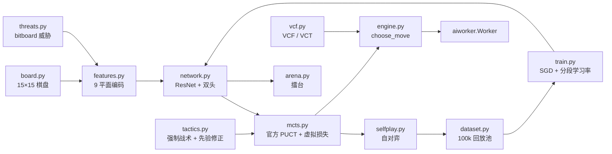

# AlphaZero 引擎（az_worker）

`az_worker` 用一个策略/价值网络加 PUCT 搜索下五子棋，训练方式沿用 DeepMind 2018 的
AlphaZero：以自对弈为主、不使用教师棋谱、不设晋级门槛，最新网络持续产生训练数据；
从零训练时每 5 轮加入 8 局传统引擎对局，作为补充样本。
能自由调整的只有硬件适配项（网络宽度、批大小、学习率、训练步数、搜索预算），
以及五子棋本身要求的适配（15×15 棋盘、合法点掩码、双方威胁平面）。

这份文档描述引擎怎么想、怎么学、怎么跑。所有数字与默认值都能在 `az_worker/` 里复核。

## 1. 组件



| 文件 | 职责 |
| --- | --- |
| `board.py` | 棋盘、落子、成五判定、空点枚举 |
| `threats.py` | 位棋盘上的成五点 / 活四点 / 活三点掩码 |
| `features.py` | 9 平面编码、全盘合法掩码、8 种对称置换 |
| `tactics.py` | 树内强制战术：候选筛选与先验修正 |
| `network.py` | 网络结构、推理、单批训练、保存/加载 |
| `mcts.py` | 节点、官方 PUCT、批量叶评估、Dirichlet 噪声 |
| `selfplay.py` | 自对弈、样本、检查点保存 |
| `dataset.py` | GPU 常驻回放池、均匀采样、八对称增强 |
| `train.py` | 自对弈训练入口（调度、学习率、日志） |
| `vcf.py` | 实战用 VCF / VCT 威胁空间搜索 |
| `engine.py` | Worker 适配：强制手 → VCF → VCT → MCTS |
| `arena.py` | 擂台（对手为传统引擎或另一份 AZ 权重） |
| `inference.py` | 共享 GPU 推理服务（`--worker-device shared`） |
| `config.py` / `__main__.py` | 环境参数与 Worker 启动 |

## 2. 方法对照

| 环节 | 官方 AlphaZero | 本实现 |
| --- | --- | --- |
| 优化器 | SGD + momentum 0.9 | `torch.optim.SGD(momentum=0.9)` |
| 初始学习率 | 0.01（国际象棋）/ 0.2（围棋） | **0.0125** |
| 学习率调度 | 分段 ×0.1 | 两次 ×0.1，边界为总步数的 60%、85% |
| L2 | `c‖θ‖²`，c = 1e-4 | `weight_decay=1e-4`（均方损失下等价） |
| 损失 | `(z-v)² - πᵀlog p + c‖θ‖²` | 同左，策略项与价值项都是批内均值 |
| 批大小 | 4096 | **256** |
| 残差块 | Conv-BN-ReLU → Conv-BN → Add → ReLU | 同左（post-activation） |
| 塔 | 20/40 块 × 256 通道 | **6 块 × 64 通道** |
| 策略头 | 2 通道 1×1 → BN → ReLU → FC(棋盘) | 同左（FC 225） |
| 价值头 | 1 通道 1×1 → BN → ReLU → FC256 → ReLU → FC1 → tanh | 新训练默认 4 通道，FC64 |
| 搜索 | PUCT，`c_base=19652`，`c_init=1.25` | 同左 |
| 模拟数 | 800 | **400 / 800 / 1600** 分段 |
| 候选动作 | 全盘合法点 | 训练默认半径 2，强制战术覆盖基础候选 |
| 根噪声 | Dirichlet α=0.03（围棋）/ 0.3（象棋），ε=0.25 | **α=0.05，ε=0.25** |
| 温度 | 前 30 手 τ=1，之后 τ→0 | **前 12 手 τ=1，之后贪心** |
| 价值目标 | 终局结果 z ∈ {+1, -1, 0} | 同左 |
| 策略目标 | MCTS 访问分布 | 同左；解算器判定为强制胜的那一手记成 one-hot |
| 数据 | 最新网络生成，回放池均匀采样 | 同左 |
| 回放池 | 最近 500k 局（围棋） | **100,000 个局面** |
| 晋级门槛 | 无（持续更新） | 无 |
| 教师预热 | 无 | 无 |
| 自对弈选点 | 纯 MCTS | MCTS + 可选 VCF/VCT 解算器（命中强制胜时直接落子） |
| 对称增强 | 依具体实现而定 | 默认开启；全连接头不保证旋转、镜像等变 |

训练规模：

- 默认 25,000 步 / 1,000 轮，每轮 25 次梯度更新。
- 每轮 `max(32, workers)` 局，避免早期用少量样本反复训练。
- 学习率在 15,000 / 21,250 步处衰减；模拟数按进度走 400 / 800 / 1600。
- 默认半径 2、八对称增强，网络为 64 通道 × 6 块。
- 每轮结束写完整检查点（`training_version`、命令行配置、优化器动量）；每轮开始前另写一份只含 `step`/`games` 的轻量检查点，用于中断后定位进度。

### 公共战术规则

`tactics.py` 按自由五子棋处理（无禁手，五连即胜）：

1. 己方成五优先于防守，直四、跳四、横竖与双斜线都算。
2. 对方能成五时搜索堵点；若多个成五点堵不完，就使用已证实的败局值。
3. 无对手立即成五时，己方能做活四就优先做活四，使用已证实的胜局值。
4. 对方活三或跳三将要变成活四时，保留消除活四点的防守，同时保留己方冲四反击。
   找不到安全防守时仍然返回合法着法，不伪造安全解。
5. 两子做活三只抬高搜索先验，不当作必胜；更长的组合交给 VCF/VCT 与 MCTS。

这些规则在树的每个展开节点执行，不依赖网络是否给关键点高概率。关掉 VCF/VCT 预算
也不会关掉树内战术。回归测试在 `az_worker/tests/test_tactics.py`。

## 3. 棋盘与动作空间

`Board.grid` 是 15×15 列表，`_stones` 维护 `(row, col, player)`，`play` 返回是否成五。

MCTS 的基础候选由半径决定：训练默认 2，0 表示全盘空点。强制战术覆盖基础候选，
半径裁剪不会漏掉成五、冲四与活三防守。Worker 的 `AZ_CANDIDATE_RADIUS` 默认仍是 0，
可以设为 2 与训练保持一致。

## 4. 九平面特征

`features.encode(board, player, last_move)` 返回 `(9, 15, 15) float32`，全部相对
**当前行动方**：

| 索引 | 平面 | 含义 |
| --- | --- | --- |
| 0 | `PLANE_SELF` | 我方棋子 |
| 1 | `PLANE_OTHER` | 对方棋子 |
| 2 | `PLANE_LAST` | 最后一手 |
| 3 | `PLANE_SELF_FIVE` | 我方落子即胜的空点 |
| 4 | `PLANE_OTHER_FIVE` | 对方落子即胜的空点 |
| 5 | `PLANE_SELF_OPEN_FOUR` | 我方落子成活四的空点 |
| 6 | `PLANE_OTHER_OPEN_FOUR` | 对方落子成活四的空点 |
| 7 | `PLANE_SELF_OPEN_THREE` | 我方落子成活三的空点 |
| 8 | `PLANE_OTHER_OPEN_THREE` | 对方落子成活三的空点 |

平面 0/1 与 3–8 都随回合交换“我方/对方”含义，同一份权重因此对黑白对称。

### 4.1 bitboard 表示

```text
STRIDE = BOARD_SIZE + 5 = 20      # 每行留 5 个填充位
TOTAL_BITS = STRIDE * 15 = 300
bit(row, col) = 1 << (row * STRIDE + col)
DIRECTIONS = (1, 20, 21, 19)      # 横、竖、主对角、副对角
```

填充位保证方向移位不会从一行末尾绕到下一行开头；`VALID_MASK` 只含真实 225 格，
掩码最后与 `empty` 或 `VALID_MASK` 相与，越界位自动被剔除。

### 4.2 三种威胁掩码

对每个方向、每个窗口起点，用前缀/后缀 AND 把“窗口里除一个空位外全是己方子”
写成一串位运算：

- **成五点**：五格窗口 4 子 + 1 空，空位就是落子成五的位置。
- **活四点**：六格窗口两端为空，中间四格 3 子 + 1 空，空位就是落子成活四的位置。
- **活三点**：五格窗口两端为空，中间三格 2 子 + 1 空，空位就是落子成活三的位置。
  两端必须为空，因此不会把一条长棋误判成更短的三。

成五点与活四点完全由位运算得到；活三点按窗口起点逐个检查，成本略高但仍在
中盘每毫秒级。一次编码覆盖 4 个方向 × 2 方 × 3 种模式，不需要逐格 Python 循环。

### 4.3 对称

`features.TRANSFORMS` 定义 8 种棋盘对称，`CELL_PERMUTATIONS` 是对应的逆向索引，
供 GPU `gather` 使用。测试断言 `permute_planes(encode(board)) == encode(permute_board(board))`
对 8 种对称都成立；威胁平面由同一套 bitboard 几何算出，因此自动满足。

## 5. 网络

从随机网络开始训练时，默认使用 6 个残差块、64 个塔通道和 64 个价值隐层单元。
残差塔之后分出策略头（225 个 logits）与价值头（一个 tanh 标量）。价值头的 1×1 卷积
默认输出 4 张特征图，再展平送入全连接层。可以用 `--value-channels` 调节这一步的宽度，
或用 `--channels 128 --blocks 10` 扩大残差塔。加载起始权重时，模型尺寸取自检查点。

推理时 logits 在非法点上填 `-1e9` 后做 softmax，价值落在 `[-1, 1]`。

训练损失与官方同形，两项都是批内均值：策略项是目标分布与掩码后 log softmax 的交叉
熵，价值项是预测价值与终局结果的平方误差，两者相加。目标策略先乘合法掩码再重新
归一化。`train_batch` 在 CUDA 上用 bf16 autocast（数值精度实现细节，不改变算法），
loss 以 fp32 计算；L2 由优化器的 `weight_decay` 提供。

检查点保存网络结构参数、`planes = 9` 与 `meta`。`load_model` 按检查点里的结构重建模型，
只接受 9 平面的权重，平面数不符时报出明确错误。`meta` 里的 `step` 由训练器写入，
续训时读回。

## 6. MCTS

### 6.1 节点

搜索树的一个节点保存：候选子节点（键是 `row*15+col`）、访问次数、价值累积、
虚拟损失、策略先验、该节点轮到谁走、终局值、是否已展开、最后一手，以及指向父节点
与本手着法的引用。

节点上的棋盘是惰性取用的：只在第一次访问时从父节点复制棋盘并落子，避免每个子节点
各复制一整盘。

### 6.2 选择（官方 PUCT）

```text
c(s)   = log((1 + N(s) + c_base) / c_base) + c_init
Q(s,a) = -child.value_sum / child.visits     # 子节点价值是父方的相反数
U(s,a) = c(s) * P(s,a) * sqrt(max(N(s),1)) / (1 + N(s,a) + virtual_loss)
```

选择分数是 `Q + U`：已访问的价值加上与访问次数相关的探索奖励。

`c_base = 19652`、`c_init = 1.25`，与论文一致。探索项随父节点访问数增长：
`N(s)=0` 时 `c(s) ≈ 1.25`，`N(s)=10⁶` 时 `c(s) ≈ 5.2`。未访问子节点 `Q = 0`，
此时选择完全由先验与探索项决定。

### 6.3 批量叶评估

1. `_descend` 沿已展开节点走到叶；
2. 叶是终端（成五、满盘）→ 立即回传；
3. 否则压入 `pending` 并打上 `virtual_loss`；
4. 攒够 `batch_size`（默认 32）或搜索结束时 `_flush`：一次前向评估所有叶子，
   逐个展开并回传；
5. 每次模拟之后检查 `deadline`（`time_budget`），超时即停。

虚拟损失是批量推理的代价补偿：多个下降路径在等 GPU 时不会全部压到同一个叶子，
正在等待评估的子节点在选择阶段被跳过。`_flush` 评估完会递减该叶的 `virtual_loss`，
再由 `_backpropagate` 沿路径回传，每层取反（negamax）。

### 6.4 展开

展开一个节点时，先由 `tactics.search_moves` 决定这一层有哪些候选、以及每个候选的
先验：

- 基础候选来自半径（半径为 0 时是全盘空点）；
- 一旦存在己方成五点、对方成五点或己方活四点，候选就替换为这些战术点；
- 以上都不成立、但对方有成活四点的点时（即对方已有活三），候选保留所有能阻止对方做出活四的走法，
  以及己方能立即成五的反击；找不到防守时保留原候选，不伪造安全解。

先验由网络策略与战术权重混合而成：九成来自网络，一成来自战术权重。战术权重以 1 为底，
己方能成活三的点再加 3（合计 4），对方能成活三的点再加 1（合计 2），其余为 1；混合后重新归一化。这一层先验地板
保证网络判断失准时，好棋仍然排在前面，但它不会把启发式变成必胜。

子节点还会被直接判终局，不用再搜：己方落子即成五记为输；对方成五点没有被这一手
堵住记为赢；这一手做出己方活四记为输；这是最后一个空点记为和局。满盘节点同样记为
和局。

### 6.5 根噪声与温度

自对弈时根节点会加噪声：先按 Dirichlet（α=0.05）抽一份随机分布，再按 25% 的比例
混进根节点的子先验。

噪声只作用于根节点；实战（`engine.py`）不加噪声。

`SelfPlay` 前 12 手用 τ=1 按 `visits^(1/τ)` 采样，之后 τ=0 取访问最多的一手。
`arena` 与 `engine` 默认 τ=0。

### 6.6 结果

`_collect(root)`：

- `visits[cell] = child.visits`（键集合为战术筛选后的搜索候选）；
- `policy[cell] = child.visits / 总访问数`，未访问点为 0——这就是策略目标；
- `root_value = root.value_sum / root.visits`；
- `simulations = 总访问数`。

## 7. 对局入口

`AlphaZeroEngine.choose_move` 的顺序：

1. 空盘 → `(7,7)`；满盘 → `EngineError`；
2. 强制手：己方能成五就成五，否则对方能成五就堵；
3. VCF（`vcf_budget`，默认 0.25 秒）：算出强制胜就直接落子；
4. VCT（`vct_budget`，默认 0.25 秒）：算出强制胜就直接落子；
5. 否则交给 MCTS，`simulations` 默认 100,000，实际由时间预算截断；
6. 温度默认 0 → `best_move()`；找不到着法 → `EngineError`。

时间预算是**每手总预算**，解算器与搜索从中分配：每个解算器最多拿剩余时间的 40%，
搜索拿到剩下的部分，且不低于 0.05 秒。

宿主按 2 秒/手计时，VCF/VCT 用掉的时间会从搜索预算里扣。搜索预算有不低于 0.05 秒的下限，
且截止时间在每次模拟结束后才检查，因此单手实际耗时为预算与 0.05 秒的较大者，再加最后一次模拟的时间。
`AZ_SIMULATIONS` 远大于实际能跑的次数（默认 100,000），让墙钟时间成为真正的限制。

## 8. 训练

### 8.1 自对弈

`SelfPlay.play_game`：

- 黑先。每一手先问解算器（`PlaySolver`）：己方成五或堵对方成五点；
  否则 VCF（默认 0.05 秒）找强制胜；再否则只在己方棋形能做出活四或活三时才跑 VCT
  （默认 0.05 秒）。解算器命中就跳过 MCTS，这一手的策略目标记成 one-hot，
  价值目标仍是终局结果。
- 没有强制胜时按常规流程 `search(add_noise=True)`，前 12 手 τ=1 采样、之后 τ=0。
- 每个样本记录 `planes`（9 平面）、`policy`、`legal`（全盘空点）与 `value`。
- 成五或满盘结束。结束后按落子方回填 `value = +1 / -1 / 0`。

解算器对双方对称生效，自对弈里 VCF 链条会被对手正确防守，不会出现“自己算杀自己
不挡”的假样本。价值目标只有终局结果这一种语义。

### 8.2 回放池

`TensorDataset(capacity=100_000)`：

| 张量 | dtype | 形状 |
| --- | --- | --- |
| `planes` | fp16 | `(capacity, 9, 225)` |
| `policy` | fp32 | `(capacity, 225)` |
| `legal` | bool | `(capacity, 225)` |
| `value` | fp32 | `(capacity,)` |

回放池常驻 GPU，`sample` 用 `torch.randint` 均匀采样，没有加权也没有优先级回放。
容量满时按时间顺序丢弃最旧的样本（一次张量搬移完成，丢弃数量等于超出部分；
单次写入超过整个容量时只保留最后一段）。`--augment` 开启八对称增强
（`gather` + 置换表），默认开启。`--buffer-file` 配合 `--resume` 把回放池与已完成
步数一起落盘，中断只丢当前一轮；只给 `--resume` 而没有 `--buffer-file` 时不会恢复进度，训练从第 0 步开始。

### 8.3 训练循环

`train.py` 每轮：

1. 用**当前最新网络**自对弈 `--games` 局（默认至少 32 局），样本进回放池。从零训练默认
   每 5 轮另外跟传统引擎打 8 局，轮流执黑执白。传统对局记录 AZ 行棋前的棋盘和 AZ 搜索给出
   的策略目标，并用这局的实际结果标注 AZ 行棋方的价值；
2. 练 `--total-steps / --iterations` 步（默认 25,000 / 1,000 = 25 步）：
   每步按当前步数设置学习率、抽样并调用 `train_batch`。有传统对局的轮次从本轮传统对局
   样本抽取约四分之一的批次，其余从全池均匀抽取。传统对局样本留在回放池供后续训练；
3. 保存检查点（含 `step` 元数据）与回放池；
4. 打印步数、学习率、模拟数、自对弈胜负、缓冲大小、策略/价值损失与用时。

网络原地更新，下一轮自对弈直接用它。并行自对弈时，训练器会先把最新权重写盘，
子进程按文件 mtime 判断是否需要重新加载。

### 8.4 调度

```text
学习率:  0.0125   (进度 < 60%)
         0.00125  (60% ≤ 进度 < 85%)
         0.000125 (进度 ≥ 85%)

模拟数:  400 (进度 < 1/3) / 800 (< 2/3) / 1600 (其余)
```

`--simulations` 可以固定模拟数（短程调试用），默认走分段。

### 8.5 参数

| 参数 | 默认 | 含义 |
| --- | --- | --- |
| `--total-steps` | 25000 | 总梯度步数 |
| `--iterations` | 1000 | 轮数（每轮步数 = 总步数/轮数） |
| `--games` | auto | 每轮自对弈局数；auto = 进程数与 32 的较大者 |
| `--batch-size` | 256 | 批大小 |
| `--lr` | 0.0125 | 初始学习率 |
| `--momentum` | 0.9 | SGD 动量 |
| `--weight-decay` | 1e-4 | L2 |
| `--buffer` | 100000 | 回放池容量 |
| `--simulations` | 无 | 固定模拟数；不给则按进度 400/800/1600 |
| `--search-batch` | 32 | MCTS 叶批大小 |
| `--candidate-radius` | 2 | 基础候选半径；强制战术覆盖候选，0 为全盘 |
| `--workers` | auto | 并行自对弈进程数；`--workers 1` 表示不进进程池、在主进程自对弈。auto 的算法见下 |
| `--worker-device` | auto | `auto`/`cuda`/`cpu`/`shared`（`shared` = 所有进程共享一个 GPU 推理服务） |
| `--temperature-moves` | 12 | 前多少手温度采样 |
| `--augment` / `--no-augment` | 开 | 八对称增强 |
| `--device` / `--model` / `--init` / `--seed` | auto / `models/az/current.pt` / 同 model / 0 | 运行参数；重训建议显式使用新路径 |
| `--channels` / `--blocks` / `--value-hidden` | 64 / 6 / 64 | 网络规模（从随机网络起步时生效） |
| `--value-channels` | 4 | 价值头 1×1 卷积输出通道数（从随机网络起步时生效） |
| `--buffer-file` / `--resume` | 无 / 关 | 回放池落盘与续训 |
| `--log-file` | auto | 每轮追加一行 CSV；auto = 权重同目录的 `<model>.log`，`none` 关闭 |
| `--tensorboard` | auto | 事件目录；auto = 权重同目录的 `tensorboard/<权重名>/`（每个 run 一个子目录，TensorBoard 才分得开），`none` 关闭 |
| `--classical-train-every` / `--classical-train-games` | 5 / 8（从零训练） | 每 N 轮加入传统对局和局数。加载已有权重时需显式启用，`--classical-train-every 0` 关闭 |
| `--classical-train-depth` / `--classical-train-time` | 2 / 0.05 | 训练对手的搜索深度与每手时间（秒） |
| `--eval-every` / `--eval-games` | 50 / 8 | 每 N 轮跟传统引擎做棋力探针及其局数（0 = 关） |
| `--eval-simulations` / `--eval-vcf` / `--eval-vct` | 512 / 0.1 / 0.1 | 探针每手的搜索预算与解算器预算 |
| `--eval-classical-depth` / `--eval-classical-time` | 2 / 0.05 | 探针对手强度 |
| `--selfplay-vcf` / `--selfplay-vct` | 0.05 / 0.05 | 自对弈每手解算器预算，0 关闭 |
| `--selfplay-solver-depth` / `--selfplay-solver-nodes` | 10 / 4000 | 解算器深度与节点上限 |
| `--progress` | on | tqdm 进度条；`off` 用于把输出重定向到日志 |

### 8.6 性能参考

RTX 4060 Laptop（16 核 32 线程，8 GB 显存）、6×64 网络、批 256、CUDA bf16。
这组测量使用 128/256/400 模拟、每轮 10 局的配置，量化的是单步开销与并行上限，
不是默认档位的整轮耗时：

| 项目 | 参考值 |
| --- | --- |
| `encode`（中盘 15 子） | 93 µs |
| 梯度一步 | 19 ms（GPU 平均 81%，峰值 97%） |
| 单进程自对弈，128 模拟 | 7.9 s/局（GPU 平均 30%，14 W） |
| 13 个 CUDA 进程，13 局/轮 | 3 轮（128/256/400 模拟）共 107 s |
| 13 个 CUDA 进程的资源占用 | GPU 平均 47.5%（峰值 96%），CPU 约 11 核（32 逻辑的 35%），显存 6.9 GB |
| 16 个 CUDA 进程 | 显存 7.2 GB，超出 8 GB 卡的安全余量，进程池被系统终止 |
| 默认 100 轮 × 13 局 + 25,000 步 | 13 个 CUDA 进程约 1 小时；单进程约 4.5 小时 |

两相的资源占用完全不同：自对弈是单核 Python（225 子节点展开 + 编码），梯度步阶段
GPU 才满载，而梯度只占总时长的一小部分。因此吞吐参数只有并行自对弈一项——
`--search-batch` 从 8 调到 225、torch 线程从 1 调到 24，搜索吞吐都稳定在
1200–1350 sims/s，没有变化。

并行自对弈的进程数由空闲显存决定：每个 CUDA 进程按 256 MB 上下文预留，再留
768 MB 余量，8 GB 卡在桌面已占约 4 GB 的情况下得到 13 个进程。`--workers auto`
就是这条公式；进程数达到局数后池不再空转，所以 `--games auto` 跟着进程数走。

`--worker-device shared` 让多个 CPU 自对弈进程共用一个 GPU 推理服务：只有一份
CUDA 上下文，进程数不再受显存限制，请求按批合并后转发到 GPU。显存吃紧或需要
更多自对弈进程时用它；默认的每进程独立推理更简单，延迟也更低。

`--workers auto` 按推理方式取不同公式：

| 推理方式 | 自动进程数 |
| --- | --- |
| 每进程独立、`--worker-device cuda` | `min(CPU 核数 // 2, (空闲显存 - 768MiB) // 256MiB)` |
| 每进程独立、`--worker-device cpu` | `min(CPU 核数 // 2, 8)` |
| `--worker-device shared` | `max(2, CPU 核数 * 3 // 4)` |

### 8.7 监控与产物

| 通道 | 位置 | 内容 |
| --- | --- | --- |
| tqdm | 终端 | 每轮一个步数进度条（含吞吐与剩余时间），外加总轮数进度条 |
| CSV | `<model>.log` | `time,iteration,step,learning_rate,simulations,games,total_games,wins,losses,draws,plies,buffer,policy_loss,value_loss,steps_per_second,seconds,eval_winrate` |
| TensorBoard | 权重同目录的 `tensorboard/<权重名>/` | `train/{loss,policy_loss,value_loss,learning_rate}`、`selfplay/{plies,simulations,games_total}`、`replay/buffer`、`time/{iteration_seconds,steps_per_second}`、`classical_train/{games,samples}`、`eval/{winrate,games}` |
| 检查点 | `<model>.pt` | 轮末完整写入：权重 + `meta`（`step`、`iteration`、`games`、`lr`、`simulations`、`total_steps`、`training_version`、命令行配置）+ 优化器状态（SGD 动量）。轮前轻量写入只含 `step` 与 `games` |

```sh
.venv/Scripts/tensorboard.exe --logdir models/az/tensorboard --port 6006
# 浏览器打开 http://127.0.0.1:6006
```

棋力探针默认每 50 轮跟传统引擎（d2 / 0.05 秒）打 8 局，候选使用 512 模拟 +
VCF/VCT 各 0.1 秒，胜率写进 `eval/winrate`，耗时随局面变化。这是粗粒度的趋势线，
正式比较棋力用 `az_worker.arena`（≥40 局、2 秒/手），`--eval-every 0` 可关闭。
使用 `--resume --buffer-file` 且权重文件存在时，续训读回已完成步数、自对弈局数与优化器动量。
若中断发生在轮前轻量检查点之后、轮末完整检查点之前，续训只恢复步数与局数，动量会重新初始化。

## 9. VCF / VCT

`vcf.py` 默认用于实战和自对弈。`PlaySolver` 先处理成五与冲四防守，再尝试 VCF/VCT。

- 位棋盘上生成攻击着法：落子后产生 ≥1 个成五点（VCF），或产生活四点（VCT）；
- 防守方堵成五点；VCT 还枚举能阻止活四的端点、内部空位与冲四反击，避免漏防导致假杀；
- 攻方产生 ≥2 个成五点（活四）→ 直接判胜，防方堵不住；
- 防方自己有成五点 → 攻方这条线不成立（对手先赢）；
- VCT 下攻方有活四点时，逐个尝试防守方的每一手回应，全部成立才判胜；
- 迭代加深（VCF 从 2 起、VCT 从 1 起，逐层加深到上限 10）+ 置换表 + 节点上限
  （默认 4,000）+ 截止时间；
- 分支按威胁数量排序，先算双威胁。

攻击着法只在已有棋子附近生成，远离棋局的威胁不会被枚举。返回的着法一定是强制胜
（可靠），找不到时只说明预算内没算到（不完备），此时由 MCTS 接管。默认每次 0.25 秒，
节点上限与深度可用环境变量调整。

## 10. 擂台

`arena.py` 让候选与对手对弈：

- 候选黑/白交替，每两局共用同一个随机开局（`--opening-moves`，默认 2 手，
  随机开局从天元起再随机一手）；
- 传统对手：`--classical-depth 4 --classical-time 0.5 --classical-width 12`；
- AZ 对手：`--opponent az --opponent-model <权重>`，`--opponent-simulations/-time` 单独配置；
- 候选与 AZ 对手都带 VCF/VCT（`--vcf-budget/--vct-budget`，默认 0.25 秒）。

**必须有成对随机开局**：温度 0 时同一对权重每局棋完全一样，N 局实际只有 2 个棋局。
成对开局 + 交换黑白让开局偏差互相抵消。局数少时胜率的采样误差很大，比较模型用
≥40 局，或改用更敏感的指标（威胁平面上的堵点正确率）。

## 11. 参数

| 环境变量 | 默认 | 含义 |
| --- | --- | --- |
| `AZ_MODEL_PATH` | `models/az/current.pt` | 权重；使用新模型时显式修改 |
| `AZ_DEVICE` | `auto` | `auto` / `cpu` / `cuda` / `cuda:0` |
| `AZ_SIMULATIONS` | 100000 | 每手模拟上限（实际由时间截断） |
| `AZ_BATCH_SIZE` | 32 | 叶评估批大小 |
| `AZ_TIME_BUDGET` | 2.0 | 每手总秒数（含解算器） |
| `AZ_TEMPERATURE` | 0 | 0 为确定性选最大访问 |
| `AZ_VCF_BUDGET` | 0.25 | 每手 VCF 预算，0 关闭 |
| `AZ_VCT_BUDGET` | 0.25 | 每手 VCT 预算，0 关闭 |
| `AZ_SOLVER_DEPTH` | 10 | 解算器最大攻方手数 |
| `AZ_SOLVER_NODES` | 4000 | 解算器节点上限 |
| `AZ_CANDIDATE_RADIUS` | 0 | 搜索打开的候选半径，0 为全盘 225 点 |

每局 `config` 可覆盖 `simulations` / `temperature`。`model_path` 不存在时构造随机
网络，链路可通、棋力无意义；权重平面数不符时打印 `权重不可用: ...` 并以状态码 2 退出。

## 12. 运行

```sh
# 依赖（仅首次）
python -m venv .venv
.venv/Scripts/python -m pip install torch --index-url https://download.pytorch.org/whl/cu128
.venv/Scripts/python -m pip install numpy tensorboard tqdm
```

### 12.1 训练

```sh
.venv/Scripts/python.exe -m az_worker.train --device cuda \
  --total-steps 25000 --iterations 1000 \
  --model models/az/tactical_v2.pt --buffer-file models/az/tactical_v2_replay.pt --seed 1
```

`--workers auto` 按空闲显存与 CPU 核数决定并行进程数，`--games auto` 跟着取
`max(32, 进程数)` 局/轮；显存吃紧（桌面占得多）时可以显式降到 8。每轮往
`models/az/tactical_v2.log` 追加一行 CSV，TensorBoard 事件写到
`models/az/tensorboard/tactical_v2/`（续训沿用同一个子目录；换一个 `--model`
就是新的一条曲线），检查点同时保存优化器动量与 `step`/`iteration`/`games`。

实时看曲线（另开一个终端）：

```sh
.venv/Scripts/tensorboard.exe --logdir models/az/tensorboard --port 6006
# 浏览器打开 http://127.0.0.1:6006
```

显存不足又想要更多自对弈进程时，用共享推理（单份 CUDA 上下文）：

```sh
.venv/Scripts/python.exe -m az_worker.train --device cuda --worker-device shared \
  --total-steps 25000 --iterations 1000 \
  --model models/az/tactical_v2.pt --buffer-file models/az/tactical_v2_replay.pt --seed 1
```

### 12.2 中断后续训

```sh
.venv/Scripts/python.exe -m az_worker.train --device cuda \
  --total-steps 25000 --iterations 1000 \
  --model models/az/tactical_v2.pt --init models/az/tactical_v2.pt \
  --buffer-file models/az/tactical_v2_replay.pt --resume
```

每轮结束都会写权重与回放池；`--init` 与 `--model` 指向同一个文件是合法的原地续训写法。
检查点里的 `meta.step` 会被读取，学习率与模拟数接着之前的进度走。

### 12.3 擂台

```sh
.venv/Scripts/python.exe -m az_worker.arena --model models/az/tactical_v2.pt \
  --games 40 --device cuda --time-budget 2.0 \
  --classical-depth 4 --classical-time 0.5 --opening-moves 2 --seed 42
```

### 12.4 Worker（被 MyGo 调用）

```sh
.venv/Scripts/python.exe -m az_worker
```

先看战术回归和对战胜率，再决定是否扩大训练规模；梯度步数不等于棋力。训练会占满
显存，建议与 Worker 分开运行；桌面同时占用 GPU 时把 `--workers` 降到 8。
