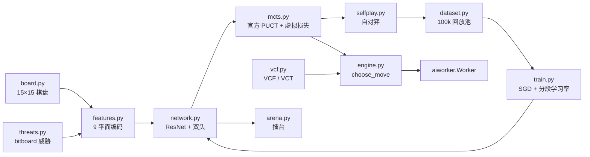

# AlphaZero 引擎（az_worker）

`az_worker` 是策略/价值网络 + PUCT MCTS 的五子棋引擎。训练方式以 DeepMind 2018 的
AlphaZero 方法为基线：**纯自对弈、无教师棋谱、无晋级门槛、最新网络持续产生数据**。
允许自行决定的只有硬件适配参数（网络宽度、批大小、学习率、训练步数、搜索预算）与
五子棋的必要适配（15×15 棋盘、合法点掩码、两侧威胁平面）。

## 1. 组件



| 文件 | 职责 |
| --- | --- |
| `board.py` | 棋盘、落子、成五判定、空点枚举 |
| `threats.py` | 位棋盘上的成五点 / 活四点 / 活三点掩码 |
| `features.py` | 9 平面编码、全盘合法掩码、8 种对称置换 |
| `network.py` | 网络结构、推理、单批训练、保存/加载 |
| `mcts.py` | 节点、官方 PUCT、批量叶评估、Dirichlet 噪声 |
| `selfplay.py` | 自对弈、样本、检查点保存 |
| `dataset.py` | GPU 常驻回放池、均匀采样 |
| `train.py` | 自对弈训练入口（调度、学习率、日志） |
| `vcf.py` | 实战用 VCF / VCT 威胁空间搜索 |
| `engine.py` | Worker 适配：强制手 → VCF → VCT → MCTS |
| `arena.py` | 擂台（对手为传统引擎或另一个 AZ 权重） |
| `config.py` / `__main__.py` | 环境参数与 Worker 启动 |

## 2. 方法对照

| 环节 | 官方 AlphaZero | 本实现 |
| --- | --- | --- |
| 优化器 | SGD + momentum 0.9 | `torch.optim.SGD(momentum=0.9)` |
| 初始学习率 | 0.01（国际象棋）/ 0.2（围棋） | **0.0125** |
| 学习率调度 | 分段 ×0.1 | 三段 ×0.1，边界为总步数的 1/7、3/7、5/7 |
| L2 | `c‖θ‖²`，c = 1e-4 | `weight_decay=1e-4`（均方损失下等价） |
| 损失 | `(z-v)² - πᵀlog p + c‖θ‖²` | 同左，策略项与价值项都是批内均值 |
| 批大小 | 4096 | **256** |
| 残差块 | Conv-BN-ReLU → Conv-BN → Add → ReLU | 同左（post-activation） |
| 塔 | 20/40 块 × 256 通道 | **6 块 × 64 通道** |
| 策略头 | 2 通道 1×1 → BN → ReLU → FC(棋盘) | 同左（FC 225） |
| 价值头 | 1 通道 1×1 → BN → ReLU → FC256 → ReLU → FC1 → tanh | FC64 |
| 搜索 | PUCT，`c_base=19652`，`c_init=1.25` | 同左 |
| 模拟数 | 800 | **128 / 256 / 400** 分段 |
| 根噪声 | Dirichlet α=0.03（围棋）/ 0.3（象棋），ε=0.25 | **α=0.05，ε=0.25** |
| 温度 | 前 30 手 τ=1，之后 τ→0 | **前 12 手 τ=1，之后贪心** |
| 价值目标 | 终局结果 z ∈ {+1, -1, 0} | 同左 |
| 策略目标 | MCTS 访问分布 | 同左 |
| 数据 | 最新网络生成，回放池均匀采样 | 同左 |
| 回放池 | 最近 500k 局（围棋） | **100,000 个局面** |
| 晋级门槛 | 无（持续更新） | 无 |
| 教师预热 | 无 | 无 |
| D4 对称增强 | 网络结构本身对棋盘对称等变，不额外增强 | 代码保留 `--augment`，默认关闭 |

训练的超参数与深度：

- 总步数默认 **25,000**（官方 700k 的 1/10 再叠加单卡预算缩减），边界
  3,571 / 10,714 / 17,857 步各衰减 10×；
- 模拟数按步数进度分三段：前 1/3 用 128，中 1/3 用 256，后 1/3 用 400；
- 每轮 10 局自对弈、250 步梯度；100 轮打完 25,000 步。

## 3. 棋盘与动作空间

`Board.grid` 是 15×15 列表，`_stones` 维护 `(row, col, player)`。`play` 返回是否成五。

**MCTS 的动作空间是全盘空点**（`Board.empty_cells()`），没有任何候选裁剪或每节点
宽度限制：剪枝是 AlphaGo Zero 之前的做法，会改变 PUCT 的访问分布，官方基线里不存在。
`features.legal_mask(board)` 把全部空点标为 1，用于在 logits 上屏蔽非法点。

`Board.candidates(radius=2)` 只用于擂台随机开局与 VCF 附近的走法生成，不参与搜索。

## 4. 九平面特征

`features.encode(board, player, last_move)` 返回 `(9, 15, 15) float32`，全部相对
**当前行动方**：

| 索引 | 平面 | 含义 |
| --- | --- | --- |
| 0 | `PLANE_SELF` | 我方棋子 |
| 1 | `PLANE_OTHER` | 对方棋子 |
| 2 | `PLANE_LAST` | 最后一手 |
| 3 | `PLANE_SELF_FIVE` | 我方落子即胜的空点 |
| 4 | `PLANE_OTHER_FIVE` | 对方落子即胜的空点 |
| 5 | `PLANE_SELF_OPEN_FOUR` | 我方落子成活四的空点 |
| 6 | `PLANE_OTHER_OPEN_FOUR` | 对方落子成活四的空点 |
| 7 | `PLANE_SELF_OPEN_THREE` | 我方落子成活三的空点 |
| 8 | `PLANE_OTHER_OPEN_THREE` | 对方落子成活三的空点 |

平面 0/1 与 3–8 都随回合交换“我方/对方”含义，所以同一个权重对黑白对称。

### 4.1 bitboard 表示

```text
STRIDE = BOARD_SIZE + 5 = 20      # 每行留 5 个填充位
TOTAL_BITS = STRIDE * 15 = 300
bit(row, col) = 1 << (row * STRIDE + col)
DIRECTIONS = (1, 20, 21, 19)      # 横、竖、主对角、副对角
```

填充位保证方向移位不会从一行末尾绕到下一行开头；`VALID_MASK` 只含真实 225 格，
所有掩码最后 `& empty` 或 `& VALID_MASK`，越界位自动被剔除。

### 4.2 三种威胁掩码

对每个方向 `shift`、每个窗口起点，用前缀/后缀 AND 把“窗口里除一个空位外全是己方子”
写成一串位运算：

- **成五点**：五格窗口 4 子 + 1 空 → 空位即落子成五的点。
- **活四点**：六格窗口两端为空、中间四格 3 子 + 1 空 → 空位即落子成活四的点。
- **活三点**：五格窗口两端为空、中间三格 2 子 + 1 空 → 空位即落子成活三的点
  （避免把一个五格窗口误判成更长的三，因为两端必须为空）。

一次编码做 4 个方向 × 2 方 × 3 种模式，没有逐格 Python 循环。实测中盘（15 子）
一次 `encode` 约 **93 µs**，是 7 平面版本的（34 µs）约 2.7 倍——这是 2 个额外平面
与活三掩码的代价。

### 4.3 对称

`features.TRANSFORMS` 定义 8 种棋盘对称，`CELL_PERMUTATIONS` 是对应的逆向索引
（用于 GPU `gather`）。测试断言
`permute_planes(encode(board)) == encode(permute_board(board))` 对 8 种对称都成立，
威胁平面由同一 bitboard 几何算出，因此自动满足。

## 5. 网络

`network.GomokuNet(channels=64, blocks=6, value_hidden=64)`，共 565,418 个参数：

```text
输入  (B, 9, 15, 15)
stem  Conv2d(9→64, 3×3, pad=1, bias=False) + BN + ReLU
tower 6 × ResidualBlock(64)
       └ Conv3×3 + BN + ReLU → Conv3×3 + BN → +x → ReLU

policy head:
  Conv2d(64→2, 1×1) + BN + ReLU
  flatten → Linear(2*225 → 225) → logits

value head:
  Conv2d(64→1, 1×1) + BN + ReLU
  flatten → Linear(225 → 64) + ReLU → Linear(64 → 1) → tanh
```

推理时 logits 在非法点上填 `-1e9` 后 `softmax`；价值在 `[-1, 1]`。

训练（批内均值，与官方损失同形）：

```text
policy_loss = -sum(target_policy * log_softmax(masked_logits), dim=1).mean()
value_loss  = ((predicted - target_value) ** 2).mean()
loss        = policy_loss + value_loss
```

目标策略先乘合法掩码再重新归一化。`train_batch` 在 CUDA 上用 bf16 autocast
（数值精度实现细节，不改变算法），loss 以 fp32 计算；实测 bs=256 一步 **17.9 ms**。

`load_model` 校验 `planes == 9`：7 平面旧权重会得到明确错误，不做静默迁移。

## 6. MCTS

### 6.1 节点

```python
class Node:
    children: dict[int, Node]   # cell = row*15+col，展开时一次建满全盘空点
    visits, value_sum, virtual_loss
    prior, player
    terminal_value
    expanded
    last_move
    _board, _parent, _move
```

`Node.board` 是惰性属性：只在第一次访问时从父节点复制棋盘并落子。逐节点复制整盘会
把搜索时间翻倍（旧实测 400 次模拟 782ms → 359ms）。

### 6.2 选择（官方 PUCT）

```text
c(s)        = log((1 + N(s) + c_base) / c_base) + c_init
Q(s,a)      = -child.value_sum / child.visits          # 子节点价值是父方的相反数
U(s,a)      = c(s) * P(s,a) * sqrt(N(s)) / (1 + N(s,a) + virtual_loss)
score       = Q + U
```

`c_base = 19652`、`c_init = 1.25`，与论文一致。探索项随父节点访问数增长：
`N(s)=0` 时 `c(s) ≈ 1.25`，`N(s)=10⁶` 时 `c(s) ≈ 5.2`。根节点访问数为 0 时
`Q = 0`（未访问子节点），完全由先验与探索项决定。

### 6.3 批量叶评估

1. `_descend` 沿已展开节点走到叶；
2. 叶是终端（成五、满盘）→ 立即回传；
3. 否则压入 `pending` 并打 `virtual_loss`；
4. 攒够 `batch_size`（默认 32）或结束时 `_flush`：一次前向评估所有叶子，逐个展开并回传；
5. 每 16 次模拟检查一次 `deadline`（`time_budget`）。

虚拟损失是批量推理的必要代价：多个下降路径在等 GPU 时不会重复选中同一个叶子。
`_flush` 里评估完会把该叶的 `virtual_loss` 递减，再由 `_backpropagate` 沿路径回传，
每层取反（negamax）。

### 6.4 展开

```text
moves  = board.empty_cells()            # 全盘空点，不裁剪
priors = policy[cell] 归一化（全 0 则均匀）
每个子节点：
  落子即胜           → terminal_value = -1（对子节点是输）
  这是最后一个空点   → terminal_value = 0（和局）
```

满盘节点 → `terminal_value = 0`。

### 6.5 根噪声与温度

自对弈时 `add_noise=True`：

```text
η ~ Dirichlet(α=0.05)
P = (1 - 0.25) * P + 0.25 * η
```

只作用于根节点的子先验；实战（`engine.py`）不加噪声。

`SelfPlay` 前 12 手用 τ=1 按 `visits^(1/τ)` 采样，之后 τ=0 取访问最多的一手
（官方“开局随机、之后贪心”的同一机制）。`arena`/`engine` 默认 τ=0。

### 6.6 结果

`_collect(root)`：

- `visits[cell] = child.visits`（键集合就是全盘空点）；
- `policy[cell] = child.visits / 总访问数`，未访问点为 0——这就是策略目标；
- `root_value = root.value_sum / root.visits`；
- `simulations = 总访问数`。

## 7. 对局入口

`AlphaZeroEngine.choose_move`：

1. 空盘 → `(7,7)`；满盘 → `EngineError`；
2. `_forced_move`：自己立即成五 → 下；否则对方立即成五 → 堵；
3. VCF（`vcf_budget`，默认 0.25s）：算杀成功直接下；
4. VCT（`vct_budget`，默认 0.25s）：算杀成功直接下；
5. 否则 MCTS，`simulations` 默认 100,000，实际由 `time_budget`（默认 2.0s）截断；
6. 温度默认 0 → `best_move()`；无着法 → `EngineError`。

**MCTS 的预算扣掉了解算器已用的时间**：主机按 2 秒/手计时，VCF/VCT 用掉的
0.5 秒从搜索预算里扣，不会让总时长超出宿主租约。

`AZ_SIMULATIONS` 必须远大于实际能跑的次数（默认 100,000），否则搜索会在模拟数上
提前刹车、2 秒预算从未生效。

## 8. 训练

### 8.1 自对弈

`SelfPlay.play_game`：

- 黑先，每手 `search(add_noise=True)`；
- 记录 `planes`（9 平面）、`policy`（访问分布）、`legal`（全盘空点）、`value`；
- 成五或满盘结束；
- 结束后给每个样本 `value = +1 / -1 / 0`（该样本落子方的终局结果）。

价值目标只有终局结果这一种语义，不再混入人工评分或搜索根值。

### 8.2 回放池

`TensorDataset(capacity=100_000)`：

| 张量 | dtype | 形状 |
| --- | --- | --- |
| `planes` | fp16 | `(capacity, 9, 225)` |
| `policy` | fp32 | `(capacity, 225)` |
| `legal` | bool | `(capacity, 225)` |
| `value` | fp32 | `(capacity,)` |

- 常驻 GPU，`sample` 用 `torch.randint` 均匀采样，不做加权、不做优先级回放；
- 满了以后按时间顺序丢弃最旧的整块样本（先入先出）；
- `--augment` 可开启 8 对称增强（`gather` + 置换表），**默认关闭**，保持官方流程；
- `--buffer-file` + `--resume` 把回放池与已完成步数一起落盘，崩溃只丢当前一轮。

### 8.3 训练循环

`train.py` 每轮：

1. 用**当前最新网络**自对弈 `--games` 局（默认 10 局），样本进回放池；
2. 练 `--total-steps / --iterations` 步（默认 25,000 / 100 = 250 步）：
   每步按当前步数设置学习率、均匀采 256 条、`train_batch`；
3. 保存检查点（含 `step` 元数据）与回放池；
4. 打印步数、学习率、模拟数、自对弈胜负、缓冲大小、策略/价值损失、用时。

没有教师样本、没有数据生成器与被训练网络的分离、没有擂台晋级判定：网络原地更新，
下一轮自对弈直接用它。

### 8.4 调度

```text
学习率:  0.0125  (0 ≤ step < 1/7)
         0.00125 (1/7 ≤ step < 3/7)
         0.000125 (3/7 ≤ step < 5/7)
         0.0000125 (≥ 5/7)

模拟数:  128 (进度 < 1/3) / 256 (< 2/3) / 400 (其余)
```

`--simulations` 可以固定模拟数（冒烟测试用），默认走分段。

### 8.5 参数

| 参数 | 默认 | 含义 |
| --- | --- | --- |
| `--total-steps` | 25000 | 总梯度步数 |
| `--iterations` | 100 | 轮数（每轮步数 = 总步数/轮数） |
| `--games` | 10 | 每轮自对弈局数 |
| `--batch-size` | 256 | 批大小 |
| `--lr` | 0.0125 | 初始学习率 |
| `--momentum` | 0.9 | SGD 动量 |
| `--weight-decay` | 1e-4 | L2 |
| `--buffer` | 100000 | 回放池容量 |
| `--simulations` | 无 | 固定模拟数；不给则按进度 128/256/400 |
| `--search-batch` | 32 | MCTS 叶批大小 |
| `--temperature-moves` | 12 | 前多少手温度采样 |
| `--augment` | 关 | 八对称增强 |
| `--device` / `--model` / `--init` / `--seed` | auto / `models/az/current.pt` / 同 model / 0 | 运行参数 |
| `--channels` / `--blocks` / `--value-hidden` | 64 / 6 / 64 | 网络规模（从随机网络起步时生效） |
| `--buffer-file` / `--resume` | 无 / 关 | 回放池落盘与续训 |

### 8.6 实测预算（RTX 4060 Laptop）

| 项目 | 实测 |
| --- | --- |
| `encode`（中盘 15 子） | 93 µs |
| 梯度一步（bs 256，bf16） | 17.9 ms |
| 全盘 215 个空点，128 模拟 | 0.14 s/手（≈900 sims/s） |
| 全盘 215 个空点，400 模拟 | 0.34 s/手（≈1,170 sims/s） |

默认 100 轮 × 10 局、平均约 6–8 s/局，加上 25,000 步梯度（≈7.5 分钟），整轮
大约 **2–3 小时**。这是“单卡几小时”的量级，不是论文的 700k 步。

## 9. VCF / VCT

`vcf.py` 是独立的威胁空间搜索，**只用于实战，不参与自对弈训练**（训练数据里没有它）。

- 位棋盘上生成攻击着法：落子后产生 ≥1 个成五点（VCF），或产生活四点（VCT）；
- 防守方只有“堵成五点 / 堵活四点”这一条合法回应，其余着法会立即输棋；
- 攻方产生 ≥2 个成五点（活四）→ 直接判胜，防方堵不住；
- 防方自己有成五点 → 攻方这条线不成立（对手先赢）；
- 迭代加深（2,4,6,8,10 攻方手数）+ 置换表 + 节点上限（默认 4,000）+ 截止时间；
- 分支按威胁数量排序，先算双威胁。

结论是**可靠的**（返回的着法确实是强制胜），不保证**完备**（找不到时只是说明预算内
没算到，MCTS 接管）。默认每次 0.25 s，节点上限与深度可用环境变量调。

## 10. 擂台

`arena.py` 让候选与对手对弈：

- 候选黑/白交替，每两局共用同一个随机开局（`--opening-moves`，默认 2 手）；
- 传统对手：`--classical-depth 4 --classical-time 0.5 --classical-width 12`；
- AZ 对手：`--opponent az --opponent-model <权重>`，`--opponent-simulations/-time` 单独配置；
- 候选与 AZ 对手都带 VCF/VCT（`--vcf-budget/--vct-budget`，默认 0.25s）。

**必须有成对随机开局**：温度 0 时同一对权重每局棋完全一样，N 局实际只有 2 个棋局。
成对开局 + 交换黑白让开局偏差互相抵消。局数少时胜率的采样误差极大（8 局 95% 区间
约 [0.16, 0.84]），比较模型用 ≥40 局，或改用更敏感的指标（威胁平面上的堵点正确率）。

## 11. 参数

| 环境变量 | 默认 | 含义 |
| --- | --- | --- |
| `AZ_MODEL_PATH` | `models/az/current.pt` | 权重 |
| `AZ_DEVICE` | `auto` | `auto` / `cpu` / `cuda` / `cuda:0` |
| `AZ_SIMULATIONS` | 100000 | 每手模拟上限（实际由时间截断） |
| `AZ_BATCH_SIZE` | 32 | 叶评估批大小 |
| `AZ_TIME_BUDGET` | 2.0 | 每手总秒数（含解算器） |
| `AZ_TEMPERATURE` | 0 | 0 为确定性选最大访问 |
| `AZ_VCF_BUDGET` | 0.25 | 每手 VCF 预算，0 关闭 |
| `AZ_VCT_BUDGET` | 0.25 | 每手 VCT 预算，0 关闭 |
| `AZ_SOLVER_DEPTH` | 10 | 解算器最大攻方手数 |
| `AZ_SOLVER_NODES` | 4000 | 解算器节点上限 |

每局 `config` 可覆盖 `simulations` / `temperature`。`model_path` 不存在时构造随机
网络，便于跑通链路，但棋力无意义。

## 12. 运行顺序

```sh
# 依赖
python -m venv .venv
.venv/Scripts/python -m pip install torch --index-url https://download.pytorch.org/whl/cu128
.venv/Scripts/python -m pip install numpy

# 1. 自对弈训练（从随机网络开始；有检查点就用 --init 续训）
.venv/Scripts/python.exe -m az_worker.train \
  --total-steps 25000 --iterations 100 --games 10 --device cuda \
  --model models/az/current.pt --buffer-file models/az/replay.pt --seed 1

# 2. 中断后续训（回放池与步数一起恢复）
.venv/Scripts/python.exe -m az_worker.train \
  --total-steps 25000 --iterations 100 --games 10 --device cuda \
  --model models/az/current.pt --init models/az/current.pt \
  --buffer-file models/az/replay.pt --resume

# 3. 擂台
.venv/Scripts/python.exe -m az_worker.arena --model models/az/current.pt \
  --games 40 --device cuda --time-budget 2.0 \
  --classical-depth 4 --classical-time 0.5 --opening-moves 2 --seed 42

# 4. Worker（被 MyGo 调用）
.venv/Scripts/python.exe -m az_worker
```

系统 Python 没有 torch，所有 `az_worker` 命令都用 `.venv/Scripts/python.exe`。

## 13. 已知边界

- **纯自对弈起步慢**：没有教师棋谱，前几轮面对的是随机网络，样本质量差；这是官方方法
  的固有代价，官方用海量算力摊平它。本仓库用 25,000 步 + 100 轮折中。
- 25,000 步远小于论文的 700k 步，回放池（100k 局面）在一次训练里填不满，实际复用率
  约百次量级；要更强就加步数、加局数、加模拟数，方法与代码不用改。
- 全盘动作空间让每手比候选裁剪慢 3–5 倍（官方基线如此）。时间预算在小预算下会
  只跑到几千次模拟，而不是 400。
- VCF/VCT 是可靠但不完备的算杀：找不到不代表没有杀，找到就一定是强制的。
- 擂台胜率有采样误差，8 局只能发现 0:8 这类大缺陷；跨代比较用 ≥40 局 + 固定开局种子。
- 训练产物在 `models/`，被 `.gitignore` 排除；换机器需要重新训练或拷贝权重。旧的
  3/7 平面权重已归档到 `models/az/legacy/`，新代码会明确拒绝加载；在没有新权重之前
  引擎会用随机网络启动（链路可通，棋力无意义）。
