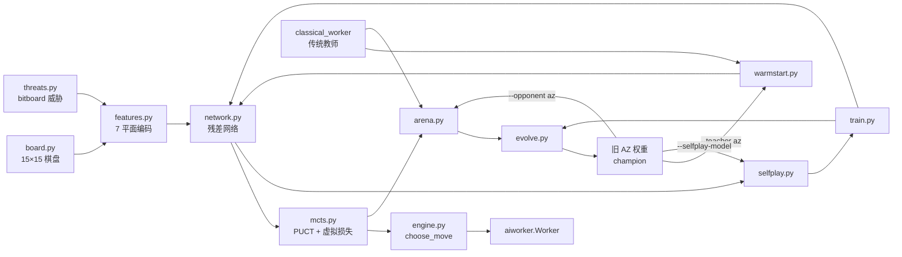
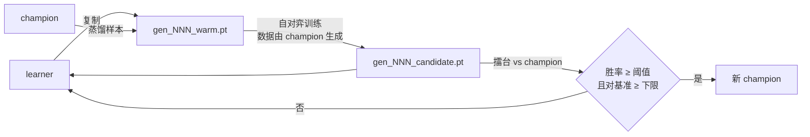

# AlphaZero 引擎（az_worker）

`az_worker` 是策略/价值网络 + PUCT MCTS，训练方式是“教师预热 + 自对弈迭代”，教师既可以是传统引擎，也可以是旧的自对弈权重（自进化）。推理时不需要外部服务，模型在本地 GPU/CPU 上运行。

## 1. 组件



| 文件 | 职责 |
| --- | --- |
| `board.py` | 棋盘、落子、成五判定、候选点 |
| `threats.py` | 位棋盘上的成五点/活四点掩码 |
| `features.py` | 7 平面编码、合法点掩码、8 种对称变换 |
| `network.py` | 网络结构、推理、训练步、保存/加载 |
| `mcts.py` | 节点、PUCT 选择、批量叶评估、Dirichlet 噪声 |
| `engine.py` | Worker 适配、强制手、时间/模拟数预算 |
| `selfplay.py` | 自对弈、样本、GPU 训练辅助、评估 |
| `dataset.py` | GPU 张量回放缓冲、对称增强 |
| `teacher.py` | 传统引擎或旧 AZ 权重的教师样本收集 |
| `warmstart.py` | 预热/蒸馏训练入口（`--teacher classical\|az`） |
| `train.py` | 自对弈训练入口（数据生成器可与被训练网络不同） |
| `arena.py` | 擂台赛（对手为传统引擎或旧 AZ 权重） |
| `evolve.py` | 自进化循环：蒸馏 → 自对弈 → 擂台晋级 |
| `config.py` / `__main__.py` | 环境参数与 Worker 启动 |

## 2. 棋盘与候选点

`Board.grid` 是 15×15 列表，`_stones` 维护 `(row, col, player)` 列表。`play` 返回是否成五。

`candidates(radius=2)`：

- 空盘返回天元 `(7,7)`；
- 否则返回所有距已有棋子 ≤radius 的空格，排序后输出。

MCTS 内部实际使用 `radius=1` 的候选集（`DEFAULT_CANDIDATE_RADIUS = 1`），因为 15×15 中盘中段 radius 2 会产生 60+ 个点，模拟数被摊薄。

## 3. 七平面特征

`features.encode(board, player, last_move)` 返回 `(7, 15, 15) float32`：

| 索引 | 平面 | 含义 |
| --- | --- | --- |
| 0 | `PLANE_SELF` | 当前行动方棋子 |
| 1 | `PLANE_OTHER` | 对方棋子 |
| 2 | `PLANE_LAST` | 最后一手 |
| 3 | `PLANE_SELF_FIVE` | 我方落子即胜的空点 |
| 4 | `PLANE_OTHER_FIVE` | 对方落子即胜的空点 |
| 5 | `PLANE_SELF_OPEN_FOUR` | 我方落子成活四的空点 |
| 6 | `PLANE_OTHER_OPEN_FOUR` | 对方落子成活四的空点 |

后四个平面**相对于当前行动方**，因此会随回合交换“我方/对方”的含义，和平面 0/1 一致。

加入威胁平面的原因：三平面网络只能看到“子在哪里”，看不到“对方下一手在哪里成五”。实测在对方已有冲四的 441 个局面上，正确堵点比例从 12.5% 提升到 47.4%。

### 3.1 bitboard 表示

`threats.py`：

```text
STRIDE = BOARD_SIZE + 5 = 20
TOTAL_BITS = STRIDE * 15 = 300
bit(row, col) = 1 << (row * STRIDE + col)
```

每行留 5 个填充位，使四个方向都变成固定位移：

```text
DIRECTIONS = (1, 20, 21, 19)   # 横、竖、主对角、副对角
```

填充位保证水平移位不会从上一行末尾绕到下一行开头。`VALID_MASK` 只包含真实 225 格。

### 3.2 成五点与活四点

对每个方向 `shift`：

```python
gaps = [empty >> (j*shift) for j in range(6)]   # 6 个连续格子的空位掩码
ends = gaps[0] & gaps[5]                        # 六格窗口两端都空
line = [stones >> (j*shift) for j in range(5)]  # 五格窗口内己方子
```

`_products` 计算前缀/后缀 AND：

```text
prefix[i+1] = prefix[i] & line[i]
suffix[i]   = suffix[i+1] & line[i]
```

- **成五点**：五格窗口中恰好一个空位，其余四格为己方：

```text
five |= (gaps[hole] & prefix[hole] & suffix[hole+1]) << (hole*shift)
```

- **活四点**：六格窗口两端为空，中间四格为己方，窗口内剩余那个空位就是“落子成活四”的点。对中间四格再做前缀/后缀 AND：

```text
middle_prefix, middle_suffix = products(line[1:5])
others = middle_prefix[hole] & middle_suffix[hole+1]
four |= (ends & gaps[hole+1] & others) << ((hole+1)*shift)
```

所有方向的结果取或，最后 `& empty` 去掉已有棋子的位。

一次计算 4 个方向 × 2 方，都是整数位运算，没有逐格 Python 循环。`encode` 从 5.5µs 增加到约 34µs，这是 4 个额外平面的代价。

### 3.3 对称

`features._transforms` 定义 8 种棋盘对称（恒等、旋转 90/180/270、水平翻转及其旋转）。`CELL_PERMUTATIONS` 是对应的**逆向**索引，用于 GPU `gather`。

`transform_planes(encode(board)) == encode(permuted_board)` 对 8 种对称都成立；威胁平面由同一 bitboard 几何计算，因此自动满足。

## 4. 网络

`network.GomokuNet(channels=64, blocks=6, value_hidden=64)`：

```text
输入  (B, 7, 15, 15)
stem  Conv2d(7→64, 3×3, pad=1, bias=False) + BN + ReLU
tower 6 × ResidualBlock(64)
       └ Conv3×3 + BN + ReLU → Conv3×3 + BN → +x → ReLU

policy head:
  Conv2d(64→2, 1×1) + BN + ReLU
  flatten → Linear(2*225 → 225) → logits

value head:
  Conv2d(64→1, 1×1) + BN + ReLU
  flatten → Linear(225 → 64) + ReLU → Linear(64 → 1) → tanh
```

推理：

- logits 在非法点（`legal_mask == 0`）上填 `-1e9`；
- `softmax` 得到先验；
- value 在 `[-1, 1]`。

训练：

```text
policy_loss = -sum(target_policy * log_softmax(masked_logits))
value_loss  = MSE(predicted, target_value)
loss        = policy_loss + value_loss
```

目标策略先乘合法掩码并重新归一化。`train_tensors` 在 CUDA 上用 bf16 autocast，loss 仍以 fp32 计算。

`load_model` 支持旧三平面权重：`_expand_stem` 把 `stem.weight` 的输入通道零填充到 7，旧模型行为不变。

## 5. MCTS

### 5.1 节点

```python
class Node:
    children: dict[int, Node]   # cell = row*15+col
    visits, value_sum, virtual_visits
    prior, player
    terminal_value
    expanded
    last_move
    _board, _parent, _move
```

`Node.board` 是惰性属性：只有访问时才从父节点复制棋盘并落子。旧实现每个子节点都复制整盘，400 次模拟产生 26,379 次 `copy`，占 44% 运行时间；惰性化后 400 次模拟从 782ms 降到 359ms。

### 5.2 选择

```text
quality = -child.value_sum / child.visits      # 子节点价值是父方视角的相反数
exploration = c_puct * prior * sqrt(parent.visits) / (1 + child.visits + child.virtual_visits)
score = quality + exploration
```

`c_puct = 1.5`。未访问子节点 `quality = 0`，靠 prior 和探索项决定。

`virtual_visits` 实现虚拟损失：一个叶节点正在等 GPU 评估时，其他下降路径会看到额外的访问计数，避免重复选同一个叶子。

### 5.3 批量评估

`search` 主循环：

1. `_descend` 沿已扩展节点走到叶；
2. 叶是终端（已成五/满盘）→ 直接回传；
3. 否则加入 `pending`，打上 `waiting` 标记；
4. 攒够 `batch_size=32` 或结束 → `_flush`：一次前向评估所有叶子，展开并回传；
5. 每 16 次模拟检查一次 `deadline`。

`_flush` 对每个叶子：

- `encode` + `legal_mask`；
- `evaluate` 得到策略/价值；
- `_expand`：按 prior 取候选点前 `candidate_width=16` 建子节点；若某子节点落子即胜，标记 `terminal_value = -1.0`（对子节点而言是输）；
- `_backpropagate`：沿路径回传，每层取反。

### 5.4 展开

```text
moves = board.candidates(radius=1)
priors = policy[cell] for moves
归一化；若全为 0，用均匀分布
按 prior 降序取前 candidate_width
```

终端处理：

- 无候选点 → `terminal_value = 0`；
- 满盘 → `terminal_value = 0`；
- 子节点落子成五 → 子节点 `terminal_value = -1`。

### 5.5 根噪声

自对弈时 `add_noise=True`：

```text
noise ~ Dirichlet(alpha=0.3)
prior = (1 - 0.25) * prior + 0.25 * noise
```

只作用于根节点的子先验，用于探索。实际对局（`engine.py`）不加噪声。

### 5.6 结果

`_collect(root)`：

- `visits[cell] = child.visits`；
- `policy[cell] = child.visits / total`；
- `root_value = root.value_sum / root.visits`；
- `simulations = total`。

`best_move()` 取访问次数最多；`sampled_move(temperature)` 在温度 >0 时按 `visits^(1/T)` 采样。

## 6. 对局入口

`AlphaZeroEngine.choose_move`：

1. 空盘 → `(7,7)`；
2. 满盘 → `EngineError`；
3. `_forced_move`：在 radius 2 候选里找自己立即成五点，其次找对方立即成五点；有则直接下；
4. 否则 `searcher.search(...)`，`simulations` 默认 100,000，`time_budget` 默认 2.0s；
5. 温度默认 0 → `best_move()`；
6. 无着法 → `EngineError`。

`AZ_SIMULATIONS` 默认必须是 100,000，而不是 400。否则搜索在 400 次模拟后就停止，2s 时间预算从未生效；实测同一模型 400 次模拟 0 胜 8 负，放开后 6 胜 2 负。

## 7. 训练

### 7.1 预热（warmstart）

`teacher.collect_one_game`：

- 用 `classical_worker.search.Searcher` 作为教师；
- 每手取 `searcher.best_move`，再用 `ordered_moves(..., teacher_moves)` 得到排名；
- 策略目标：`exp(-rank/decay)`，位置 `cell = row*15+col`，`decay=2.0`；
- 合法掩码 radius 1；
- 价值目标：
  - `eval`（默认）：`tanh(position.evaluate(player) / 8000)`；
  - `outcome`：整局结束后 `±1`。

`warmstart.py`：

- `ProcessPoolExecutor` 并行收集（Windows spawn 需要 `teacher.py` 可导入）；
- 留 10% 样本做验证；
- 默认 `steps = max(1, len(examples)//32) * 6`；
- 每 50 步打印“验证首选一致率”；
- 保存权重和教师样本（`--data-out`）。

#### AZ 教师（自进化用的蒸馏）

`--teacher az --teacher-model <权重>` 让旧的自对弈权重当老师：

- 每手由该权重做 `--teacher-simulations` 次 MCTS（默认 400，`--teacher-time` 默认 1.0s 上限，`--teacher-width` 16）；根节点加 Dirichlet 噪声，所以同一个权重也能产出不同棋局；
- 策略目标 = 访问分布（`SearchResult.policy`）；价值目标 = 搜索根值 `root_value`（`--value-target search`，是 AZ 教师的默认值），天然在 `[-1, 1]` 且为落子方视角；
- 学生权重由 `--model` 决定：文件存在就在它上面继续训（`--lr`，蒸馏一般用 1e-4），不存在才是随机网络；
- 教师推理走 GPU、单进程串行，`--workers` 被忽略（只对 CPU 的传统教师有效）；
- 错误的组合直接报错：`eval` 只属于传统教师，`search` 只属于 AZ 教师。

蒸馏带来的是“比被训练网络更强的搜索产生的策略/价值目标”，这是自进化能累积强度而不是回到起点的关键前提。

### 7.2 自对弈（selfplay）

`SelfPlay.play_game`：

- 黑先；
- 前 `temperature_moves=12` 手温度 1.0，之后 0；
- 每手 `search(add_noise=True)`，记录 `planes`、`policy`、`legal`；
- `board.play` 成五即结束；
- 结束后按胜方给每个样本 `value = ±1`，和局 0。

样本价值是“该样本的落子方最终是否获胜”，不是“当前局面相对父节点”。

### 7.3 训练循环

`train.py` 每轮：

1. 自对弈 `--games` 局，加入 `TensorDataset`；
2. 用一局自对弈做验证；
3. `train_gpu` 跑 `--train-steps` 步，批大小 1024（预热）/默认 256（自对弈入口）；
4. 评估验证策略/价值损失；
5. 保存检查点；
6. 可选保存回放缓冲区。

`--init` 与 `--model` 分开：从预热权重开始训练，但不覆盖预热文件。

`--selfplay-model` 把“产生自对弈数据的网络”和“被训练的网络”分开：数据由更强的 champion 生成，被训练的网络（`--init`）可以比它弱，于是新样本的质量下限由 champion 决定。不传时两者是同一个网络（经典 AlphaZero 行为）。

`--buffer-file` + `--resume` 让回放缓冲区跨进程、跨代累积（默认容量 60000）；自进化每代都会复用同一个 `replay.pt`。

`--teacher-data` 必须混入缓冲区。否则第一轮自对弈会把预热知识冲掉；实测“教师一致率”从 64% 提升到 76%。

### 7.4 GPU 数据管道

`TensorDataset` 把样本常驻 GPU：

| 张量 | dtype | 形状 |
| --- | --- | --- |
| `planes` | fp16 | `(capacity, 7, 225)` |
| `policy` | fp32 | `(capacity, 225)` |
| `legal` | bool | `(capacity, 225)` |
| `value` | fp32 | `(capacity,)` |

- `sample` 用 `torch.randint` 选索引；
- 8 种对称增强用 `gather` + `PERMUTATION_TABLE`，与旧的逐样本变换位精确一致；
- 缓冲区满时按时间顺序丢弃最旧样本（整块左移）。

`train_tensors` 的 bf16 autocast 在 bs=1024 时从 208ms 降到 85ms。

## 8. 擂台（arena）

`arena.py` 让候选网络与对手对弈，对手可以是传统引擎，也可以是旧 AZ 权重：

- 候选黑/白交替，每两局共用同一个随机开局（`--opening-moves`，默认 2 手）；
- 传统对手：`--classical-depth 4 --classical-time 0.5`（默认），宽度 12；
- AZ 对手：`--opponent az --opponent-model <权重>`，预算用 `--opponent-simulations` / `--opponent-time` / `--opponent-width` 单独配置，`--opponent-time` 不写时跟随 `--time-budget`；
- 输出胜/负/和与胜率。`arena.play_series`、`arena.az_side`、`arena.classical_side` 可被 `evolve.py` 直接调用。

### 8.1 为什么必须有成对随机开局

两个引擎在温度 0 下都是确定性的：同一对权重、同样的先后手，每局棋完全一样。于是 N 局擂台实际只有 2 个不同棋局（黑一局、白一局），统计量没有意义。

实测：gen1 候选对 `current_v3`，无开局时 40 局打出 40:0；换成 2 手成对随机开局后，同一批权重是 22:18（55%）。同一权重自战 20 局在成对开局下恰好 10:10（50%），这是公平性对照。

开局的生成是 `random_opening(rng, plies)`：从半径 2 的候选里随机落子，随机数由 `--seed` 决定，因此整场擂台可复现；每一对棋局用同一个开局、交换黑白，从而抵消先后手偏差。

`warmstart --value-target outcome` 的模型 0 胜 8 负；改成 `eval` 后 6 胜 2 负。价值头方向错误会让 PUCT 退化到“只按先验选”，这是历史缺陷，当前默认已修正。

加入威胁平面后：

| 模型 | 平面 | 擂台 |
| --- | --- | --- |
| `warmstart_v2.pt` | 3 | 4 胜 4 负 |
| `warmstart_v3.pt` | 7 | 4 胜 4 负 |
| `current_v3.pt`（预热 + 50 轮自对弈） | 7 | 8 胜 0 负 |

预热阶段新增的 4 个通道从零开始，2000 步不足以让它们发挥作用；威胁平面的收益要在自对弈阶段才体现。局数少（例如 8 局）或省掉随机开局时，擂台分辨率极低；敏感指标是“验证首选一致率”和“强制堵点正确率”。

## 9. 自进化（evolve）

`evolve.py` 把三阶段串成世代循环：旧 champion 当老师和数据生成器，学习器持续累积，擂台达标才换代。



每代的固定动作：

1. 把 **learner** 复制成 `gen_NNN_warm.pt`（不是从随机网络开始）；
2. `warmstart --teacher az --teacher-model <champion> --lr 1e-4`，在其上蒸馏新鲜的 champion 样本；
3. `train --init <warm> --selfplay-model <champion> --buffer-file replay.pt --resume`：champion 产生自对弈数据、learner 学习，回放池跨代累积；
4. `arena` 打两场：对 champion（晋级门槛）与对固定基准（`--baseline-games`）；
5. 判定：`(胜 + 0.5×和)/局数 ≥ --promote-winrate` **且** 对基准胜率 ≥ `--min-baseline-winrate` 才把 champion 换成候选；**无论是否晋级，learner 都换成候选**。

```sh
.venv/Scripts/python.exe -m az_worker.evolve \
  --champion models/az/current_v3.pt --out-dir models/az/evolution \
  --generations 10 --device cuda --seed 1
# 续跑：加 --resume
```

产物与状态：

| 路径 | 内容 |
| --- | --- |
| `<out>/gen_NNN_warm.pt` | 本代蒸馏后的中间权重 |
| `<out>/gen_NNN_teacher.pt` | 本代 champion 教师样本 |
| `<out>/gen_NNN_candidate.pt` | 本代自对弈训练产物 |
| `<out>/replay.pt` | 跨代回放缓冲区 |
| `<out>/state.json` | `generation`、`champion`、`learner`、`baseline`、`history` |

`history` 每代记录 `teacher`、`wins/losses/draws`、`winrate`、`promoted`、`baseline_winrate`。**看基准列判断是否真的进步**，晋级只说明过了当代的 champion。

### 9.1 基准守护线

只比 champion 会被“代际互克”骗过去。实测两代小规模运行：第 2 代候选对 champion 15:5（75%），对固定基准却是 3:17（15%）——赢了上一代却明显弱于起点。没有守护线它会顶掉 champion，整条线实际退化。现在的规则是“赢 champion **且** 对基准不低于 45%”，这次运行因此正确淘汰了第 2 代，同时 learner 仍推进到该候选继续积累。

### 9.2 参数

| 参数 | 默认 | 含义 |
| --- | --- | --- |
| `--champion` / `--baseline-model` | `current_v3.pt` / 初始 champion | 起点与固定基准 |
| `--generations` | 10 | 世代数 |
| `--promote-winrate` / `--min-baseline-winrate` | 0.55 / 0.45 | 晋级门槛与基准下限 |
| `--match-games` / `--baseline-games` | 40 / 20 | 擂台与对照局数（0 关闭对照） |
| `--match-simulations/-time/-width` | 100000 / 2.0 / 16 | 擂台搜索预算 |
| `--opening-moves` | 2 | 每对棋局的随机开局手数 |
| `--distill-games/-simulations/-time/-width/-steps/-batch/-lr` | 60 / 400 / 1.0 / 16 / 1000 / 1024 / 1e-4 | 蒸馏采集与训练 |
| `--games` / `--iterations` / `--simulations` / `--train-steps` / `--batch-size` / `--lr` | 10 / 20 / 400 / 300 / 1024 / 1e-4 | 自对弈（champion 生成）与训练 |
| `--buffer` | 60000 | 跨代回放池容量 |

## 10. 参数

| 环境变量 | 默认 | 含义 |
| --- | --- | --- |
| `AZ_MODEL_PATH` | `models/az/current.pt` | 权重 |
| `AZ_DEVICE` | `auto` | `auto` / `cpu` / `cuda` / `cuda:0` |
| `AZ_SIMULATIONS` | 100000 | 每手模拟上限 |
| `AZ_C_PUCT` | 1.5 | 探索常数 |
| `AZ_BATCH_SIZE` | 32 | 叶评估批大小 |
| `AZ_CANDIDATE_RADIUS` | 1 | 候选半径 |
| `AZ_CANDIDATE_WIDTH` | 16 | 根扩展保留的候选数 |
| `AZ_TIME_BUDGET` | 2.0 | 每手秒数 |
| `AZ_TEMPERATURE` | 0 | 0 为确定性选最大访问 |

每局 `config` 可覆盖 `simulations` / `temperature`。`model_path` 不存在时构造随机网络，便于跑通链路，但棋力无意义。

## 11. 运行顺序

### 11.1 自进化（从已有权重继续变强，推荐）

```sh
.venv/Scripts/python.exe -m az_worker.evolve \
  --champion models/az/current_v3.pt --out-dir models/az/evolution \
  --generations 10 --device cuda --seed 1
# 续跑：加 --resume
```

每代自动完成“蒸馏 → 自对弈 → 擂台判定”，`state.json` 是唯一状态来源。要判断真实进步，把 `--match-games` / `--baseline-games` 提到 100 左右（40 局的胜率区间约 ±15pp），并且不要设 `--opening-moves 0`。

### 11.2 三阶段手动流程（从零起步或单次实验）

```sh
# 1. 预热：传统引擎当老师，收集样本并训练
.venv/Scripts/python.exe -m az_worker.warmstart --games 300 --depth 4 --time 0.1 \
  --steps 2000 --teacher-moves 4 --decay 1.5 --workers 12 --batch-size 1024 \
  --model models/az/warmstart_v3.pt --data-out models/az/teacher_data_v3.pt

# 2. 自对弈：从预热权重开始，混入教师样本
.venv/Scripts/python.exe -m az_worker.train --init models/az/warmstart_v3.pt \
  --model models/az/current_v3.pt --teacher-data models/az/teacher_data_v3.pt \
  --games 10 --iterations 50 --lr 1e-4 --device cuda --batch-size 1024

# 3. 擂台（对传统引擎，或加 --opponent az --opponent-model 对旧权重）
.venv/Scripts/python.exe -m az_worker.arena --model models/az/current_v3.pt \
  --games 40 --device cuda --candidate-width 16 --time-budget 2.0 \
  --classical-depth 4 --classical-time 0.5 --seed 42
```

依赖：

```sh
python -m venv .venv
.venv/Scripts/python -m pip install torch --index-url https://download.pytorch.org/whl/cu128
.venv/Scripts/python -m pip install numpy
```

系统 Python 没有 torch，所有 `az_worker` 命令都用 `.venv/Scripts/python.exe`。

## 12. 已知边界

- 教师弱于对手会封顶策略上限；教师至少要与目标对手同强（d6/0.3s 对 d8/2.0s 仍偏弱）。
- 自对弈轮数是威胁平面收益的来源；纯预热不足以拉开差距。
- `candidate_width=16` 可能裁掉唯一防守点，虽然根节点强制手会先处理成五。
- value 头在极端局面（已成五、分数爆炸）仍可能饱和；`score_scale=8000` 是实测折中。
- 评测必须有随机开局：确定性引擎在固定先后手下每局相同，`--opening-moves 0` 会让 N 局退化成 2 局。
- 擂台胜率有采样误差：40 局约 ±15pp，8 局只能发现 0:8 这类大缺陷；跨代比较看固定基准列。
- 晋级只说明“赢了当代 champion”，不保证比起点强；`--min-baseline-winrate` 是防退化底线。基准之外的模型池评测（多代互打 + Elo）尚未实现。
- 自进化每代从 learner 复制并微调，不重置优化器动量；拒绝的候选仍会推进 learner，但不会污染数据（数据由 champion 生成）。
- 训练产物在 `models/`，被 `.gitignore` 排除；换机器需要重新训练或拷贝权重。
