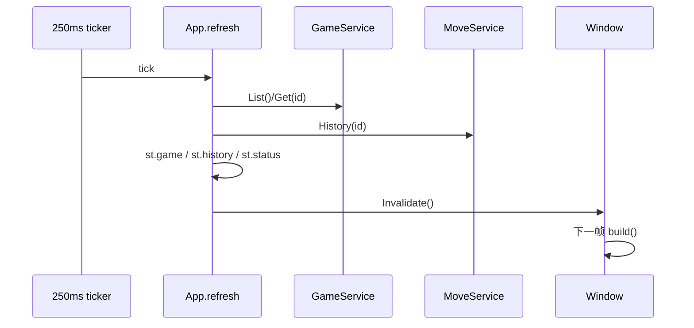

# 桌面 UI 架构

UI 是 MyGo 进程内的原生界面，使用 `github.com/egoist/mygo` 的窗口/绘制/输入能力，以及 `github.com/lobehub/lobe-mygo` 的布局、图标、主题和反馈组件。它**不经过 HTTP**，直接调用 `application.GameService` / `MoveService`。

## 1. 文件与职责

| 文件 | 职责 |
| --- | --- |
| `ui/app.go` | 应用状态、动作（新局/落子/悔棋/暂停/复盘）、轮询、错误提示 |
| `ui/view.go` | 页面结构：工具栏、侧栏、棋盘区、落子记录 |
| `ui/board.go` | 棋盘几何、绘制、鼠标命中、最后一手/胜利线/悬停子 |
| `ui/style.go` | 调色板、面板、按钮、分段控件、标签、提示条 |
| `ui/*_test.go` | 交互、撤销、渲染快照 |
| `tests/contracts/ui_integration_test.go` | UI 动作与真实服务/Worker 的集成 |

## 2. 线程与刷新模型

- 窗口和所有绘制回调在 MyGo 的 UI 线程执行。
- `StartPolling` 启动一个 goroutine，每 250ms：
  1. `refresh()`：读取当前棋局与历史；
  2. `win.Invalidate()`：请求重绘。
- `App.mu` 保护 `state`；UI 回调和轮询 goroutine 都通过它读写。
- 每个动作（落子、悔棋、暂停）都先拿 `App.mu` 读取快照，释放锁后调用应用服务，再拿锁写回结果。**不要在持有 `App.mu` 时调用应用服务**，否则会与轮询/Coordinator 锁形成长临界区。



## 3. 状态

`ui/app.go` 的 `state`：

| 字段 | 用途 |
| --- | --- |
| `modeIndex` | 当前模式索引（人机/AI 对战/玩家对战） |
| `engineIndex` | 人机模式下的 AI 引擎 |
| `aiIsBlack` | 人机模式下 AI 执黑/白 |
| `firstEngineIndex` / `secondEngineIndex` | AI 对战的先手/后手引擎 |
| `gameID` / `ownerToken` / `game` | 当前棋局与凭据 |
| `history` | 当前着法列表 |
| `status` | 状态栏文案 |
| `notice` / `noticeKind` | 错误/提示条 |
| `replayGames` | 最近棋局列表（最多 12 局） |
| `reviewing` / `reviewGame` / `reviewMoves` / `reviewStep` | 复盘模式 |

`engineInfo` 在 `New` 时从 `auth.Registry.Engines()` 拷贝。UI 只显示名称；结构里的 `Enabled` 当前不参与渲染或选择。

## 4. 页面结构

```text
Column
├─ Toolbar (56px)
│  品牌图标 + 标题 + “AI 思考中” + 状态 chip
└─ Row (grow, padding 16, gap 16)
   ├─ Sidebar (296px, 可滚动)
   │  新对局面板：模式、引擎、开始、悔棋、暂停、结果、提示
   │  对局信息面板
   │  棋局记录面板（最近 12 局，可进入复盘）
   ├─ 棋盘区 (grow)
   └─ 落子记录 (256px)
```

尺寸常量在 `ui/view.go`：`sidebarWidth=296`、`historyWidth=256`、`pagePadding=16`、`columnGap=16`、`toolbarHeight=56`、`boardPadding=12`。

棋盘尺寸 `boardSizeFor(width, height)`：

- 横向可用 = 总宽 - 侧栏 - 历史栏 - 2×面板间距 - 2×页面 padding - 2×棋盘 padding；
- 纵向可用 = 总高 - 工具栏 - 2×页面 padding - 2×棋盘 padding；
- 取较小值，限制在 `[420, 1000]`；
- 窗口过小时允许低于 420，以免溢出。

## 5. 棋盘绘制

`ui/board.go`：

| 常量 | 值 | 含义 |
| --- | --- | --- |
| `boardGutter` | 22 | 棋盘到网格的边距 |
| `boardRadius` | 10 | 圆角 |
| `stoneRatio` | 0.42 | 棋子半径 / 格宽 |
| `starRatio` | 0.10 | 星位半径 |
| `shadowOffset` / `shadowRadius` | 1.5 / 3 | 棋子阴影 |
| `labelSize` | 12 | 行列标签字号 |

几何：

```text
grid = size - 2*22
cell = grid / 14
origin = 22
x(col) = rect.X + 22 + col*cell
y(row) = rect.Y + 22 + row*cell
```

绘制顺序：

1. 棋盘阴影/渐变/边框；
2. 15 条横线与 15 条竖线；
3. 5 个星位 `(3,3)(3,11)(7,7)(11,3)(11,11)`；
4. 行列标签（上边 `A`–`O`，左边 `1`–`15`）；
5. 胜利线（若已结束且有 winner）；
6. 棋子：先阴影，再径向渐变，白子额外描边；
7. 最后一手标记（ accent 圆点，半径 0.19 cell）；
8. 悬停幽灵子（该格为空时绘制；`ReadOnly` 只阻止输入，不参与这里的判断）。

命中测试 `cellAt`：

```text
col = round((x - originX) / cell)
row = round((y - originY) / cell)
```

超出网格或 `row/col` 不在 `0..14` 返回 `(-1,-1)`。鼠标移动更新 `HoverRow/HoverCol`，按下触发 `OnPick`。

棋盘 `View` 只负责绘制和输入；`ReadOnly` 在复盘时为 true。

## 6. 动作

### 6.1 新局

`newGame()`：

- 如果上一局是“进行中且 0 手”，先删除，避免留下空局；
- 根据模式构造 `players`：
  - 人机：一方 human，一方指定 AI；
  - AI 对战：黑/白各一个引擎；
  - 玩家对战：双方 human；
- `games.Create("", req, "")`，UI 传入空 caller hash（本地可信调用）；
- 保存返回的 `ownerToken` 和 `game`。

### 6.2 落子

`pick(row,col)`：

1. 取当前 `game` / `ownerToken`；
2. 已结束则提示；
3. `moves.Submit` 带 `ExpectedVersion: game.Version`；
4. 若返回 `VERSION_CONFLICT`：
   - `refresh()` 取最新快照；
   - 若版本确实变了，用新版本**重试一次**；
5. 成功则更新 `game`/`status`/提示条；
6. `refresh()`。

AI 可能在用户点击与请求到达之间完成落子，因此冲突后刷新一次再用新版本提交；第二次仍冲突则显示错误，不做无限重试。

### 6.3 悔棋

`undo()`：

- AI 对战不允许；
- 调用 `moves.Undo`，同样对 `VERSION_CONFLICT` 刷新后重试一次；
- 服务端决定回退 1 手还是 2 手（人机模式下若最后一手是 AI，则回退 2 手）。

按钮只在非复盘、非 AI 对战、`MoveCount > 0` 时显示。

### 6.4 暂停/恢复

`togglePause()` 只对 AI 对战显示。调用 `games.SetExecutionState(id, state, nil)`；服务端会校验模式并让租约失效。暂停后棋盘仍显示，但 Worker 领不到新回合。

### 6.5 AI 思考中

`buildThinking` 读取 `game.AIThinking`。该字段由服务端根据“当前版本是否存在有效租约”派生，因此 UI 不需要额外状态，也不会和 Worker 生命周期脱节。

## 7. 复盘

- `refreshReplay()` 从 `games.List()` 倒序取最近 12 局，跳过“未结束且 0 手”的空局；当前局只有在已结束时才进入列表。
- 点击一局调用 `startReview`，保存克隆、完整着法和 `reviewStep = len(moves)`。
- `replayPosition` 用 `NewGame` + 重放前 `step` 手得到只读棋盘；当 `step == len(moves)` 时恢复真实 `Status/Result/Execution/Winner`。
- 复盘时：
  - 棋盘 `ReadOnly`；
  - 顶部工具栏的状态 chip 显示“回溯 · 第 x / y 手”；
  - 历史面板顶部出现上一手/下一手；
  - 点击历史行跳转到该手之后。
- 退出复盘清空 `reviewing/reviewGame/reviewMoves/reviewStep`。

复盘的棋盘是即时重建的，不依赖服务端提供中间状态。

## 8. 主题

`ui/style.go` 的 `paletteOf(tk)` 根据 `theme.Tokens.Dark` 返回两套颜色：

| 语义 | 亮色 | 暗色 |
| --- | --- | --- |
| canvas | `#f5f2ed` | `#171512` |
| surface | `#fdfcfa` | `#1f1c18` |
| text | `#262320` | `#f2ede4` |
| accent | `#bf6640` | `#d47a52` |
| success | `#4a7d52` | `#7aa87f` |
| warning | `#a97a2f` | `#d0a25c` |
| danger | `#a8463c` | `#d97b6d` |

棋盘木头色、棋子渐变、标签色在 `BoardView.applyTheme` 中单独处理：

- 亮色木纹 `#f1e3c9 → #ddc29c`，线 `#c2a37a`；
- 暗色木纹 `#2e2822 → #1f1b16`，线 `#4a4036`；
- 黑子 `#544b42 → #171310`（暗色 `#5a5148 → #171310`）；
- 白子 `#ffffff → #d5ccbf`（暗色 `#f6f0e6 → #cfc5b6`）。

所有颜色都从主题 token 或固定的木纹/棋子色派生，不写死 background 以外的页面底色。

## 9. 测试

| 文件 | 覆盖 |
| --- | --- |
| `ui/ui_test.go` | 界面绘制、落子经应用服务、坐标命中、悬停幽灵子 |
| `ui/interaction_test.go` | 点击与边界、悬停、AI 选边/选引擎、开始对局、按钮、历史、复盘 |
| `ui/undo_test.go` | 悔棋、未结束旧局记录、放弃空局、复盘后开新局 |
| `ui/snapshot_test.go` | 空盘/对局/暗色/小窗口/终局五张 PNG 快照，写入临时目录 |
| `tests/contracts/ui_integration_test.go` | UI 动作与真实服务/Worker 的集成 |

快照测试只负责渲染并写文件，不做像素对比。

## 10. 扩展点

- 新控件：优先复用 `style.go` 的 `panel` / `primaryButton` / `ghostButton` / `segmented` / `chip`，不要引入第二套间距和颜色。
- 新页面区域：在 `build` 的 `Row` 里加列，并同步 `boardSizeFor` 的扣减。
- 新棋盘交互：在 `BoardView.View` 的 `HandleInput` 中处理，保持 `ReadOnly` 语义。
- 新棋局动作：在 `app.go` 加方法，遵守“锁内快照、锁外调用服务”的模式。
- 新提示：用 `noticeRow` + `noticeKind`，错误文案集中在 `errorMessage`。
