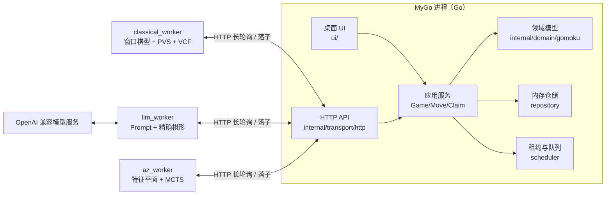

# MyGo / 五子棋 技术文档

本文档描述 `E:/Gomoku` 仓库中 MyGo 平台与三个 AI 引擎的架构、算法和运行方式。内容以源码为准；所有数字、默认值和接口字段都可以在对应模块中复核。

## 系统全貌

MyGo 是一个单进程桌面应用：Go 负责棋局权威状态、HTTP API、租约调度和原生界面，Python 只负责在 Worker 里计算落子。UI 与 Python Worker 共用同一套业务规则，棋子颜色、手数、胜负判定不会出现两份实现。



## 三个引擎

| 引擎 | 目录 | 决策方式 | 是否需要外部服务 | 默认 engine_id |
| --- | --- | --- | --- | --- |
| 传统引擎 | `classical_worker/` | 6 格窗口棋型评估 + PVS + 置换表 + VCF | 否 | `classical` |
| LLM 引擎 | `llm_worker/` | 把精确棋形与坐标写进 Prompt，解析模型返回的 JSON | 是，OpenAI 兼容接口 | `llm` |
| AlphaZero 引擎 | `az_worker/` | 9 平面残差网络 + PUCT MCTS，纯自对弈训练 | 否（推理本地） | `az` |

另有 `mock_worker/`，只用于契约测试和链路排查，不参与实际对局。

## 文档索引

| 文件 | 内容 |
| --- | --- |
| [01-mygo-architecture.md](01-mygo-architecture.md) | 领域模型、应用服务、并发、存储、鉴权、HTTP 路由、启动流程 |
| [02-worker-protocol.md](02-worker-protocol.md) | Worker 契约、长轮询、租约、幂等、配置与令牌解析、失败处理 |
| [03-classical-engine.md](03-classical-engine.md) | 窗口棋型、增量评估、威胁表、PVS、置换表、VCF、参数与基准 |
| [04-llm-engine.md](04-llm-engine.md) | 棋形原语、Prompt 结构、输出解析、重试与兜底、推理模型适配 |
| [05-az-engine.md](05-az-engine.md) | 9 平面特征、bitboard 威胁、网络、官方 PUCT、纯自对弈训练、VCF/VCT、擂台 |
| [06-desktop-ui.md](06-desktop-ui.md) | UI 分层、绘制几何、交互、版本冲突重试、复盘、主题 |
| [07-comparison-and-operations.md](07-comparison-and-operations.md) | 引擎对比、评测方法、环境变量矩阵、运行手册、故障排查、发行包 |

## 全局约定

- 棋盘固定 15×15，索引 `0..14`。
- 颜色编码：`0` 空、`1` 黑、`2` 白。
- 所有 API、Worker、内部引擎交互使用 **0 基** `(row, col)`；棋盘上的 `A`–`O` / `1`–`15` 标签只出现在 UI 和日志显示层。
- 黑棋先行。领域层只实现“五连即胜”，没有禁手规则。
- 一局棋的 `version` 每次落子或悔棋都会递增；Worker 必须用领取时的 `version` 提交，过期结果会被拒绝。
- `board` 是行优先的二维切片，`board[row][col]`。

## 快速开始

```sh
# 编译并运行桌面程序（同时启动 API）
GOPROXY=off go build ./...
go run ./cmd/app
```

启动后控制台会打印本地客户端令牌、各引擎令牌，并写入 `configs/engines.runtime.json`。随后启动需要的 Worker：

```sh
python -m classical_worker
python -m llm_worker
.venv/Scripts/python.exe -m az_worker
```

注意先启动 MyGo，再启动 Worker：运行时配置里的令牌在 MyGo 每次启动时重新生成。

### 测试

```sh
GOPROXY=off go test ./... -count=1
python -m unittest discover -s classical_worker/tests -t .
python -m unittest discover -s llm_worker/tests -t .
.venv/Scripts/python.exe -m unittest discover -s az_worker/tests -t .
```

Go 契约测试会真实启动 Python Worker，见 `tests/contracts/`。
