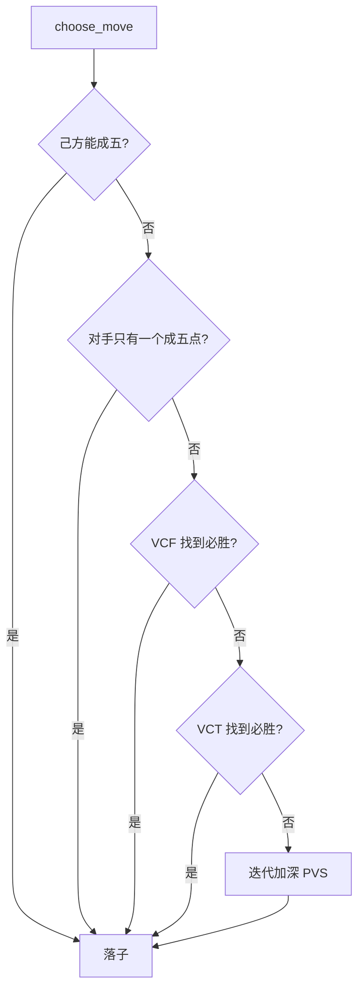

# 第二代传统算法设计（classical v2）

**状态**：设计定稿，待实现
**范围**：`classical_worker/`，不改变 Worker 协议、REST 契约与 Go 侧代码
**兼容目标**：`ClassicalEngine.choose_move(board, history, player, last_move, config)` 与
`CLASSICAL_DEPTH` / `CLASSICAL_WIDTH` / `CLASSICAL_TIME_BUDGET` 保持可用

## 0. 摘要

第一代是「连子长度 × 开口数」的线性评分 + 固定宽度 negamax。第二代把它换成四件
互相独立、可单独验证的事：

1. **窗口棋型表**：6 格窗口查表评分，落子只更新穿过该点的 4 条线上的窗口，取分为 O(1)；
2. **威胁分类与强制着**：对每个候选点精确判断「成五 / 双四 / 四三 / 双三」，搜索前先走强制着；
3. **置换表 + PVS**：Zobrist 增量哈希，迭代加深、主变例搜索、杀手着法与历史启发；
4. **VCF / VCT**：连续冲四（VCF）求必胜，连续威胁（VCT）在受限预算内求胜。

这四件事各自有独立的测试与开关，按 P0 → P1 → P2 落地，每一阶段都必须跑赢上一阶段
的自对弈门槛才进入下一阶段。

## 1. 第一代的边界

实测基线（见 [`classical-engine.md`](classical-engine.md)）：单手平均 0.27 秒，自对弈
39 手分胜负，对旧贪心启发式 9–12 手取胜。

结构上的四个限制：

| 限制 | 后果 |
| --- | --- |
| 评分按连续连子算 | `11010` 这类断三完全看不见，只能靠搜索深度发现 |
| 评估是线性的 | 双活三、四三没有组合加成，除非搜索恰好走到 |
| 无置换表 | 不同顺序到达同一局面要重算；迭代加深不共享结论 |
| 无强制着/必胜搜索 | 有 VCF 杀也要靠 2 层一档的宽搜索去碰 |

第二代针对的正是这四条，不改变棋盘规则、坐标约定与协议。

## 2. 目标与非目标

| 指标 | 第一代 | 第二代目标 |
| --- | --- | --- |
| 对第一代胜率（100 局，换色） | — | P0 ≥ 55%，P1 ≥ 70%，P2 ≥ 80% |
| 默认预算下单手平均 | 0.27 s | ≤ 0.6 s |
| p95 单手 | 0.7 s | ≤ 2.0 s |
| 立即成五/堵五 | 直判覆盖 | 保持 100% |
| 发现 12 手内 VCF | 不保证 | 固定题库 100% |
| 非法落子 / 超时崩 | 0 | 0 |

非目标：禁手规则、神经网络评估、MCTS、跨进程学习、开局库（第一版不需要）。

## 3. 结构

```
classical_worker/
  patterns.py   6 格窗口表、行编码、棋型分类（纯函数，无棋盘状态）
  position.py   棋盘、Zobrist、窗口增量分、落子/撤销
  tt.py         置换表、深度/标志/时代、将杀分归一化
  threats.py    威胁分类、强制着、VCF/VCT
  search.py     迭代加深 PVS、杀手/历史、时间管理
  engine.py     组装一次决策（协议入口不变）
```

`aiworker/` 不动，`engine.py` 的公开签名不动。所有新模块只依赖 `position` 的棋盘
表示，`position` 不依赖搜索。

## 4. 评估函数

### 4.1 6 格窗口

棋盘上每条线（横、竖、两条斜线）按 6 格滑窗切成窗口。窗口内每个格子编码为
`0=空、1=黑、2=白`，棋盘外与对方棋子一样按 `2`（阻挡）处理。编码是 3 进制整数，
共 `3^6 = 729` 种，导入时一次性建表：

```python
PATTERN_TABLE[code] = (score_for_black, score_for_white)
```

每个窗口只认**一个最高棋型**，按优先级匹配；窗口内同时存在两个低阶棋型时不重复计分。
重叠窗口会重复计入同一段连子，这是有意的：分值只用于比较，最终权重由自对弈校准，
而不是按单窗口的语义解释。

| 棋型 | 命中示例（己方=1，空=0，阻挡=2） | 分值 |
| --- | --- | --- |
| FIVE | `11111` | 10,000,000 |
| OPEN_FOUR | `011110` | 120,000 |
| FOUR | `011112`、`211110`、`11011`、`10111`、`11101` | 15,000 |
| OPEN_THREE | `011100`、`001110`、`010110`、`011010` | 6,000 |
| CLOSED_THREE | `001112`、`211100` | 600 |
| OPEN_TWO | `001100`、`010100` | 300 |
| CLOSED_TWO | `001120`、`021100` | 50 |
| ONE | `001000` | 2 |

`evaluate(player) = totals[player] - totals[other(player)]`。

### 4.2 增量维护

`Position` 保存 `totals[BLACK]`、`totals[WHITE]` 与 Zobrist 哈希。落子时只有穿过该点的
4 条线变化；每条线上覆盖该点的窗口最多 6 个，因此一次落子最多更新 24 个窗口：

```text
play(row, col, player):
    对每个覆盖 (row, col) 的窗口:
        before = code(窗口)            # 落子前
        after  = code(窗口, 落下这子)   # 落子后
        totals[BLACK] += T[after].black - T[before].black
        totals[WHITE] += T[after].white - T[before].white
    记下 [(before, after)] 供 undo 反算
```

`undo` 用同一对编码反向加减，不需要重扫棋盘。复杂度：每次落子/撤销 O(24)，取分 O(1)。

第一代的 `RUN_SCORES`、`run_score`、`gain_of`、`_run_at` 全部删除；`wins_with` 保留
（强制着直判仍需要它）。

### 4.3 为什么不是「连子分加组合规则」

连子加组合规则需要枚举所有棋型组合，`11010`、`10110` 这类断型会漏；窗口表把断型
当成普通表项，新增棋型只改表不改搜索。棋型表的顺序与分值用固定题库 + 自对弈校准，
不引入运行时学习。

## 5. 着法生成

### 5.1 威胁分类

对候选点 `(row, col)` 和一方 `player`，构造穿过该点的 4 条 9 格线（该点已假设为己方），
逐线算出：

- `five`：是否存在长度 ≥ 5 的连子；
- `five_points`：这些线上有多少个空点，落子后能成五（即这条线已经四子）；
- `open_fours`：是否存在两端皆空的四；
- `open_threes`：有多少个空点，落子后能形成活四。

汇总成一个与搜索无关的 `Threat`：

```python
@dataclass(frozen=True, slots=True)
class Threat:
    five: bool
    five_points: int      # 1 = 单四, >=2 = 双四/活四（对手堵不完）
    open_threes: int      # >=2 = 双活三
```

分类优先级：`five` > `five_points >= 2`（双四/活四）> `five_points == 1 and open_threes >= 1`
（四三）> `open_threes >= 2`（双三）> `five_points == 1`（单四）> `open_threes == 1`（活三）。

分类是**精确**的，不查窗口表；窗口表只服务叶子评估。每个候选点的分类结果只在本次
节点内使用，不入置换表。

### 5.2 强制着

在搜索之前和每个节点上，按固定顺序收敛分支：

1. 己方能成五 → 只走成五点；
2. 对手只有**一个**成五点 → 只走该点（己方能成五已在第 1 步处理）；
3. 对手有活四/双四（`five_points >= 2`）→ 只搜索己方的四/五与两个端点；若无解，
   仍返回静态最优，不抛异常；
4. 其余情况使用候选点集合。

第 3 步不能剪掉「己方四三反杀」：候选集包含己方所有能形成四或活三的点。

### 5.3 候选点与排序

候选集仍是「已有棋子周围两格内的空点」，但排序改用威胁等级而非连子增益：

```text
order_key(move) = (
    max(attack_rank, defence_rank),      # 先看最响的威胁
    attack_rank + defence_rank,          # 同等级看双向价值
    history[player][move],               # 历史启发
    window_gain(move),                   # 静态增量分
    -row, -col                           # 稳定排序，保证可复现
)
```

- `attack_rank`：己方在该点的 `Threat` 等级；
- `defence_rank`：对手在该点的 `Threat` 等级（占掉对手的威胁点）；
- 每层保留 `width` 个。根节点 `width*2`，深层按 `max(6, width - depth)` 收缩；
- alpha-beta 的剪枝依赖排序，`Threat` 分类比第一代的 `gain_of` 多算两条线的「成五点」，
  但仍在同一量级。

杀手着法每层两个，历史启发按 `(player, row, col)` 累加 `depth^2`，命中置换表着法时置顶。

## 6. 搜索

### 6.1 迭代加深 + PVS

```text
best_move:
    直判成五 / 堵五
    VCF（预算内）
    清空本手置换表时代
    for depth in 2, 3, 4, ..., max_depth:
        value, move = root_pvs(depth)
        记录最后一层完整搜完的 move
        如果 value 是将杀分，提前结束
        如果已用时间 > soft_limit，停止加深
```

- 深度按 **1 层**递增（第一代按 2 层）；PVS 只在第一个子节点开全窗口，其余用零窗口，
  零窗口失败高于 alpha 时再全窗口重搜；
- **不做 LMR**：五子棋的 quiet move 可能就是唯一的防守点，削减层数会漏反杀；分支因子
  已由宽度和强制着压住；
- **威胁延伸**：若某着法让对手只剩一个合法应手（单四/单五），延伸 1 层，全局延伸预算
  `max_depth // 2` 层，防止无限延伸；
- 将杀分 `MATE_SCORE = 10**9`，胜利用 `MATE_SCORE - ply`，越早赢分越高。

### 6.2 置换表

- Zobrist：`ZOBRIST[2][225]` 用固定种子生成，`Position.hash` 在 `play`/`undo` 时 XOR；
- 查表键 = `hash ^ SIDE_KEY[player]`（同一棋盘、不同轮次是不同节点）；
- 表项：`depth`、`value`、`flag`（EXACT / LOWER / UPPER）、`best_move`、`age`；
- 命中条件：`entry.depth >= depth`，按 flag 收缩 alpha/beta；`best_move` 参与排序；
- 将杀分入库前按 `ply` 归一化，出库时还原，避免「同一杀法在不同深度被当成不同分」；
- 表随进程存活，跨手复用；键是完整局面，复用不会错。条目上限默认 200,000，
  超限时整表清空（简单、可预测）；`age` 只用于同键替换的优先级。

### 6.3 时间管理

| 阶段 | 默认预算 | 行为 |
| --- | --- | --- |
| VCF | 0.15 × 总预算（0.3 s） | 找到必胜立即返回 |
| VCT | 0.25 × 总预算（0.5 s，P2 起） | 找到必胜立即返回；超时静默放弃 |
| 主搜索 | 剩余预算（约 1.2 s） | 每 2048 节点检查一次硬截止 |

- 软截止：用掉 55% 预算后不再开始新深度；
- 硬截止：用掉 95% 预算时抛 `SearchTimeout`，保留最后一个完整深度的着法；
- 所有 `play`/`undo` 继续放在 `try/finally` 里，超时不能把棋盘弄脏；
- 测试用 `max_nodes` 代替墙钟，避免 CI 抖动。

## 7. VCF 与 VCT

### 7.1 VCF（连续冲四）

只走「落子后形成四或五」的着法。对手的应手被强制为唯一的成五堵点；若己方一着形成
两个成五点（双四/活四），对手堵不完，判胜。

```text
vcf(position, attacker, depth):
    if depth <= 0: return False
    for move in four_making_moves(attacker):
        play
        if five: return True
        if five_points(attacker) >= 2: return True
        if opponent_can_five: undo; continue      # 对手先赢，此线失败
        block = the only five_point
        if vcf(position, attacker, depth - 1): return True
        undo
    return False
```

- 深度上限默认 20 个半回合，节点上限 50,000；结果按 `(hash, attacker, depth)` 入置换表；
- 返回第一手胜着；只用于根节点，不做防守方的 VCF 反算（那是主搜索的职责）；
- 对手在应手处若能成五，直接判此线失败——这是 VCF 与「对手已有五威胁」的边界。

### 7.2 VCT（连续威胁）

VCT 在 VCF 基础上允许活三。攻击方只走「四、活三、双三」；防守方可以堵威胁点，也可以
用冲四反先。VCT 的分支比 VCF 大一个量级，因此：

- 只在根节点运行，深度上限 8，节点上限 50,000，预算 0.5 × 总预算；
- 防守应手只生成「能消除威胁」的点（威胁点本身、反四、成五点），不做全盘搜索；
- 超时或超节点即放弃，结果不缓存到主搜索的置换表；
- P2 默认开启，P1 阶段只留接口与测试。

### 7.3 根节点顺序



VCF 放在堵五之后：若对手下一手成五，任何慢一手的 VCF 都没有意义；VCF 内部会检查
对手的成五，所以顺序不会漏杀。

## 8. 参数

保留第一代三个变量，新增四个；对局 `config` 仍只覆盖 `depth` / `width` / `time_budget`。

| 变量 | 默认 | 说明 |
| --- | --- | --- |
| `CLASSICAL_DEPTH` | 8 | 主搜索最大深度（层） |
| `CLASSICAL_WIDTH` | 12 | 每层候选点上限 |
| `CLASSICAL_TIME_BUDGET` | 2.0 | 单手总预算（秒） |
| `CLASSICAL_VCF_BUDGET` | 0.15 | VCF 预算比例（0 关闭） |
| `CLASSICAL_VCT_BUDGET` | 0.25 | VCT 预算比例（P1 为 0，P2 起 0.25） |
| `CLASSICAL_TT_ENTRIES` | 200000 | 置换表条目上限 |

默认总预算 2.0 秒时，VCF 0.3 秒、VCT 0.5 秒（P2）、主搜索 1.2 秒。P1 阶段
`CLASSICAL_VCT_BUDGET` 默认 0，接口保留。

## 9. 正确性与测试

| 层 | 测试 | 通过标准 |
| --- | --- | --- |
| `patterns` | 729 个窗口编码的表项、棋型优先级、黑白对称 | 与手写分类一致 |
| `position` | 随机 500 手落子/撤销后，增量总分等于全量重算；哈希等于全量重算 | 完全相等 |
| `threats` | 成五、单四、双四、活四、四三、双三、断三的固定局面 | 分类完全相等 |
| `search` | 同深度、无时间限制时 PVS+TT 的值等于不剪枝 negamax | 完全相等 |
| `search` | 开/关置换表、开/关杀手着法 | 值不变，节点数下降 |
| `search` | 将杀分归一化、最快胜、单个堵点、超时复原 | 通过 |
| `VCF` | 双四杀、活四杀、四三杀、无杀、对手反五 | 题库 100% |
| `engine` | 满盘、非法参数、对局覆盖参数 | 通过 |
| 契约 | `go test ./tests/contracts/ -run TestClassicalWorkerFinishesAGame` | 通过 |

`position` 的全量重算保留为测试辅助函数 `_recount()`，生产路径不使用。

## 10. 棋力验收

固定协议，避免「感觉变强了」：

1. 冻结第一代引擎到 `classical_worker/tests/fixtures/v1_engine.py`，只允许基准脚本导入；
2. 100 局自对弈，先后手各 50 局，每局前两手从固定开局表取（中心 + 8 个邻点），
   不使用随机数；
3. 记录胜率、平均/ p95 单手时间、非法着法数、超预算次数、VCF 命中数；
4. 门槛：P0 ≥ 55%，P1 ≥ 70%，P2 ≥ 80%；p95 ≤ 2.0 秒；非法着法 0；
5. 题库：20 个 12 手内 VCF 局面必须全部找到；1000 个随机战术局面（成五/堵五各半）
   必须全部正确。

基准脚本 `python -m classical_worker.benchmark --games 100 --opponent v1` 输出上述数字，
不进入生产包。

## 11. 分阶段落地

| 阶段 | 改动 | 验收门槛 |
| --- | --- | --- |
| P0 | `patterns.py`、窗口增量 `position.py`、Zobrist、`tt.py`、PVS 主搜索 | 等价/性质测试通过；对第一代 ≥ 55% |
| P1 | `threats.py` 威胁分类、强制着、VCF | VCF 题库 100%；对第一代 ≥ 70% |
| P2 | VCT、威胁延伸、时间分段、权重校准 | 对第一代 ≥ 80%；p95 ≤ 2.0 s |

每个阶段单独提交，提交前跑完整 Python 单测与契约测试；任何阶段都可以用
`CLASSICAL_VCF_BUDGET=0` / `CLASSICAL_VCT_BUDGET=0` 回退到上一阶段的棋力。

## 12. 风险与取舍

| 风险 | 影响 | 处置 |
| --- | --- | --- |
| 窗口重叠导致分值偏大 | 评估偏向局部棋型 | 用固定题库 + 自对弈校准；只比较相对值 |
| 每节点威胁分类变慢 | 深度上不去 | 先用 `wins_with` 做廉价预筛，只对前 `2×width` 个候选做精确分类 |
| VCT 分支爆炸 | 超预算、结果不稳定 | 根节点限定、节点上限、超时静默放弃 |
| 置换表跨手复用导致内存增长 | 长时间运行占用上升 | 条目上限 + 整表清空，必要时按时代淘汰 |
| Python 单线程速度 | 默认预算下深度受限 | 保持 2.0 秒预算；用窗口表 O(1) 取分与窄分支换深度 |

设计上明确拒绝的两件事：不做 LMR（防守点不能被削减），不把 VCT 放进每个搜索节点
（只在根节点，避免不可控的分支）。
